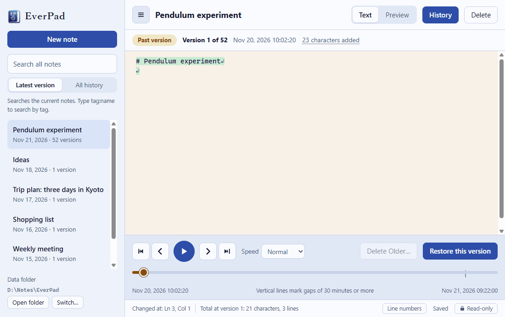
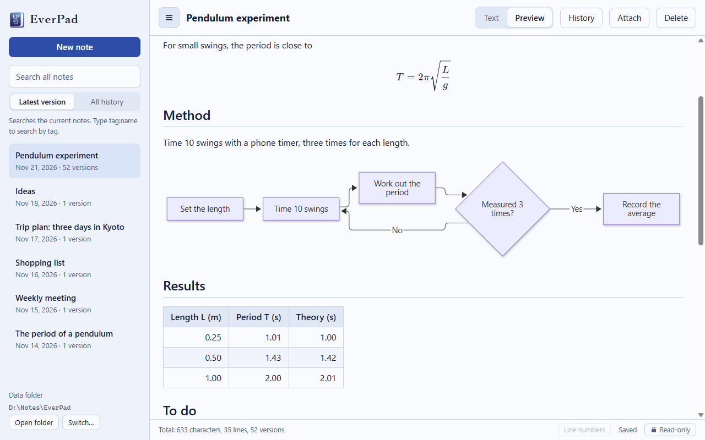
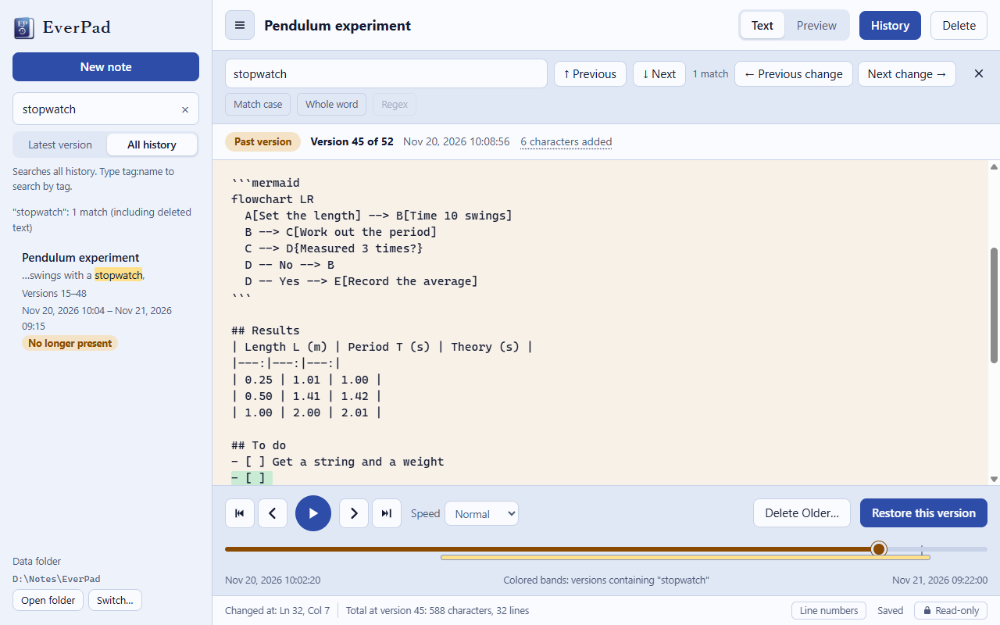
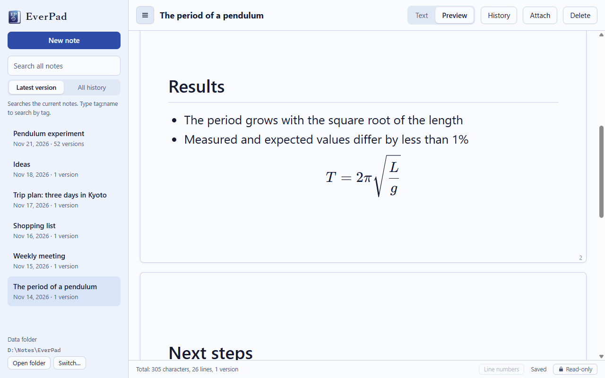
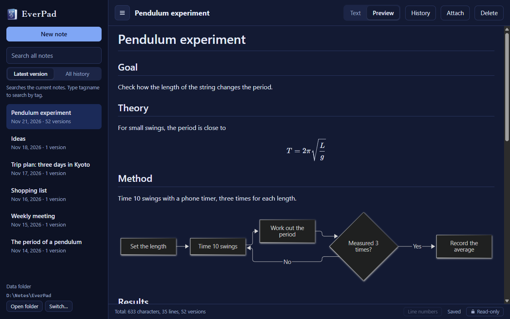
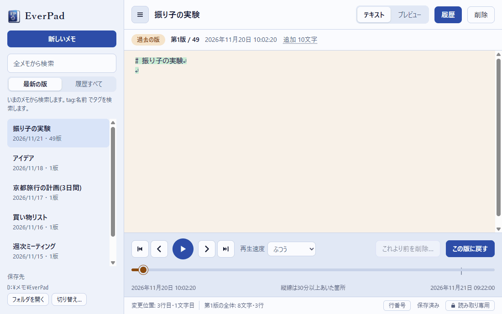
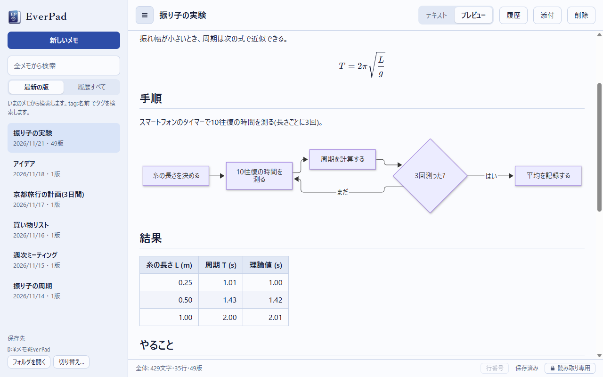
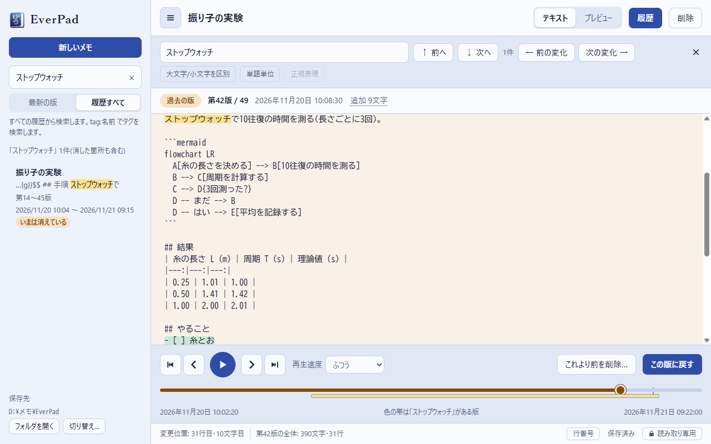
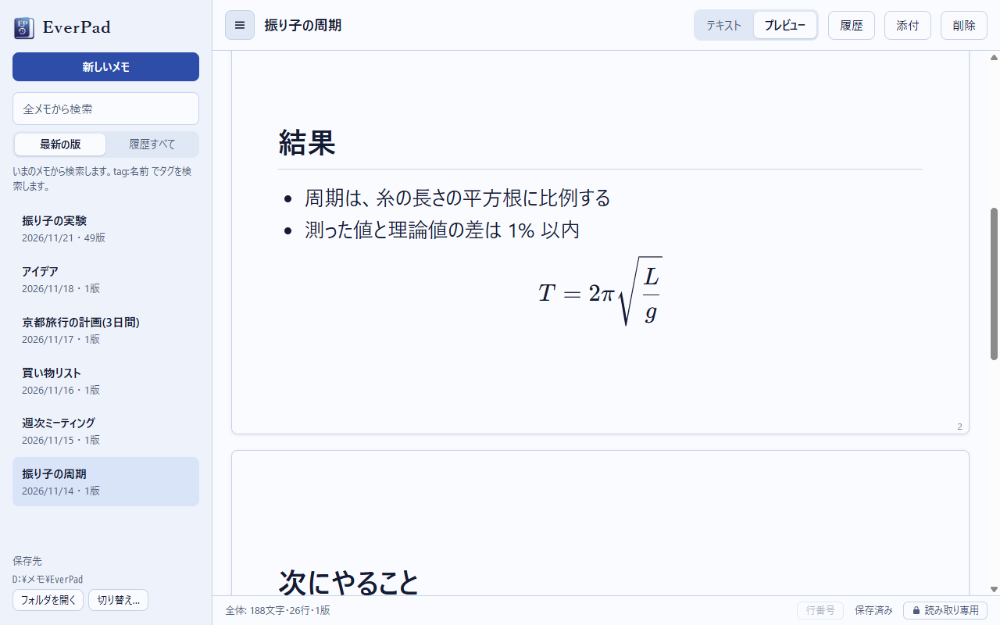
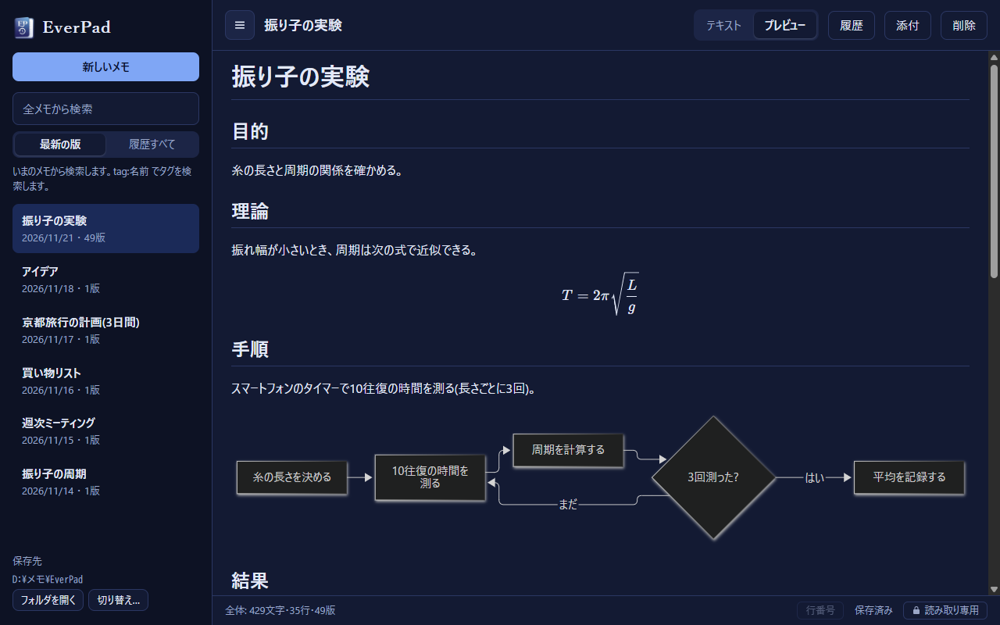

# EverPad

[https://github.com/nihongi/everpad/](https://github.com/nihongi/everpad/)

[English](#english) | [日本語](#日本語)

## English

EverPad is a note-taking app for Windows. You write in plain text or Markdown, with tables, math and diagrams. Every single edit is kept in the history, and a time slider lets you rewind a note and watch how it was written.

<p align="center"></p>
<p align="center"><em>Every edit is kept. Play the history back and watch a note being written.</em></p>

### Features

- **Full edit history**: every edit is recorded. Drag the time slider or play the history back to see any past version, and restore it with one click.
- **Markdown preview**: headings, lists, check boxes, code, links, block quotes and tables (with merged cells and table titles, written as in MultiMarkdown), plus GitHub's emoji shortcodes (`:smile:`, with suggestions as you type), alerts (`> [!NOTE]`) and footnotes. Switching between Text and Preview keeps your place, and paragraphs, lists, tables and check boxes can also be edited right in the preview. Selected text can be made bold, italic, struck through or code from the right-click menu, line by line when the selection spans several lines.
- **Math**: LaTeX math (and chemical formulas) is shown as formatted formulas in the preview, the history and printouts.
- **Diagrams**: flowcharts, sequence diagrams and other diagrams written in [Mermaid](https://mermaid.js.org/) are drawn in the preview, the history and printouts.
- **Search across all notes**: search either the latest version of each note or the entire history, including text that has since been deleted.
- **Find and replace**: with case sensitivity, whole-word and regular-expression options.
- **Tags**: write tags in front matter at the top of a note (Edit → Insert Front Matter (Tags)), and find the notes with a tag by searching for `tag:name`.
- **Images and attachments**: paste screenshots or drop files into a note.
- **Links from the web browser**: drag the icon to the left of the address in Chrome or Edge (or a link on a page) onto a note to insert `[page title](URL)`.
- **Print and export**: print a note, or save it as a PDF or as one web page file (HTML or MHTML) with the images included, with the same formatting as the preview. A note can also be saved as AsciiDoc, as a Word document (`.docx`) or as LaTeX (`.tex`), keeping its headings, lists, tables, images and formulas.
- **Slides**: split a note with `---` lines to make 16:9 slides, as in Marp. Show them full screen with View → Slideshow (`F5`), or save them as a web page, a PDF or a PowerPoint file with editable text and equations. With `marp: true` in the front matter, the preview and the history show the note as slides.
- **Keyboard shortcuts you can change**: assign the keys you like from File → Keyboard Shortcuts….
- **English and Japanese**: the interface follows the Windows display language at first (English for anything other than Japanese), and can be switched at any time from File → Settings… (Language).
- **Plain files**: notes are stored as ordinary files in a folder you choose, so backing up is just copying the folder. Keep several data folders, for example one for work and one for personal notes, and switch between them from the menu.
- **Sharing between computers**: keep the data folder in OneDrive or similar and use it from several computers. One EverPad edits at a time; the others open it read-only, and editing can be handed over (see "Sharing the data folder between computers").

### Screenshots

<table>
<tr>
<td width="50%"><br>Preview with formulas, diagrams and tables</td>
<td width="50%"><br>Search all history, including deleted text. Colored bands show when it was there</td>
</tr>
<tr>
<td><br>Slides from a note split with <code>---</code> lines</td>
<td><br>Dark mode</td>
</tr>
</table>

### Download

EverPad for Windows is available from two places:

- **Microsoft Store**: install it from [EverPad on the Microsoft Store](https://apps.microsoft.com/detail/9mw2hbgkgxh3). The Microsoft Store updates it automatically. Windows does not show a SmartScreen warning. Because Microsoft reviews each update, a new version may reach the Store a few days after it appears on GitHub.
- **GitHub**: download the installer (`EverPad.Setup.x.y.z.exe`) or the portable version (`EverPad.x.y.z.exe`, no installation needed) from this repository's [Releases page](https://github.com/nihongi/everpad/releases). EverPad tells you when a new version is available, and you download and install it yourself. The files are not code-signed, so Windows SmartScreen may show a warning; choose "More info" → "Run anyway". The files are published only on the Releases page, and files with these names from anywhere else are not from this project. The Releases page shows the SHA-256 of each file, so you can check a download with `Get-FileHash <file>` in PowerShell.

How the three Windows versions differ is described in "Windows versions" below. To build EverPad yourself, see "Building it yourself".

### Windows versions

EverPad for Windows comes in three versions. The app itself is almost the same; they differ in how they are installed and updated, and where settings are kept.

#### Microsoft Store version

In the Microsoft Store version, updates come from the Microsoft Store, so Help has no update check, and Settings has no Add to the "Send to" menu. Notes are saved in the same place as in the installed version (by default, Documents\EverPad). Windows keeps its settings in a folder for the app, which is deleted when the app is uninstalled (if the installed version is also on the PC, the settings it already has are used).

#### Installer version

The installer can be shown in English or Japanese, and offers a check box (off by default) to add EverPad to the Explorer "Send to" menu.

**Uninstalling**: the uninstaller never deletes your data folder (your notes stay). It offers a check box (off by default) to also delete EverPad's settings (`%APPDATA%\EverPad`: the data folder location, language, window position, recently viewed notes and so on). Settings are kept per Windows user, so only the settings of the user running the uninstaller are deleted, also when EverPad was installed for all users; other users' settings are not touched. Updates and silent uninstalls (`/S`) never delete settings.

#### Portable version

The portable executable (`EverPad 0.53.3.exe`) keeps everything in an `EverPad Data` folder next to itself, so you can carry it on a USB drive:

```
EverPad 0.53.3.exe
EverPad Data\
  settings\   settings, recently viewed notes, caches
  notes\      the data folder (default)
```

- The data folder inside `EverPad Data` is remembered relative to the executable, so it keeps working when the drive letter changes.
- The portable and installed versions do not share settings, and can run at the same time. Their "Send to" entries have different names (`EverPad (Portable)` and `EverPad`), and they appear as separate taskbar buttons.
- If the folder of the executable cannot be written to (for example, inside Program Files), settings are saved in `%APPDATA%\EverPad Portable` and notes in `Documents\EverPad Portable`; EverPad tells you once.
- Versions before 0.17.0 stored the portable version's settings and notes in `%APPDATA%\EverPad` and `Documents\EverPad`. Those notes are not moved: choose File → Data Folder → Add Folder… and select `Documents\EverPad`, or copy the note files into `EverPad Data\notes`.
- Everything EverPad saves stays in `EverPad Data` (plus the "Send to" shortcut if you add it). Windows itself still records some traces, and the portable executable unpacks itself into a temporary folder (`%TEMP%`) each time it starts.

### Usage

| Action | Key |
|---|---|
| New note | `Ctrl+N` |
| Search all notes | `Ctrl+F` |
| Back to the previously viewed note | `Alt+←` |
| Import (EverPad archives and text files) | `Ctrl+O` |
| Export as a text file | `Ctrl+Shift+E` |
| Print | `Ctrl+P` |
| Export as PDF | `Ctrl+Shift+P` |
| Properties of the current note | `Alt+Enter` |
| Text / Preview | `Ctrl+1` / `Ctrl+2` |
| Show / hide history | `Ctrl+3` (or the History button at the top) |
| Attach an image or file | `Ctrl+Shift+U` (or paste with `Ctrl+V`, drag and drop, or the Attach button at the top right) |
| Find and replace (a bar appears above the note; in the Preview view and the history, find only) | `Ctrl+H` |
| Insert a link to another note | `Ctrl+K` |
| Insert or edit a formula | `Ctrl+Shift+M` |
| Insert or edit a diagram | `Ctrl+Shift+D` |
| Bold / italic / strikethrough / code for the selected text | `Ctrl+Shift+B` / `Ctrl+I` / `Ctrl+Shift+X` / `Ctrl+E` |
| Quote / bulleted list / numbered list / code block for the selected lines | `Ctrl+Shift+Q` / `Ctrl+Shift+8` / `Ctrl+Shift+7` / `Ctrl+Shift+K` |
| Indent / outdent (the current line or the selected lines) | `Tab` / `Shift+Tab` (see "Indentation and lists") |
| New line in the same list item, without a new bullet | `Shift+Enter` |
| Find next / previous | `Enter` / `Shift+Enter` (also `F3` / `Shift+F3` while the bar is open) |
| Show / hide the left pane (note list and search) | `Ctrl+B` (or the menu button at the top left) |
| Show / hide line numbers | `Ctrl+L` (or the Line numbers button at the bottom right) |
| Settings | `Ctrl+,` |
| Previous / next version in the history | `←` / `→` |
| Play / pause the history | `Space` |

On macOS, Ctrl becomes ⌘, and some keys are different (see "macOS and Linux (untested)"). These are the default keys; most of them can be changed (see "Keyboard shortcuts").

**Indentation and lists**

- When you press Enter on an indented line, the new line gets the same indentation (half-width spaces and tabs; full-width spaces are not carried over). On a line that has only spaces, the spaces are removed and the indentation moves to the new line, so no invisible spaces are left behind. Turn this off in File → Settings… (Auto indent).
- On a list line (`- `, `* `, `+ `, `1. `, `1) `, `- [ ] ` or `> `), Enter starts the next line with the same mark: numbers go up by one, and check boxes start unchecked. Press Enter on a line that has only the mark to end the list. Shift+Enter starts a new line in the same item, indented to the item's text, without a mark. Inside a code block, no marks are added. Turn this off in File → Settings… (Continue lists automatically).
- Tab inserts spaces up to the next indentation position. On a list line, it indents the whole line, nesting the item one level deeper. With text selected, Tab indents the selected lines (empty lines are skipped) and Shift+Tab outdents them; Shift+Tab also works on the current line. The width of one indentation (2 or 4 spaces, 4 by default) is set in File → Settings… (Tab indent width). Edit → Format also has Indent and Outdent. In the note text, Tab no longer moves to buttons; it still does in other boxes such as the find and replace bar.
- Undo (`Ctrl+Z`) removes a new line and the indentation or mark added with it in one step. Nothing is added while you are converting text with an input method (IME).

**Editing in the preview**

- Click a paragraph, heading, list item, text in a block quote, code block or horizontal rule in the Preview view to edit it in place: that part turns into a box with its Markdown text, and the rest of the note stays formatted. Only the part you edit changes; the rest of the text stays exactly as written. Press Esc or click elsewhere to see it formatted again. ↑ on the first line and ↓ on the last line move to the previous or next part (lines are counted as you see them, so in a line that wraps, ↑ ↓ first move within it). As in the Text view, Enter continues lists, Tab indents, and Format (bold, italic and so on) works on the selected text. Formulas are edited with the formula editor, and diagrams with the diagram editor (double-click one).
- In an empty note, click anywhere in the preview to get an empty box and start writing.
- To add a paragraph, click the empty space below the last part of the note (a hint appears when you point there), or right-click a part, formula or diagram and choose Insert Paragraph. An empty box opens there (after the whole block quote, list or table when you are in one), so you can keep writing below a diagram or formula without switching to the Text view. What you type is added as a paragraph separated by blank lines; if you close the box without typing, nothing changes.
- Click a table cell to change just that cell (a `|` you type is written as `\|`). Tab moves to the next cell (at the last cell, it adds a row), Shift+Tab to the previous one and ↑ ↓ to the cell above or below (a merged cell counts as one cell); Enter or Esc finishes.
- To start a new line inside a cell while changing it, press Shift+Enter or Alt+Enter (as in Excel; ⌥+Enter on a Mac). The cell then shows the line break as it will look, and the note gets `<br>`, the way GitHub writes a line break in a table cell. In a cell with several lines, ↑ ↓ move between its lines first and then to the cell above or below. Tables pasted from Word, Excel or web pages keep the line breaks in their cells as `<br>`, and so does text with several lines pasted into a cell (until now they became spaces). In the Text view, write `<br>` yourself. Exports turn `<br>` into a line break in the cell (Word, PowerPoint, AsciiDoc and LaTeX too). Search finds the text as written, so a phrase that spans a `<br>` is not found as one phrase.
- Click a check box to check or clear it (`[ ]` ↔ `[x]`).
- To add a table, choose Edit → Table → Insert Table, or right-click in the preview outside a table and choose Insert Table. An empty table (a header row and 3 rows, 3 columns) is added after the part you clicked or are editing (after the whole block quote or table when you are in one, and at the end of the note when you clicked below the text), and its first header cell opens for editing. In the Text view, it is added on the line after the cursor (after the table, code block, formula or diagram when the cursor is in one), and the right-click menu has Table → Insert Table.
- To add a formula in the preview, right-click outside a table and choose Insert Formula… (or press `Ctrl+Shift+M`). The formula is added after the part you right-clicked (at the end of the note when you right-clicked below the text, or in an empty note). While a part or table cell is being edited, its right-click menu puts the formula at the cursor, and shows Edit Formula… when the cursor is in a formula.
- To add a diagram in the preview, right-click outside a table and choose Insert Diagram… (or press `Ctrl+Shift+D`). The diagram is added after the part you right-clicked or are editing (at the end of the note when you right-clicked below the text, or in an empty note).
- Right-click a table cell for Insert Table (after this table), Insert Row Above, Insert Row Below, Delete Row, Insert Column Left, Insert Column Right, Delete Column, Merge with Cell on the Right, Merge with Cell Below, Unmerge Cells, Column Alignment (Align Left, Center, Align Right) and Delete Table. The same commands are in Edit → Table, and in the right-click menu of the Text view when the cursor is in a table (keys can be assigned in Keyboard Shortcuts). Only the lines of that table are changed. Insert Row Above on a header row adds a header row; a table's only header row cannot be deleted. See "Merged cells, header rows and table titles" for how merged cells change.
- What you type is recorded in the history just as in the Text view. After a box is closed, `Ctrl+Z` / `Ctrl+Y` in the preview undo and redo the changes made in the preview, one at a time (until another note is opened). Read-only notes and the history cannot be edited.

**Views and history**

- There are two views, Text and Preview, and each has a history mode. Pressing History shows the time slider while keeping the current view: in Text, the characters changed in each version are highlighted; in Preview, each version is shown formatted, and the paragraph, list item, table row or other part changed in that version is marked with a bar on the left and a light color. Added characters are highlighted, and in a version that only deleted characters, a thin line shows where they were deleted (point to it to see them). If the change is out of view, the view scrolls to it. Switching between Text and Preview during the history keeps the same version. Press History again to leave the history. EverPad starts in the view (Text or Preview) you used last.
- In the preview (also in the history), long lines in code blocks are wrapped so that you can see them whole. The wrapped continuation of a line is indented and marked with an arrow on the left, so you can tell it from the line breaks in the code. Point to a code block and press the button at its top right to scroll long lines sideways instead (and press it again to wrap them). The choice applies to all code blocks and is kept for next time.
- Switching between Text and Preview keeps your place, and the matching spot flashes briefly. From Text, the line with the cursor stays at the same height on the screen if the cursor is visible; otherwise the line at the top stays at the top. From Preview, if you clicked somewhere that is still visible, the cursor moves to the start of that line in Text (after a list mark or `#`), at the same height; otherwise the part at the top stays at the top and the cursor does not move. At the very top or bottom of the note, the other view also opens at the top or bottom. The same applies when switching during the history (without moving the cursor). Diagrams and images that take a moment to appear do not shift the place you were looking at.
- Showing or leaving the history also keeps your place in the same way (the cursor line or the top line stays at the same height), without the flash and without moving the cursor. In an older version, the line with the same number is used.
- Opening another note from the note list while the history is shown shows that note's latest version.
- When you open another note, EverPad remembers where you were in the current note (the part shown and the cursor), and opening that note again shows the same place, in the Text view and in the preview alike. A note you have not opened before starts at the top. The places are kept for each data folder, also after EverPad is closed (up to 300 notes). Opening a note from text search results shows what was found instead (results of a search for tags only open where you were, as from the note list).
- The status bar at the bottom shows where the edit of the version shown was made ("Changed at: Ln 12, Col 5"): just after the added text, or where text was deleted. Click the change summary at the top (such as "1 character added") to scroll to the change and briefly emphasize it. In the Preview history it stays in the Preview (only when the change cannot be marked there, for example when only blank lines changed, does it switch to the Text history to show it). When line numbers are shown, the numbers of the changed lines are highlighted.
- Playback speed can be set to five levels, from very slow to very fast.
- Restore this version adds the content of that version as a new edit. The existing history is never deleted.
- **Deleting old history**: to make a long history smaller, go to the oldest version you want to keep and press "Delete Older…" (or View → Delete History Older Than This Version…). All versions before it are deleted from the file. **This cannot be undone**, so a warning is shown first ("Cancel" is selected at first), with a check box (on by default) to export the full history to an EverPad archive before deleting; if the export is cancelled or fails, nothing is deleted. The text does not change, and neither does the number of versions: version numbers stay the same, and the history starts at the version you kept (the left end of the time slider says, for example, "Versions 1–1,000 deleted"). Properties shows the versions you can still view. Attachments that no remaining version uses are moved to the Recycle Bin at the same time (the warning shows how many and their size). This is like Etherpad's `compactPad --keep`, but done from the history view.
- The note text widens to fit the window. Line numbers count a wrapped line as one line and are also shown in the history. These settings are remembered.
- The line with the cursor has a light background, in the Text view and in the edit box of the preview. As in Notepad++, a wrapped line is highlighted as a whole. When line numbers are shown, the number of that line is bold. Turn this off in File → Settings… (Highlight the current line).
- In the Text and Preview views and in the history, you can scroll until the last line is at the top of the window, so the line you are writing does not have to stay at the bottom edge (as in VS Code). Even a short note can be scrolled. In the preview, clicking anywhere in the space below the last part adds a paragraph. Turn this off in File → Settings… (Scroll beyond the last line).
- **Note colors**: in File → Settings… (Note colors), choose the background and text colors of the note area (Text, Preview and history), separately for light mode and dark mode: Standard (the usual colors), Black and white (black text on white; white text on black in dark mode) or Custom. For Custom, pick the background and the text color. With Auto (on at first), the text is dark or light to suit the background, and the window tells you when the text would be hard to read. If you choose a dark background in light mode (or a light one in dark mode), links, code, the history colors and diagrams in the note switch to the matching colors. The rest of the window, printouts and exported files keep their usual colors.

**Read-only notes**

- To protect a note from accidental changes, choose File → Read-Only, right-click the note in the note list and choose Read-Only, or press the Read-only button at the bottom right. Do the same again to make it editable. A read-only note has a lock before its title in the note list, and the Read-only button is highlighted while it is open. No shortcut key is set at first; you can assign one in File → Keyboard Shortcuts….
- A read-only note cannot be changed: typing, pasting, cutting, formatting, replacing, attaching images or files, moving an attachment to the Recycle Bin, Restore this version, deleting old history and deleting the note are all turned off (trying to type shows a message). You can still view it, look through its history, search it, copy from it, print it and export it. Properties shows whether a note is read-only.
- The setting is saved in the note's history file (`ro` in the header), so it is kept when you copy the data folder or move the note with an EverPad archive. Older versions of EverPad ignore it and let you edit the note.
- Importing an archive with the same ID as a read-only note still asks what to do, and the question says that the existing note is read-only.

**Search and replace**

- Search can target Latest version or All history. The latest-version search lists each note once, with the text around the first match and the number of matches; clicking it opens the note with the first match selected and the find bar open with the same text, so Enter / F3 moves to the next match. In the preview, the note opens in the preview, scrolled to that match. The history search finds every place where the text was ever written, including text that has since been deleted, one result per place. Neither search matches the key names of the front matter (such as `tags:` and `title:`) or its `---` lines, but both find its values, such as the title and the tag names.
- Find and replace supports case sensitivity, whole words and regular expressions. With regular expressions, the replacement can use `$1` (a captured group), `$&` (the whole match), `\n` (newline) and `\t` (tab). Replace all is recorded in the history as a single edit and can be undone with `Ctrl+Z`. `Ctrl+F` remains the search across all notes.
- In the Preview view, Find and Replace… (`Ctrl+H`) opens a find-only bar (replacing is done in the Text view). It searches the formatted text as you see it (so `**ap**ple` is found as "apple"; text inside formulas and diagrams is not searched). Every match is highlighted, and Enter / F3 moves to the next one. The bar stays open when you switch between Text and Preview, and the replace row appears only in the Text view. For a read-only note, the bar is find-only in the Text view too.
- In the history, Find and Replace… also opens a find-only bar. The time slider then shows colored bands under it for the versions that contain the text, so you can see when it was written and when it was deleted. Previous change / Next change move to the versions where the number of matches changed (where the text was written or deleted). The matches in the version shown are highlighted, and Enter / F3 moves between them. The bands are computed from the note's text as written (Markdown), and regular expressions cannot be used in the history. Opening a result of the All history search opens this bar with the same text.
- The Search all notes box and the find box of Find and Replace suggest what you searched for before. Click the empty box or press ↓ to see your recent searches. While you type, the searches that contain what you have typed appear below the box. Choose one with ↑↓ and press Enter or Tab (or click it). Esc closes the list, and Shift+Delete removes the chosen search from it. Search all notes remembers a search when you press Enter or open one of its results. Find and Replace remembers it when you use Next, Previous or Replace. Each box keeps up to 20 searches. They are saved in `config.json` with the other settings, so they stay on this PC and are not part of the data folder. To stop this, turn off Remember searches and suggest them in File → Settings…, which also deletes the saved searches. Clear Saved Searches there deletes them and keeps the suggestions on.

**Tags and front matter**

- Edit → Insert Front Matter (Tags) (also in the right-click menu of the Text view and of the preview, where it reads Edit Front Matter (Tags) when the note already has front matter; a key can be assigned in File → Keyboard Shortcuts…) puts three lines, `---`, `tags: ` and `---`, at the top of the note, wherever the cursor is, and places the cursor after `tags: `. Type the tags separated by commas, for example `tags: YAML, design`. If the note already has front matter, the command only moves the cursor to the end of its tags (adding a `tags:` line if there is none). In the preview, the front matter then opens for editing. Inserting is one edit and can be undone; the command is grayed out in the history and for read-only notes.
- Tags can also be written as `tags: [YAML, design]`, or as a list with one `  - YAML` line per tag under `tags:`. Put a tag in quotes (`"a, b"`) if it contains a comma; a `#` at the start of a tag is ignored. This is the front matter used by Obsidian, Jekyll, Hugo and Pandoc, so Markdown files from them keep their tags when imported.
- The lines at the top count as front matter only when the first line is exactly `---` and every line up to the closing `---` (or `...`) is `key: value`, an indented line, a `- ` line, a blank line or a `#` comment. Otherwise `---` is a horizontal rule, as before. Keys other than `tags` are kept as written.
- The preview and the history's Markdown view show the front matter as a box of keys and values, with the tags as labels. Click a label to search for that tag (`Ctrl`+click adds it to the current search; the labels can also be reached with Tab and pressed with Enter); click elsewhere in the box to edit it, like other parts. Printouts, PDFs, HTML, MHTML, AsciiDoc, Word and LaTeX files leave the box out (the title, author and date are used as described below); text files and EverPad archives keep it as written. Values are shown without their quotes.
- Search for `tag:YAML` to list the notes that have the tag YAML, one result per note. Case and full-width or half-width letters do not matter, and `tag:work` also finds `work/meeting`. With several `tag:`, a note must have all of them. Other words search inside those notes: `tag:work agenda` finds "agenda" in the notes tagged work (in the latest version or all history, as chosen). Use quotes for a tag with spaces: `tag:"two words"`. Search for `tag:` alone to list all the notes that have tags. While you are typing the last `tag:name` in the search box (with nothing after it), it finds the tags that begin with what you have typed, and the matching tags appear below the search box with their number of notes: choose one with ↑↓ and Enter or Tab, or click it, to enter `tag:name` and a space. After a space (or the closing quote), only the tag with that name (and the tags below it) is found. The tags are taken from the latest version of each note, also when searching all history. To find a note by a tag that was later removed, search for the tag name without `tag:` in All history. Clicking a result opens the note as from the note list: in the current view (Text or preview), at the place you were viewing.
- A note can have up to 50 tags of up to 100 characters each.
- `title: Design notes` makes that the note's title: in the note list, the window title, search results, Insert Link to Note… and the file name suggested when exporting. This leaves the first line free for the text. Without `title`, the title is the first line with text after the front matter, as before.
- `title`, `author` and `date` are also used when printing and exporting. Printouts, PDFs, HTML, MHTML and Word documents show them at the top of the text (Word uses the Title, Author and Date styles). They also go into the file information: the title of the PDF, the `<title>` and the author and keywords (from the tags) of HTML and MHTML files, the title, author and keywords of Word documents, `\title`, `\author` and `\date` in LaTeX, and the title, author line and `:revdate:` in AsciiDoc. When the front matter has a title, a `#` heading at the top of the text stays a heading in LaTeX and AsciiDoc instead of becoming the document title. Write several authors as `author: [Alex, Sam]`, and the date as written (`2026-11-19` is read as a date by other apps too).
- Values are read the YAML way: put a value in quotes (`title: "Design: 2nd edition"`) if it contains `: ` or starts with `[`, `{`, `#`, `@`, `*`, `&`, `!`, `|`, `>`, a quote, `%` or a backtick, so that other apps can read it too; a `#` after a space starts a comment; `|` and `>` blocks and values continued on indented lines can also be used. Help → Markdown Guide explains the front matter and its keys.
- Front matter can also set how a note is shown and printed. `toc: true` adds a table of contents with links to the headings at the top of the preview, printouts, PDFs, HTML and MHTML (click an entry to go to that heading); Word gets a table of contents field (choose Yes when Word asks whether to update the fields, to get page numbers), LaTeX gets `\tableofcontents` (compile twice) and AsciiDoc gets `:toc:`. `toc-depth: 2` sets how deep it goes (1–6, default 3). `lang: en` sets the language of the document: the preview, printouts, PDFs and HTML use the character shapes of that language, the language is recorded in Word, LaTeX, AsciiDoc and HTML files, and `ja` makes LaTeX use the Japanese document class. `papersize: a5` (a4, a5, b5, letter or legal; b5 is the Japanese JIS B5) and `orientation: landscape` (an EverPad-only key) set the paper for printing, PDF, Word and LaTeX, and for printing the HTML file from a browser; without them, the paper is chosen as before.

**Recently viewed notes and links between notes**

- File → Recently Viewed Notes lists the ten notes you opened most recently (excluding the current one), newest first. Deleted notes stay in the list marked "(deleted)"; choosing one shows a message. A note restored from the Recycle Bin opens again. The list is kept per data folder; Clear List empties it. (Recently updated notes are already at the top of the note list on the left.) When you delete the note that is open, the note you viewed before it opens (the top of this list); if there is none, the most recently updated note opens.
- File → Back to Previous Note (`Alt+←`) opens the note you viewed before the current one. Pressing it again switches back, so you can go back and forth between two notes, for example after following a link.
- Write `[text to show](note:note ID)` to link to another note. You do not need to type the ID: choose Edit → Insert Link to Note… (`Ctrl+K`) and pick a note from the list (type to filter by title), or click Copy Link to This Note in the target note's Properties and paste it.
- Click a link in the preview or the history's Markdown view, or `Ctrl`+click it in the Text view, to open that note. Hover over it to see the target's current title. Links point to the note, not to a position in it, and are not broken when the target's title or text changes. If the target is deleted, the link is shown struck through in gray, and clicking it shows a message.
- To find notes that link to a note, search all notes for `note:` followed by its ID (shown in Properties). In printouts, PDFs and exported text, links stay as written. In HTML, MHTML, AsciiDoc, Word and LaTeX files, links to other notes become plain text.

**Math**

- Write LaTeX between `$` for math inside text (`$E = mc^2$`), or between lines containing only `$$` for a formula on its own line. `\( … \)`, `\[ … \]` and ```` ```math ```` code blocks also work. Chemical formulas can be written with `\ce{…}` (mhchem), for example `$\ce{H2O}$`.
- Math inside text shows fractions and similar parts smaller, to keep the line spacing even (as LaTeX does). To show them full size, put the formula on its own line between `$$` lines, or, inside text, write `\dfrac` instead of `\frac` (`$\dfrac{1}{3}$`).
- Formulas are shown in the preview, the history's Markdown view, printouts, PDFs, HTML and MHTML files. In Word documents they become Word equations that can be edited in Word, and AsciiDoc and LaTeX files keep the LaTeX. The Text view and search keep the LaTeX as text.
- To keep prices such as "$5 and $10" from becoming math, the same rule as Pandoc and GitHub is used: there must be no space just inside the `$`, and the closing `$` must not be followed by a digit. Write `\$` for a literal dollar sign.
- In a table, `|` inside a formula is taken as a cell separator; write `\vert` instead.
- **Formula editor**: Edit → Insert Formula… (`Ctrl+Shift+M`, also in the right-click menu of the Text view) opens a window with a palette on the left, the LaTeX on the upper right and a live preview below it. The Templates tab lists about 45 typical formulas (quadratic formula, limits, integrals, sums, matrices, cases, statistics, trigonometry, chemical equations and more); choose one and change it as you like. The other tabs (Structures, Greek, Relations, Arrows, Symbols, Fonts and colors, Chemistry) insert a symbol at the cursor. Empty `{}` are slots: the cursor goes to the first one, and Tab / Shift+Tab move to the next or previous one. If the LaTeX has an error, the error is shown and Insert is grayed out. Choose On its own line (`$$…$$`) or In the text (`$…$`), and press Insert (or `Ctrl+Enter`).
- Where the formula goes: in the Text view, at the cursor (in the text) or on the line after the cursor (on its own line); in the preview, at the cursor of the part being edited, or after the part you clicked (at the end of the note if you have not clicked anything). When the cursor is inside a formula in the Text view, the command edits that formula instead. In the preview, double-click a formula, or right-click it and choose Edit Formula…, to edit it; the way it was written (`$`, `\(…\)`, `$$` lines, ```` ```math ````, and `>` in a block quote) is kept. A formula in a table can only be in the text. The change is one edit in the history and can be undone.
- A formula with an error is shown as its LaTeX in red; hover over it to see the error. Right-click a formula and choose Copy LaTeX to copy its source.
- Math is drawn with [KaTeX](https://katex.org/), which is bundled with the app (no internet connection is used). KaTeX supports most common math commands, but not everything in LaTeX (for example, drawings such as TikZ, or `\label` / `\ref`). Commands that refer to external resources, such as `\href` and `\includegraphics`, are disabled.

**Diagrams (Mermaid)**

- Write [Mermaid](https://mermaid.js.org/) syntax in a ```` ```mermaid ```` code block to draw a diagram: flowcharts, sequence diagrams, class diagrams, state diagrams, Gantt charts, pie charts, mind maps and more. See the Mermaid documentation for the syntax.
- **Diagram editor**: Edit → Insert Diagram… (`Ctrl+Shift+D`, also in the right-click menu of the Text view and of the preview) opens a large window with templates on the left, the Mermaid source in the middle and a live viewer on the right. The 12 templates (flowchart, flowchart from left to right, sequence diagram, class diagram, state diagram, entity relationship diagram, Gantt chart, pie chart, mind map, timeline, Git graph and quadrant chart) replace what you wrote; `Ctrl+Z` brings it back. The viewer redraws the diagram shortly after you stop typing. Drag to move the diagram, scroll the mouse wheel (or pinch on a touchpad) to zoom around the pointer, and double-click to fit the whole diagram; the buttons above it zoom out, show the actual size (100%), zoom in and fit. The diagram is fitted to the viewer until you move or zoom it; after that, the zoom and position stay the same while you type. If the source has an error, the error is shown below the viewer and the last diagram that could be drawn stays, dimmed. Tab indents, Enter keeps the indentation of the line, and `Ctrl+Enter` inserts.
- Where the diagram goes: in the Text view, on the line after the cursor (after the table, code block or formula when the cursor is in one); in the preview, after the part you are editing or clicked (at the end of the note if you have not clicked anything). When the cursor is inside a diagram in the Text view, the command edits that diagram instead. In the preview, double-click a diagram, or right-click it and choose Edit Diagram…, to edit it; the fence (```` ``` ```` or `~~~`) and `>` in a block quote are kept. The change is one edit in the history and can be undone.
- In a read-only note and in the history, double-click a diagram (or right-click it and choose View Diagram…) to see it in the same viewer, without editing.
- Diagrams are shown in the preview, the history's Markdown view, printouts, PDFs, HTML and MHTML files. In Word documents and LaTeX files they become pictures, and AsciiDoc files keep the source in a `[mermaid]` block (drawn as a diagram where Asciidoctor Diagram is installed). The Text view and search keep the source as text.
- The colors follow dark mode (or the background of the note, when you choose one in Note colors in Settings). Printouts and exported files always use light colors.
- A diagram with an error is shown as its source in red; hover over it to see the error. Right-click a diagram and choose Copy Diagram Source to copy its source.
- Diagrams are drawn with Mermaid, which is bundled with the app (no internet connection is used). It is loaded the first time a note with a diagram is shown, so the first diagram can take about a second to appear. Clicks and links in diagrams are disabled.

**Emoji, plain URLs, alerts and footnotes (as on GitHub)**

- **Emoji**: write `:name:` to show an emoji, with the same names as GitHub (`:smile:` 😄, `:+1:` 👍, `:tada:` 🎉; about 1,900 of them). In the Text view, type `:` and two letters of a name to see suggestions at the cursor. Choose one with ↑ / ↓ and press Enter or Tab to insert `:name:` (one edit, undone with `Ctrl+Z`), or click it; Esc closes the list. Suggestions are not shown right after a letter, a digit, `:` or `/` (as in `12:30` or `http:`), or in code blocks. The note keeps `:name:`, so the emoji also shows on GitHub. Unknown names, names right after or before a letter or digit, and names in code are left as they are. Note titles show the emoji too.
- **Plain URLs**: addresses starting with `http://`, `https://` or `www.` become links without `[ ]( )`, and so does an address surrounded by `< >`. An address ends before a space or a non-ASCII character (so `https://example.comを見る` links only the address), and a final `.`, `,`, `:`, `;`, `!`, `?` or an unmatched `)` is not part of it.
- **Writing marks as text**: put `\` before an ASCII punctuation character to show it as it is: `\*` shows `*` instead of starting italics, and `\#`, `\-`, `1\.` or `\>` at the start of a line do not make a heading, list or quote. Two backslashes show one, so a path written as `\\server\share` is shown as `\server\share` in the preview (the Text view keeps what you typed; put it in `` ` `` to show it unchanged). Code and math are not affected (`\$` is still a literal dollar sign).
- **Alerts**: a block quote whose first line is only `[!NOTE]`, `[!TIP]`, `[!IMPORTANT]`, `[!WARNING]` or `[!CAUTION]` is shown as a colored notice with an icon and the heading Note, Tip, Important, Warning or Caution (注記・ヒント・重要・警告・注意 in Japanese).
- **Footnotes**: write `[^name]` in the text and `[^name]: the note` at the start of a line (anywhere in the note). Notes are numbered in the order they are first referred to and listed at the end of the note; notes that are never referred to are not shown, and `[^name]` without a note stays as text. To continue a note on more lines or paragraphs, indent them by two spaces. Click a number to go to its note and ↩ to go back; pointing at a number shows the note at the bottom left.
- These are kept in printouts, PDFs, HTML and MHTML files. Word documents get Word footnotes and alerts as block quotes with a colored line and heading; AsciiDoc files get `footnote:[…]` and admonition blocks (`[NOTE]` and so on, with the Japanese headings set when the interface is in Japanese); LaTeX files get `\footnote` and boxes with a colored line and heading.
- The emoji list comes from [gemoji](https://github.com/wooorm/gemoji), the list GitHub uses; it is part of the app, so no internet connection is used.

**Bold, italic, strikethrough and code**

- Select text in the Text view (or in a part being edited in the preview) and right-click to choose Bold, Italic, Strikethrough or Code (also in Edit → Format). The text is surrounded by `**`, `*`, `~~` or `` ` ``. Ctrl+B shows and hides the left pane, so Bold is `Ctrl+Shift+B`.
- When the selection spans several lines, each line is decorated separately (only the selected part of the first and last lines). List marks, check boxes, `>`, `#`, indentation and spaces at either end stay outside the marks, so `- apple` becomes `- **apple**`. Empty lines, code blocks, horizontal rules and the `|---|` line of a table are skipped, and each cell of a table row is decorated separately.
- If everything selected already has that decoration, it is removed instead, whether you selected the text with or without the marks. Bold and italic can be combined (`***text***`). If only part of the selection is bold, the inner `**` are removed first and the whole selection is made bold.
- The text stays selected afterward, so you can add another decoration right away. With nothing selected, a pair of marks is inserted with the cursor between them. The change is a single edit that can be undone with `Ctrl+Z`.
- Note titles (the first line with text) leave out these marks, so `# **Shopping**` is titled "Shopping".

**Formatting lines**

- Choose Edit → Format → Quote, Bulleted List, Numbered List or Code Block (also on the Text view's right-click menu) to format every line the selection touches, or the cursor's line when nothing is selected. A selection that ends right at the start of a line does not include that line.
- Quotes add `> ` to each line (`>` on empty lines, so the quote is not broken). Bulleted and numbered lists add `- ` or `1. `, `2. ` … after the indentation and skip empty lines; applying one to the other switches between them. Code blocks add a ```` ``` ```` line before and after the lines.
- If all the lines already have that format, it is removed instead (for a code block: when the lines are surrounded by ```` ``` ```` lines). Tables and headings are processed the same way, without exceptions.
- The change is recorded in the history as a single edit and can be undone with `Ctrl+Z`. Available in the Text view, and in the preview while a part of the note is being edited.

**Keyboard shortcuts**

- File → Keyboard Shortcuts… lists every menu command with its key, grouped by menu (File, File › Export, Edit, Edit › Format, Edit › Table, View, Help). Type in the box at the top to filter by command name or key (for example `ctrl+shift`).
- In the menus, the key names are always shown in English (for example `Ctrl+Comma` for `Ctrl+,`, and `Alt+Left Arrow`), whatever the interface language.
- To change a key, double-click the command (or select it and press Enter, or press Change), then press the keys you want: the box shows them as you press them. Press Enter to set it, or Esc to cancel. While you are pressing keys, the menu shortcuts do nothing. Commands that have no key by default (such as File → Export → HTML…) can be given one too.
- A key must use Ctrl or Alt (on macOS, ⌘, ⌃ or ⌥), or be one of F1–F24. Letters, digits, F keys, arrow keys, Home / End / Page Up / Page Down, Insert, Delete, Backspace, Space, Enter, Tab and the numeric keypad can be used. Keys whose character depends on the keyboard layout (such as `;` and `@`) cannot be assigned. Keys used for typing, editing or the system cannot be assigned either: Ctrl+Z / Y / X / C / V / A, Ctrl with the arrow keys, Home, End, Backspace or Delete, F3, Alt+F4 and F10 (on macOS, ⌘Q, ⌘H, ⌘W, ⌘M, ⌥ with a letter or digit, ⌃A, ⌃E and the other text-editing keys).
- If the key is already used by another command, EverPad says which one. Press Enter to use the key here instead; the other command then has no key.
- Remove leaves the selected command without a key, Reset gives it back its default key, and Reset All… returns every key to the default after asking. Commands whose key you changed are marked "Changed", with the default key shown when you point at the mark.
- The menus, the right-click menu, the tooltips of the buttons and the Markdown Guide show the keys you set. The keys are saved in `config.json` with the other settings (only the ones you changed), so they apply to this PC only and are not part of the data folder. The list ends with keys that cannot be changed (Undo, Copy, Tab for indentation, F3 and so on) for reference.

**Pasting formatted text**

- When you paste text copied from a web page, Word, Excel, Google Docs or the EverPad preview, its formatting is turned into Markdown: headings, bold, italic, strikethrough, code, lists (with check boxes), block quotes, code blocks, tables, links and horizontal rules. Bold or italic set with styles (as Google Docs does) counts too. Pasting is one edit, which `Ctrl+Z` undoes. This works in the Text view and in the part or table cell you are editing in the preview (a table cell gets one line, without headings or lists).
- Merged cells and the title of a pasted table are kept (see "Merged cells, header rows and table titles"). The rows of `<thead>` become header rows; without them, the rows at the top made only of header cells (`<th>`), or else the first row when all its cells are bold. Otherwise an empty header row is added (shown as a thin row), and all the copied rows stay as rows of the table. A cell merged from the header rows into the rows below becomes empty cells below the header. The alignment of a column is the one most of its cells have; a cell aligned differently keeps its alignment with spaces (see "Aligning one cell" below).
- Numbered and nested lists copied from Word or Google Docs keep their numbers and levels. Letters and Roman numerals (a., i.) become numbers, because Markdown has no way to write them.
- From the EverPad preview, formulas, diagrams, links to notes, attachments, emoji, alerts, footnotes and front matter come back as they were written. Formulas copied from web pages that use KaTeX or MathML come back as LaTeX when the page keeps it.
- Attachments copied from another note, from its preview or as text from its Text view, are copied into this note together with their files. If the original note no longer has a file, the attachment syntax is kept and EverPad tells you.
- Images that are part of the copied content are added as attachments. Images on the web (`https://…`) are not downloaded, because EverPad does not connect to the internet; they become links, and a message says how to add the images themselves: drag each image in, or use "Copy image" in the browser and paste it. Colors, font sizes, fonts and underlines are dropped, because Markdown has no way to write them. HTML tags and scripts never end up in the note.
- Images that you copy together with text in Word or Excel are added as attachments too (on Windows). **Word or Excel must still be running when you paste:** they keep these images in temporary files only while they are running. If you close Word or Excel before pasting, the text is pasted but the images are not, and EverPad tells you; open the document again and copy it again (or copy and paste the image by itself).
- Plain text, and text with only colors and fonts (such as code copied from a code editor), is pasted as before. Inside a code block, text is always pasted as it is. To paste only the text, press `Ctrl+Shift+V` or choose Edit → Paste as Plain Text (also in the right-click menu). To always paste text as it is, clear "Keep formatting when pasting" in File → Settings….

**Dropping links from the web browser**

- Drag the icon to the left of the address in Chrome or Edge (the lock or page icon) onto a note, and `[page title](URL)` is inserted where you drop it. A link on a web page can be dropped the same way; its text becomes the link text. In the Text view, the link goes where you drop it. In the preview, it goes where you drop it in the part or table cell you are editing; with nothing being edited, it is added as a new paragraph before the part you drop it on (upper half) or after it (lower half), and in the space above the first part, before the first part. Dropping is one edit, which `Ctrl+Z` undoes.
- Only the URL is inserted (EverPad shows it as a link) inside a code block, when there is no title, and when "Keep formatting when pasting" is cleared in File → Settings….
- Internet shortcut files (`.url`), for example dropped from Explorer, also become links (with the file name as the link text) instead of attachments. Images dragged from a web page are still added as attachments.
- Links cannot be dropped into a read-only note or into the history.

**Images and attachments**

- In the Text view, paste a copied image (such as a screenshot), drag and drop a file onto the window, or choose a file with the Attach button. `` (image) or `[name](attach:…)` (file) is inserted at the cursor, and is shown as an image or a file link in the preview and in the history's Markdown view. Pasting inside a table row puts the attachment in that cell (several attachments line up side by side). In the preview, paste or drop into the part or table cell you are editing to insert at the cursor; with nothing being edited, a dropped file is added before the part you drop it on (upper half) or after it (lower half), in the same way as dropped links, and the Attach button adds it at the end of the note. Clicking an image or link opens it; executables and similar files are not opened, but shown in their folder instead.
- The files are kept in the note's `.files` folder. **Removing an attachment from the text does not delete the file, so that older versions in the history can still show it.** Identical files are stored only once. The size limit is 50 MB per file.
- To delete an attachment, right-click it in the attachment list below the Text view (or the image in the preview) and choose "Move to Recycle Bin…". After a confirmation, the file goes to the Recycle Bin and the links to it are removed from the text in one edit, which Undo (`Ctrl+Z`) brings back. Restoring the file from the Recycle Bin makes it show again. Past versions that use it show "(Image not found)". Attachments are also moved to the Recycle Bin when no version uses them any more after deleting old history (see "Views and history").
- You may freely edit the "name" part before `attach:` (avoid `|`, `[` and `]`). When you copy an attachment (in the preview, or its syntax in the Text view) and paste it into another note, the file is copied too (see "Pasting formatted text"). Attachment syntax written by hand or copied from outside EverPad does not bring the file; paste the file again instead.
- A list of the attachments used in the note (thumbnails) is shown below the text.
- Right-click an image (in the preview, the history's Markdown view or the attachment list) for Copy Image, Open Image, Show Image in Folder and Save Image As…. Right-click a file link for Open File and Show File in Folder. In the attachment list and the preview, the menu also has Move to Recycle Bin…. Left-clicking still opens it.

**Importing and exporting**

- File → Import… (`Ctrl+O`) imports EverPad archives (`.everpad`) and text files. EverPad tells them apart by their contents, so you can choose several files of both kinds at once.
- File → Export has eight formats: Text File… (`Ctrl+Shift+E`), PDF… (`Ctrl+Shift+P`, see "Printing and PDF"), HTML… and MHTML… (see "HTML and MHTML"), AsciiDoc…, Word Document… and LaTeX… (see "AsciiDoc, Word and LaTeX") and EverPad Archive…. Printing (File → Print…) is a separate command because it does not create a file.
- The file dialogs open in the folder you used last time, remembered separately for importing and exporting (all export formats and Save Image As… share one folder) and kept after EverPad is closed. The first time, or if that folder no longer exists, importing opens the data folder and exporting opens Documents.

**EverPad archives**

- File → Export → EverPad Archive… saves the current note as one `.everpad` file containing its text, its whole history and its attachments (the whole note, even while the history is shown). It is a ZIP file, and you can rename it to `.zip` to look inside. It contains the following:

| File | Contents |
|---|---|
| `manifest.json` | Information about the archive: the format name and format version, the EverPad version and time of the export, and the note's ID, title and creation time. When importing, EverPad uses it to check that the file is an EverPad archive in a format version it supports. |
| `note.jsonl` | The edit history, the same as the note's `.jsonl` file in the data folder (see "Where notes are stored") |
| `note.md` | The latest text |
| `files/` | Attached files (only when the note has attachments) |

- Importing an archive restores the note with its history and attachments. If a note with the same ID already exists, you choose: **Overwrite** replaces the existing note's text, history and attachments (this cannot be undone in EverPad; the original files are moved to the Recycle Bin), **Import with a New ID** imports it as a separate note, or **Cancel**.
- An imported note is shown at the top of the note list: EverPad records when it was imported (in the history file's header line, which older versions ignore) and sorts the list by the later of the last edit and the import. Properties shows the import time.
- The installer associates `.everpad` files with EverPad, so double-clicking an archive imports it. Sending archives with "Send to" or dropping them onto the EverPad icon also works.
- Archives are checked before importing (format, note ID, history, attachment names and size); damaged or invalid archives are not imported.

**Importing text files**

- Each text file becomes a new note; its first line becomes the title.
- In Explorer, select files and choose Send to → EverPad to import them. EverPad starts if it is not running. To add EverPad to the "Send to" menu, check the box in the installer, or check Add to the "Send to" menu in File → Settings… at any time (uncheck it to remove it). Dropping files onto the EverPad icon also imports them. Dropping files onto the EverPad window still attaches them.
- The encoding is detected automatically: UTF-8 (with or without BOM), UTF-16, Shift_JIS, EUC-JP and ISO-2022-JP. Line breaks are converted to LF. Files larger than 10 MB, files that are not text, and files with data that cannot be read as text are not imported; the reason is shown, including where the unreadable data is (for example, "Read as Shift_JIS, line 12, character 5 … (0x82 0xFF)").
- Images that a Markdown file refers to with a relative path (`` or ``) and that are in the same folder as the file or below it are imported as attachments of the new note, and the references are changed to point to them (as with a README with screenshots). Images elsewhere (`../`, other drives) and images on the web are left as they are; references in code are not changed.
- An imported note belongs to EverPad and has no link to the original file; EverPad does not record where it was imported from.
- File → Export → Text File… (`Ctrl+Shift+E`) saves the current note as a `.txt` or `.md` file (UTF-8 without BOM, CRLF line breaks). While the history is shown, the version being viewed is exported. Attachments are not included.

**Printing and PDF**

- Choose File → Print… (`Ctrl+P`) to print the current note, or File → Export → PDF… (`Ctrl+Shift+P`) to save it as a PDF.
- The note is printed with the same formatting as the preview (headings, tables, check boxes and attached images), whichever view you are in. While the history is shown, the version you are viewing is printed.
- Each page shows the note title and the time of the last edit at the top, and the time it was printed (or the PDF was exported) and the page number at the bottom. When a past version is printed, the top shows that version's title, the time that version was made, and its version number.
- Even in dark mode, notes are printed as dark text on white paper. PDFs use A4 paper (Letter in the United States and Canada).

**HTML and MHTML**

- File → Export → HTML… or MHTML… saves the current note as one web page file with the same formatting as the preview. Attached images and the fonts for formulas are inside the file, so it can be copied or sent on its own. While the history is shown, the version being viewed is saved.
- Fonts: only the fonts for formulas are put in the file, and only when the note has formulas (they add about 400 KB). All other text uses the fonts installed on the computer that opens the file, the same as in EverPad itself: for the body, Yu Gothic UI on Windows (Segoe UI in English) and Hiragino Sans on macOS (for code on Windows, BIZ UDGothic in Japanese, and Cascadia Mono or Consolas in English). In English, these fonts are used so that a backslash is not shown as ¥. If none of them is installed, the computer's standard font is used, so the page can look slightly different from computer to computer, but the text is always shown. Japanese fonts are not put in the file because they are large (several MB or more each), and the fonts that come with Windows and macOS are generally licensed for use on that computer, not for embedding in files you give to others.
- HTML (`.html`) opens in any web browser (Edge, Chrome, Firefox, Safari and others) and can be edited with a text editor. The images are stored inside the HTML as text (data: URIs).
- MHTML (`.mhtml`) opens in Microsoft Edge and Google Chrome (on Windows, double-clicking it usually opens Edge), and Microsoft Word can open it too. Firefox and Safari cannot open MHTML files.
- The top shows the note title and the time of the last edit (for a past version, that version's title, the time it was made and its version number), and the bottom shows when the file was exported. It always uses light colors.
- Web links (`http://`, `https://`) still work. Links that only work inside EverPad (links to other notes, attached files other than images, relative paths) become plain text. Images that cannot be found are shown as "(Image not found)".
- The files contain no scripts, and they do not load anything from the internet when opened.

**AsciiDoc, Word and LaTeX**

- File → Export → AsciiDoc…, Word Document… or LaTeX… saves the current note in a form other programs can edit. While the history is shown, the version being viewed is saved. Headings, paragraphs and line breaks, bold, italic, strikethrough, code, lists, check boxes, block quotes, alerts, code blocks, tables (with merged cells, header rows and titles), horizontal rules, web links, images, formulas, emoji and footnotes are converted. As in HTML files, links that only work inside EverPad become plain text.
- AsciiDoc (`.adoc`) is a text format. Attached images are copied to a folder named after the file with `_images` added (for `Notes.adoc`, the folder `Notes_images` next to it), and the `.adoc` file refers to them, so move the folder together with the file. Formulas keep their LaTeX (`latexmath`), so Asciidoctor shows them as formulas. If the note starts with its only top-level heading (`#`), that heading becomes the document title; otherwise the note title is used.
- Word (`.docx`) opens in Microsoft Word and in other programs that read Word documents. Attached images are inside the file (WebP and AVIF images are converted to PNG, because older versions of Word cannot read them), and images wider than the page are shrunk to fit. Headings use Word's Heading 1–6 styles, so the Navigation pane and tables of contents work. Formulas become Word equations that can be edited in Word; a formula with an error is put in as its LaTeX. The body text uses Yu Mincho and the headings Yu Gothic (the fonts Word uses for Japanese documents), and no fonts are put in the file. The paper size is A4 (Letter in the United States and Canada).
- LaTeX (`.tex`) is a text file to be compiled with LuaLaTeX (for example `lualatex Notes.tex`; TeX Live and MiKTeX include it, and on Overleaf choose LuaLaTeX as the compiler). Formulas keep their LaTeX; the few commands that only KaTeX has (such as `\R`) are defined at the top of the file, and Greek letters and symbols typed directly in a formula (such as `α` and `≤`) become LaTeX commands. Attached images and diagrams are put in a folder named after the file with `_images` added, as for AsciiDoc (images LuaLaTeX cannot read, such as WebP, are converted to PNG, and diagrams become PNG pictures). A note with Japanese text uses the `ltjsarticle` class, and other notes use `article`; only the packages the note needs are loaded. Headings are not numbered (delete the line `\setcounter{secnumdepth}{0}` to number them). Footnotes become `\footnote`, alerts become boxes with a colored line, and tables become `longtable` tables that can continue on the next page (long text in a column wraps). The title is set as for AsciiDoc. Characters missing from the fonts, such as emoji, are left out of the PDF.

**Slides**

- A note becomes slides when it is split with horizontal rules (`---`, `***` or `___` on a line of their own, with blank lines around them): each part is one 16:9 slide. Rules inside block quotes, lists and code blocks do not split slides, and empty slides are left out. This is the same way of writing as [Marp](https://marp.app/), so a note made in Marp opens in EverPad as slides. In slides, lines that are HTML comments (`<!-- … -->`, which Marp uses for directives such as `paginate` and for speaker notes) are not shown; Marp's themes, directives and `![bg]` background images are not used. Put a blank line before `---`, so that Marp does not read the line above it as a heading.
- Write `marp: true` in the front matter to show the note as slides in the preview and in the history's preview: the slides are lined up as 16:9 frames, numbered in the bottom-right corner. The text is sized to the width of the frame (35 px when the frame is 1280 px wide, as in Marp) and centered vertically. When a slide's content does not fit, its text is made smaller until it fits (down to half size), as PowerPoint does; this also applies to the slideshow and the exports. A slide that still does not fit gets a red bottom edge (point at it for an explanation), and the part that does not fit is cut off. Editing in the preview works as usual, and the slide grows while you edit it. In the history, the slide changed by the version shown has a colored frame, so you can see which slide each edit changed (during playback, the view follows that slide). Without `marp: true`, the preview shows the horizontal rules as before.
- View → Slideshow (`F5`; on macOS, ⌘⇧Return) makes the window full screen and shows one slide at a time, starting with the slide you are viewing (in the Text view, the slide with the cursor). → ↓ Page Down, Space, Enter, a click or the mouse wheel go to the next slide; ← ↑ Page Up and Backspace go back; Home and End go to the first and last slide; Esc ends the slideshow. The slide number appears in the bottom-right corner while the mouse moves. The slideshow works for any note, with or without `marp: true`. While the history is shown, the version being viewed is shown.
- File → Export → Slides (HTML)… saves the slides as one web page file, with images and the fonts for formulas inside, as for HTML. Opened in a web browser, it shows the slides one under another; press the Slideshow button at the top right (or F) to show them full screen, one at a time, with the same keys as above. Printing it from the browser puts one slide on each page. The page contains a small script for the slideshow (the only script it may run; it loads nothing from the internet).
- File → Export → Slides (PDF)… saves a PDF with one slide on each 16:9 page (254 × 142.875 mm), without the title, times and page numbers of the usual PDF.
- File → Export → Slides (PowerPoint)… saves the slides as a PowerPoint file (`.pptx`, 16:9) that can be edited in PowerPoint. Each part of a slide (heading, paragraph, list, code, table, quote and so on) becomes a text box, a table or a picture placed where it is in the preview, with the same text sizes (made smaller when the slide's text was made smaller to fit). Formulas become PowerPoint equations, which can be edited in PowerPoint (in Microsoft 365, select an equation and choose LaTeX in the Equation tab to edit its LaTeX); for apps that cannot show PowerPoint equations, the file also holds the LaTeX as text. Diagrams and attached images become pictures (WebP and AVIF images are converted to PNG). Links stay links. The text uses the same font as EverPad (Yu Gothic UI in Japanese, Segoe UI in English on Windows), so the layout can differ slightly on a computer without that font. In PowerPoint, a fraction inside a line of text is always drawn small, also when written with `dfrac`.
- The exports and the slideshow work for any note, using the horizontal rules, and use the version being viewed while the history is shown. Exported slides always use light colors; the slideshow uses the same colors as the preview.

**Other**

- Menu items that cannot be used in the current view are grayed out (and their shortcut keys do nothing): Attach Image or File… and Insert Link to Note… work only in the Text view, and Format only in the Text view and while a part of the note is being edited in the preview; Toggle Line Numbers (and the Line numbers button at the bottom right) works only where line numbers are shown (the Text view and the history started from it); Back to Previous Note works only when there is a note to go back to; Delete History Older Than This Version… works only in the history; in the View menu, Text or Preview is grayed out while that view is shown (also during the history). For a read-only note, Attach Image or File…, Format, Insert Link to Note… and Delete History Older Than This Version… are grayed out (Find and Replace… still works, as find only).
- Right-click a note in the note list on the left (or in the search results) for actions on that note, regardless of the note that is open: Open, Copy Link to This Note, Export (text file, PDF, HTML, MHTML, AsciiDoc, Word document, LaTeX or EverPad archive; the latest version), Read-Only, Properties… and Delete… (grayed out for a read-only note). The menu starts with the note's title, and the row is outlined while the menu is open. Deleting a note that is not open leaves the open note as it is.
- Hover over a link in the preview to see where it goes at the bottom left, as in a web browser: the address, the title of the linked note, the heading, the attachment name, or the text of a footnote. Links EverPad cannot open, such as relative paths to files, are marked "(cannot be opened in EverPad)".
- Choose File → Properties… (`Alt+Enter`) to see the current note's title, note ID, creation and last edit times, number of versions (and, after deleting old history, the versions you can still view), characters (without line endings), words, lines, and the files that store it: the history file (`.jsonl`), the text file (`.md`) and the attachment folder (`.files`), with their sizes. Each file has buttons to show it in Explorer and to copy its path. Characters, words and lines are counted as in Notepad++'s Summary: a word is a run of characters other than spaces, line breaks and the ASCII symbols ``\ . , ; : ! ? ( ) + - * / = [ ] { } & ~ " ' ` | @ $ % < > ^`` (so Japanese punctuation does not separate words), and an empty note has one line.
- Right-click in the Text view (or in the find and replace fields) for undo, redo, cut, copy, paste, delete and select all. In the Text view, the menu also has text formatting (bold and so on), line formatting (quote and so on), Insert Formula… (Edit Formula… when the cursor is in a formula), Insert Diagram… (Edit Diagram… when the cursor is in a diagram), Insert Front Matter (Tags) (Edit Front Matter (Tags) when the note already has front matter) and Table. In the preview, right-click a table cell for the table commands, a formula or diagram to edit or copy it or to insert a paragraph after it, or another place to insert a paragraph, a formula, a diagram, front matter or a table. While you edit a part or a table cell in the preview, its right-click menu also has Insert Formula… (Edit Formula… when the cursor is in a formula) and Table, and a part also has Insert Diagram… and Insert Front Matter (Tags). In the preview and the history, select text and right-click to copy.
- The window position and size (including whether it was maximized) are restored at the next start. If the previous position would be off screen, for example because a display was disconnected, the position is left to Windows.
- View → Always on Top keeps the EverPad window in front of other windows (the Markdown Guide window too). The setting is remembered for the next start. It has no key by default; you can give it one in File → Keyboard Shortcuts….
- **Settings**: File → Settings… (`Ctrl+,`) collects the settings in one window: Editing (auto indent, continuing lists, keeping formatting when pasting, Tab indent width), Display (highlighting the current line, scrolling beyond the last line, line numbers, note colors, language) and Other (checking for updates at startup and adding EverPad to the "Send to" menu, which the Microsoft Store version does not have, and a button that opens Keyboard Shortcuts…). Keyboard Shortcuts… is also just below Settings… in the File menu. Changes take effect at once and are remembered.
- To change the interface language, choose English or 日本語 in Language (言語) in File → Settings…. The setting is remembered, and the current view (Text, Preview or history, the search, the find and replace bar, the cursor and scroll position) is kept when switching.
- The status bar shows up to three groups, separated by lines: **Cursor** (the line and column of the input position, in the Text view), **Selected** (the number of selected characters, and lines when several lines are selected; shown only while text is selected) and **Total** (characters, lines and versions of the whole note; while the history is shown, the characters and lines of the version being viewed). Line breaks are not counted as characters, and lines are counted by line breaks, as with line numbers (an empty note has one line). Hover over a group for a short explanation.
- Choose Help → Markdown Guide for the Markdown you can use, with each example shown next to its result. See also "Markdown syntax" below.
- To check the version you are running, choose Help → About EverPad from the menu. It also shows the Electron version, the data folder and the address where EverPad is published ([https://github.com/nihongi/everpad/](https://github.com/nihongi/everpad/)); Open on GitHub opens it in your browser, and Licenses opens the licenses of EverPad and the software it contains ([LICENSES.md](LICENSES.md)).
- **Checking for updates**: EverPad checks GitHub for a newer version a few seconds after it starts, and you can check at any time with Help → Check for Updates…. If a newer version is available:
  - Installed version: Download and Update downloads the new installer, checks it, closes EverPad (your notes are saved first), installs the new version in the same place and starts EverPad again. If EverPad is installed for all users, Windows asks for permission.
  - Portable version: Download saves the new portable exe (`EverPad x.y.z.exe`) in the same folder as the current one. Close EverPad and start the new exe; it uses the same `EverPad Data`. You can delete the old exe afterwards.
  - The download shows its progress at the bottom right of the window (and on the taskbar button), with a Cancel button. EverPad downloads only the file for that version from the release on GitHub, and uses it only if its size and SHA-256 match what GitHub records for the release; otherwise the file is deleted and nothing is run.
  - Open Download Page opens the latest release page on GitHub instead (on macOS and Linux, which have no published builds yet, the repository page).
  - At startup, nothing is shown unless a newer version is found, and you can tick "Don't remind me about version x.y.z" to skip that version. To turn off the check at startup, clear "Check for updates at startup" in File → Settings….
- The check reads `https://api.github.com/repos/nihongi/everpad/releases/latest` and compares only the version number. Nothing about you or your notes is sent; like any web request, GitHub sees your IP address and the app's name and version (`EverPad/x.y.z`). It uses the system's proxy settings (on Windows, the Internet Options / Settings → Network & Internet → Proxy, including automatic configuration scripts). Apart from this check, EverPad connects to the internet only to download an update you chose (from GitHub, in the same way).
- Behind a proxy (for example on a company network), EverPad connects to `api.github.com` (the check), `github.com` and `release-assets.githubusercontent.com` (the download; GitHub forwards downloads there), all over HTTPS. If the proxy refuses one of them, EverPad says so; ask your administrator to allow them, or use Open Download Page. EverPad does not support proxies that ask for a user name and password (proxies that use your Windows sign-in usually work). Some proxies check an `.exe` before passing it on, so a download may wait at 0 MB for a while; EverPad waits up to two minutes without data, and you can cancel at any time.

### Markdown syntax

| Element | You type |
|---|---|
| Headings | `# Heading 1`, `## Heading 2` … `###### Heading 6` |
| Emphasis | `**bold**`, `*italic*`, `~~strikethrough~~`, `` `code` `` |
| Marks as text | `\*`, `\#`, `\[` … (a `\` before ASCII punctuation) |
| Emoji | `:smile:`, `:+1:` (the same names as GitHub; type `:` and two letters for suggestions) |
| Lists | `- item` (or `*`, `+`; indent by two spaces to nest), `1. item`. Paragraphs, tables, quotes and code blocks indented to the item's text belong to that item |
| Check boxes | `- [ ] to do`, `- [x] done` |
| Links | `[text](https://example.com)` (opened in the browser), `[text](#heading)` (jumps to a heading in the same note). Other links, such as relative paths, are shown as links but cannot be opened |
| Plain URLs | `https://example.com`, `www.example.com`, `<https://example.com>` |
| Block quotes | `> quoted text` |
| Alerts | `> [!NOTE]` (or `[!TIP]`, `[!IMPORTANT]`, `[!WARNING]`, `[!CAUTION]`) on the first line of a block quote |
| Code blocks | lines surrounded by ```` ``` ```` (or `~~~`); to put ```` ``` ```` lines inside, surround with ````` ```` ````` |
| Horizontal rules | `---` |
| Front matter (tags, title, author, date, table of contents, language, paper) | `---`, `title: Design notes`, `tags: [YAML, design]` and `---` as the first lines of the note |
| Tables | `\| a \| b \|` followed by `\|:---\|---:\|` (`:---` left, `:---:` center, `---:` right) |
| Merged cells, table title | `\| a \|\|` (merge with the cell on the right), `\| ^^ \|` (merge with the cell above), `[title]` just above the table (see "Merged cells, header rows and table titles") |
| Aligning one cell | `\|  a  \|` (center), `\|  a \|` (right), `\| a  \|` (left): two or more spaces |
| Footnotes | `text[^1]` and `[^1]: the note` at the start of a line |
| Math | `$E = mc^2$` (in text), `$$` lines around a formula (on its own line), `\ce{H2O}` (chemistry) |
| Diagrams | ```` ```mermaid ```` code block with [Mermaid](https://mermaid.js.org/) syntax |
| Links to notes | `[text](note:note ID)`, inserted with `Ctrl+K` |
| Attachments | `` (image), `[name](attach:…)` (file), inserted automatically |

Unlike some other Markdown, a line break inside a paragraph is shown as a line break, and only attached images are displayed. HTML written in a note is shown as on GitHub, limited to tags and attributes that only change how the text looks (such as `<p align="center">`, ``, `<br>`, `<b>`, `<kbd>`, `<details>` and tables): scripts, styles and event handlers are removed, and HTML comments are not shown. An image in HTML is shown only when it is an attachment; an image on the web becomes a link, because EverPad does not connect to the internet.

**Merged cells, header rows and table titles**

Tables can also be written in the MultiMarkdown way. Merging with the cell on the right, several header rows and table titles are written as in MultiMarkdown, and merging with the cell above as in markdown-it-multimd-table (used by Joplin and others):

```
[Fruit sales][sales]
| Item   | Origin |  Period  ||
| ^^     | ^^     | H1  | H2  |
|:-------|:-------|----:|----:|
| Apples | Aomori | 120 |  98 |
| ^^     | Nagano |  60 |  75 |
| Total          || 180 | 173 |
```

- **Merging with the cell on the right**: add `|` after a cell (`| Total || 180 |`: "Total" spans two columns; `|||` spans three). Only an empty cell without spaces (`||`) merges; `| |` is an ordinary empty cell.
- **Merging with the cell above**: a cell containing only `^^`. It merges when the cell above has the same width (a cell spanning two columns needs `| ^^ ||`), and not across the header rows and the rows below them; otherwise `^^` is shown as it is. To show `^^` itself, write `\^^`.
- **Aligning one cell**: spaces around the text of a cell align that cell only, as in DokuWiki: two or more spaces on both sides center it, two or more on the left only align it right, and two or more on the right only align it left. For example, in a right-aligned column (`---:`), `|  Qty  |` centers just that header. With one space on each side, as usual, a cell follows the alignment of its column. Full-width spaces are not counted. Empty cells that EverPad makes have two spaces, and text typed between them has one space on each side.
- **More header rows**: rows starting with `|` just above the header row (with no blank line between) are header rows too.
- **Table title**: a line containing only `[title]` just above or below the table (with no blank line between). It is shown above the table. With `[title][label]`, a link `[see the table](#label)` jumps to the table. If both lines are there, the one above is used.
- In the preview and the Text view, right-click a cell and choose Merge with Cell on the Right, Merge with Cell Below or Unmerge Cells. The cells merge only when they have the same height (on the right) or width (below). The text of the merged cell is added after the text of the first, so nothing is lost. When you edit a cell in the preview, the text you type is written as text: a cell where you type only `^^` gets `\^^` and does not merge (to merge it with the cell above, right-click the cell above and choose Merge with Cell Below).
- Adding a row or column inside a merged cell makes it larger; deleting part of it makes it smaller. Deleting the row or column with its text moves the text to the next row or column.
- Printing, PDF, HTML, MHTML, Word, LaTeX and AsciiDoc keep the merged cells, header rows and title (LaTeX uses the `multirow` package; AsciiDoc has one header row, so with several header rows their cells are marked as header cells). Titles are not numbered.
- Other apps that do not know this way (GitHub, VS Code, EverPad 0.45 and earlier, and others) show the table without merging: `||` as an empty cell, `^^` as it is, extra header rows and the title as lines of text. Cells aligned with spaces follow the alignment of their column.
- A note written before may change: `||` used as an empty cell, a cell containing only `^^`, a cell with two or more spaces before or after its text, or a line `[…]` just above a table. Write `| |`, `\^^` or `\[…]` to keep them as they were.

### Where notes are stored

The default data folder is `Documents\EverPad`. File → Open Data Folder opens it in Explorer.

You can keep several data folders, for example one for work and one for personal notes, and switch between them with File → Data Folder, or with Switch… below the note list. EverPad uses one data folder at a time: the note list, search, tags and links between notes cover only the folder in use.

- File → Data Folder → Add Folder… chooses a folder (it can also be a new, empty one) and switches to it. The folder is added to the end of the list.
- Switching saves your edits and reads the other folder without restarting EverPad. The note you had open in each folder opens again when you come back to it. As when you open another note, Text or Preview and the search scope (Latest version or All history) stay as they were (from the history view, you return to the view you opened it from).
- Remove from List takes a folder off the menu. The folder and its notes are not deleted, and you can add it again later.
- If a folder in the list cannot be found (it was moved or renamed, or it is on a USB drive that is not connected), EverPad says so and stays in the current folder.
- If another EverPad is editing the folder you switch to, it opens read-only, as described in "Sharing the data folder between computers".

Each note consists of the following files and folder.

| File | Contents |
|---|---|
| `<date-time>-<id>.jsonl` | The edit history itself. The first line is a header; each following line is one edit, `[position, deleted text, inserted text, time (ms)]`. The file only ever grows by appending, so a crash while writing cannot damage the earlier history. After deleting old history, the header also has `base` (the number of deleted versions) and `pruned` (when), and the first edit inserts the text of the oldest kept version; version numbers are `base` + the number of edits. Older versions of EverPad ignore these header fields, so they can still open and edit the note (they only show a smaller number of versions). |
| `<date-time>-<id>.md` | The latest text, for reading with other apps. Search across all notes reads the latest text of unopened notes from here (if it is older than the history, the text is rebuilt from the history). |
| `<date-time>-<id>.files\` | Pasted images and attached files (see "Images and attachments"). Created only when the note has attachments. |

The data folder also contains `.everpad-index.json`, an index for the note list (title, tags, number of versions and last update time) that makes startup faster. It is rebuilt automatically if it is deleted or damaged.

- To back up, just copy the data folder.
- If a `.jsonl` file is damaged partway through, the readable part is used and the original file is kept under the name `.corrupt-…`.
- Deleting a note moves its files and its attachment folder to the Recycle Bin. On drives without a Recycle Bin (USB drives, network folders), they are moved to a `.trash` folder inside the data folder instead, because Windows would otherwise delete them permanently. Overwriting a note by importing an archive works the same way. Empty `.trash` yourself when you no longer need it. On macOS and Linux, files go to the system Trash, and to `.trash` only if that fails.
- The data folder can be shared between computers with OneDrive or similar; see "Sharing the data folder between computers".

### Sharing the data folder between computers

You can put the data folder in OneDrive (or another folder that is synced between computers) and use the same notes on several computers. On each computer, choose File → Data Folder → Add Folder… and select the same folder. With the portable version, keep the executable outside the synced folder and change only the data folder, because its `EverPad Data\settings` folder is meant for one computer.

- Only one EverPad edits the data folder at a time. The editing EverPad keeps a marker file, `.everpad-lock`, in the data folder. It tells other EverPads which EverPad (on which computer) is editing the folder, and is updated every 30 seconds. Another EverPad that opens the same folder (on another computer, or the portable version on the same computer) opens it read-only: a bar at the top says which EverPad is editing, and you can read, search, copy, print and export notes, but not change them. Reload in the bar reads the notes again to show what the other EverPad wrote (they are also read again when you switch back to the window).
- To edit in the read-only EverPad, press Take Over Editing in the bar. The editing EverPad shows the request in a bar at the top (its taskbar button flashes if it is not in front) and keeps editing until someone there chooses Hand Over or Decline. With Hand Over, it saves its edits and becomes read-only, and the asking EverPad becomes editable (this takes a few seconds, longer if the folder is synced). With Decline, the asking EverPad says so and stays read-only.
- If there is no response for 20 seconds (for example because the other computer is asleep or offline), or no answer for 2 minutes after the request was shown (for example because nobody is at the other computer), Take Over Without Waiting appears; it asks before taking over. When the other EverPad is closed, the bar shows Edit instead.
- When EverPad is closed, it notes in the marker file which notes it wrote. If you open the folder on another computer before those notes have arrived through sync, EverPad opens it read-only and starts editing by itself when they arrive (Take Over Without Waiting is also available). This is why `.everpad-lock` stays in the folder after EverPad is closed, marked as released.
- A marker left over from a crash is ignored after 90 seconds on the same computer, and after 5 minutes when it is from another computer.
- If both computers write the marker file at about the same time (for example after sync was paused), OneDrive keeps the other version as a copy such as `-PCNAME.everpad-lock`. The editing EverPad deletes these copies, as EverPad does not use them.

**Things to know**

- **Use EverPad 0.45.0 or later on every computer.** EverPad 0.44 and earlier do not know the read-only mode or taking over editing, so with them two computers can edit at the same time.
- **The marker works only while sync is running.** While a computer is offline or sync is paused, it does not see the other computer's marker, so both computers may edit. If the other computer's changes to a note have already arrived, EverPad notices before saving and does not write to that note: your edits are kept in a new note with the same title, which opens in its place, and the original note shows the other EverPad's version. If both computers changed the same note before either change arrived, OneDrive keeps one of them as a copy named like `<note>-PCNAME.jsonl`, which EverPad shows as another note with the same title (its images and attachments are not shown; they stay with the original note). Compare the two notes, combine them, and delete the one you no longer need.
- **EverPad does not overwrite another EverPad's edits.** It only appends to the history files (`.jsonl`) and does not write to a note that another EverPad changed. If a history file arrives cut off partway, the readable part is used and the original is kept as `.corrupt-…`. What can happen is that edits end up split between two notes, as described above.
- **Tested with OneDrive.** Other sync services (Dropbox, Google Drive and so on) should work the same way, but they name their conflict copies differently, so EverPad does not delete their copies of `.everpad-lock` (they do no harm, and you can delete them yourself). A shared network folder without a sync service should also work, without sync delays.
- **Back up from time to time** by copying the data folder, especially before leaving sync paused for a long time.

### Performance with many notes

- At startup, only the index for the note list is read. A note's history file is read again only when its size or modification time no longer matches the index.
- The full content, including history, is loaded only for notes you open. The six most recently used notes are kept in memory; others are released (notes being edited or waiting to be saved are never released).
- The note list is not rebuilt on every keystroke, but updated once typing has settled.
- Search across all notes runs in batches of 100 notes (20 when searching the history), and changing the search text cancels the previous search. Unopened notes are discarded after being read. Searching the latest version reads only the latest text, not the history. A search for tags only (`tag:name`) uses the tags in the index and reads no notes.

### Importing from Etherpad

A MySQL dump of Etherpad can be converted to EverPad's format.

```
node tools/import-etherpad.js <dump file> <output folder>
```

- Each pad becomes one note (`.jsonl` and `.md`), and its Etherpad revisions are replayed one by one to build the history. A pad whose converted text does not match Etherpad's latest text is skipped with a message.
- Copy the contents of the output folder into EverPad's data folder (`Documents\EverPad`) to read them. Close EverPad before copying.
- Headings become `#`, bullets and indents `-`, numbered lists `1.`, bold, italic and strikethrough `**` `*` `~~`, and tables (ep_tables2) Markdown tables. Underline, colors, authors, chat and saved revisions (bookmarks) are not imported.
- The sample text that Etherpad puts in new pads ("Welcome to Etherpad!") is not imported.
- The pad name is added as plain text on the first line of each note, so it becomes the note's title (EverPad uses the first line as the title). Use `--no-title-line` to not add it, or `--as-is=<pad name>` to skip it for a specific pad. A table of pad names and note IDs is written to `etherpad-import-map.csv`.
- Use `--read-only` to import every note as read-only (see "Read-only notes"), or `--read-only=<pad name>` to make only that pad read-only (repeat it for several pads). The last column of `etherpad-import-map.csv` shows which notes are read-only. A pad name given with `--read-only=` that is not among the converted pads is reported, so you notice typos. An unknown option stops the script with the usage message.

### Importing from Evernote

The database made by [evernote-backup](https://github.com/vzhd1701/evernote-backup) (`en_backup.db`, made by its "sync" step; exporting to ENEX is not needed) can be converted to EverPad's format. Python 3 is needed (only its standard library; the script tries `py -3`, `python3` and `python`, or use `--python=<command>`).

```
node tools/import-evernote.js <en_backup.db> <output folder> [--notebooks=tag|folder|none] [--read-only] [--no-html]
```

- The output folder must be empty or not exist yet, so existing notes are never overwritten. Copy its contents into EverPad's data folder (`Documents\EverPad`) to read them, with EverPad closed. The database is only read, not changed. It also contains your Evernote sign-in token, so do not share it.
- Each note becomes one note in EverPad (`.jsonl`, `.md` and a `.files` folder for attachments). Evernote's earlier versions are not in the backup, so the history starts with one version, dated when the note was last updated (the note keeps its creation date).
- The first line is the title as a heading (`# Title`). Evernote tags go into front matter `tags` (search with `tag:name`), and the address of a web clip into `source`.
- `--notebooks=tag` (the default) puts every note in the output folder and adds the notebook name as a tag (`stack/notebook` if the notebook is in a stack, so `tag:stack` finds the notes of all its notebooks). `--notebooks=folder` makes one folder per notebook, which you can add as separate data folders. `--notebooks=none` puts every note in the output folder without the notebook. `"` is removed from tag names, because it cannot be written in `tag:"…"`.
- The text is converted to Markdown the same way as pasting formatted text: headings, bold, italic, strikethrough, lists, links, tables (with merged cells) and code blocks are kept; colors, highlighting, font sizes, fonts, underline and indentation are removed. Centered and right-aligned paragraphs, superscript and subscript, and the size of images shown smaller than their real size are kept with the HTML that notes can contain (`<div align="center">`, `<sup>`, `<sub>`, ``; see "Markdown syntax"). Use `--no-html` to write Markdown only (these are then removed). Tables inside tables (often used for the layout of web clips) cannot be written in Markdown, so the inner tables become text, and web clips may look quite different from the page. Evernote check boxes become ☐ and ☑, and encrypted text is not converted.
- Attachments are added to the note where they appear: images are shown, and other files (PDF and so on) are added as files. Attachments the text does not show (including those in hidden parts of a web clip) are listed at the end of the note. Images on the web become links, because EverPad does not connect to the internet. References to attachments that are not in the backup are removed (the map below shows how many). Text recognized in images and PDFs by Evernote is not imported, so search finds only the text of the notes.
- Links between notes (`evernote:///view/…` from "Copy note link", and `https://www.evernote.com/…` links that contain the note's GUID) become links to the imported note (`[text](note:ID)`), including links to notes imported later. When the link text differs from the title of the linked note (for example, because the note was renamed), the title follows in parentheses: `[here](note:ID) (→ Title)`. A link to a note that is not imported (deleted, in the trash, or not in the backup) keeps its text with "(→ 見つからないノート)" for app links, and stays a web link for `https://` links; the map below shows how many. The backup has each note's GUID, so links are matched exactly, not by title (ENEX files do not have the GUID).
- Notes in the trash are not imported. Links in web clips whose `&` was escaped twice (`&amp;amp;`) are repaired.
- A table of titles, notebooks and note IDs, with the number of attachments and anything to check, is written to `evernote-import-map.csv` (remove it from the folder you copy, or leave it; EverPad ignores it). `--read-only` imports every note as read-only. An unknown option stops the script with the usage message.

### Building it yourself

This section is for building EverPad from the source. To use EverPad, the files under "Download" are enough.

#### Requirements

- Windows 10 / 11 (macOS and Linux builds can be made from the source, but have not been tested; see "macOS and Linux (untested)" below)
- [Node.js](https://nodejs.org/) (LTS, v20 or later)

#### Getting started

1. Put the source files anywhere you like.
2. Open PowerShell or Command Prompt in the folder that contains `package.json`.
3. The first time only, install the dependencies (Electron and electron-builder). This downloads Electron itself and takes a few minutes.

   ```
   npm install
   ```

   If `node_modules\electron\dist\electron.exe` does not exist afterwards, run `npx install-electron` to download Electron.

4. Start the app.

   ```
   npm start
   ```

To run the automated tests, run `npm test`. The tests do not need Electron; they cover the storage layer and the history, Markdown and search logic.

#### Building the installer and the portable version

```
npm run dist
```

This creates an installer (`EverPad Setup 0.53.3.exe`) and a portable executable that needs no installation in the `dist` folder. The executables are not code-signed, so Windows may show "Windows protected your PC" the first time you run one. Choose "More info" and then "Run anyway". The installer and the portable executable can also be built with GitHub Actions (see "Building with GitHub Actions" below).

#### Building the Microsoft Store package

On Windows, `npm run dist:store` creates `EverPad-0.53.3-store.appx` in the `dist` folder, the package that is submitted to the Microsoft Store (the package name and publisher in `package.json` under `build.appx` are those of the Microsoft Store account). It is not signed: the Microsoft Store signs it, so it cannot be installed by double-clicking.

#### Building with GitHub Actions

The repository can build the Windows, macOS and Linux versions without a Mac or Linux computer. On GitHub, open the Actions tab, choose "Build (Windows / macOS / Linux)" and press "Run workflow" (it also runs when a tag starting with `v`, such as `v0.53.3`, is pushed). When it finishes, download `everpad-windows` (the installer, the portable executable and the Microsoft Store package), `everpad-macos` (the `.dmg` files) and `everpad-linux` (the AppImage) from Artifacts at the bottom of the run's page. You need to be signed in to GitHub, and the files are kept for 30 days. They are not published as a release. Each build is started once to check that it does not crash, and a screenshot is saved in `smoke-windows` / `smoke-macos` / `smoke-linux` (for Windows, the installer is also installed, updated the same way as updating from within the app (checking that EverPad starts again from the same place) and uninstalled silently, checking that settings and notes are kept, and the Microsoft Store package is installed, started and checked with the Windows App Certification Kit); this is not a substitute for testing on a real computer. Files downloaded this way come in a ZIP file: on macOS, see the note below about opening a downloaded copy, and on Linux, allow the AppImage to run again after extracting it.

#### macOS and Linux (untested)

EverPad is developed and tested on Windows. Because it is built with Electron, it can also be built for macOS and Linux, and it includes the changes needed for them (described below). However, these builds have **not been tested on a real Mac or Linux computer**, so treat them as experimental.

**Building**: build on the OS you want to use it on (macOS and Linux versions cannot be built on Windows). Install Node.js, then in the folder that contains `package.json` run `npm install`, and then `npm start` to try it, or `npm run dist` to create the following in the `dist` folder:

- macOS: `.dmg` disk images for Apple silicon (arm64) and Intel Macs (x64)
- Linux: `EverPad-0.53.3.AppImage` (x64)

**macOS**

- The menus follow the macOS layout: an EverPad menu (About EverPad, Settings… (⌘,), Keyboard Shortcuts…, Services, Hide EverPad, Quit EverPad and so on) on the left, and a Window menu.
- Shortcuts use ⌘ instead of Ctrl (⌘N, ⌘F and so on). These differ, because macOS uses the Windows keys for something else: Back to Previous Note ⌘[, Properties ⌘I, Find and replace ⌥⌘F, Quote ⌘', Italic ⇧⌘I (⌘H hides the app, ⇧⌘Q logs out and ⌘I is Properties). Redo is ⇧⌘Z, and a link to another note opens with ⌘-click in the Text view.
- Closing the window does not quit EverPad: it stays in the Dock, and clicking the Dock icon opens the window again. Quit with ⌘Q. Unsaved edits are saved when the window closes. While EverPad is running, its data folder stays locked (see "Where notes are stored").
- `.everpad` files can be opened by double-clicking them in Finder, with Open With, or by dragging them onto the Dock icon. Import text files by dragging them into the window, or with File → Import….
- Settings are saved in `~/Library/Application Support/EverPad`, and notes in `~/Documents/EverPad`. The first time, macOS asks whether EverPad may access the Documents folder.
- The app has an ad-hoc signature (a simple signature that does not use an Apple certificate), but is not signed with an Apple Developer ID or notarized by Apple. A copy you built yourself normally opens. A downloaded copy is blocked the first time with a message such as "Apple could not verify 'EverPad' is free of malware". Only if you trust where the copy came from: choose Done, open System Settings → Privacy & Security, and click Open Anyway next to the message about EverPad (on macOS 14 and earlier, you can instead Control-click EverPad in Finder and choose Open). If that does not work, run `xattr -cr /Applications/EverPad.app` in Terminal.
- To uninstall, move EverPad to the Trash. Settings in `~/Library/Application Support/EverPad` and your notes are not deleted.
- The "Send to" menu entry and the installer options are Windows only.

**Linux (AppImage)**

- The AppImage works like the Windows portable version: it keeps settings and notes in an `EverPad Data` folder next to the AppImage file. If that folder cannot be written to, settings are saved in `~/.config/EverPad Portable` and notes in `~/Documents/EverPad Portable`.
- After downloading, allow the file to run (`chmod +x EverPad-0.53.3.AppImage`, or the file's properties).
- Some distributions need FUSE 2 to run AppImages (the `libfuse2` package, `libfuse2t64` on Ubuntu 24.04).
- On Ubuntu 24.04 and later, Electron AppImages may fail to start because of a security restriction (AppArmor and unprivileged user namespaces). Starting it with `--no-sandbox` works around this, but turns off Chromium's sandbox, a security protection; if you can, allow it with an AppArmor profile instead.
- Because nothing is installed, there is no entry in the app list, and double-clicking an `.everpad` file does not open EverPad. Use File → Import… or drag the file into the window.
- While running, the AppImage is mounted read-only under `/tmp`.
- Menus and windows behave as on Windows (closing the window quits EverPad).

### Project structure

```
build/           Icons (icon.ico / icon.png) and a script that rebuilds them from the source image (make-icon.py)
contextmenu.js   Contents of the right-click menu
main.js          Electron main process (window, menus, data folder, Recycle Bin)
preload.js       The bridge exposed to the UI (saving, loading and menu actions only)
store.js         File storage layer (testable without Electron)
windowstate.js   Remembering and restoring the window position (testable without Electron)
portable.js      Where the portable version (and the Linux AppImage) keeps its settings and notes (testable without Electron)
macmenu.js       The macOS menu layout (testable without Electron)
keymap.js        Keyboard shortcuts: the default keys (Windows and macOS), checking and saving the keys you set (testable without Electron)
updatecheck.js   Checking GitHub for a newer version (testable without Electron)
updatedownload.js  Downloading a new version and checking its SHA-256 for updating from within the app (testable without Electron)
pageexport.js    Building HTML, MHTML and slide HTML files for File → Export (testable without Electron)
pptxexport.js    Building PowerPoint files of the slides for File → Export (testable without Electron)
docexport.js     Building AsciiDoc, Word and LaTeX files for File → Export (testable without Electron)
datalock.js      The marker file that lets only one EverPad edit a data folder, and hands editing over between them (testable without Electron)
textcodec.js     Detecting the encoding of imported text files (testable without Electron)
pasteclip.js     Checking the temporary image files that Word and Excel copy, before they are added as attachments (testable without Electron)
archive.js       EverPad archives: building, checking and reading (testable without Electron)
ziplite.js       Minimal ZIP reading and writing for archives, using Node.js zlib (testable without Electron)
sendto.js        The "Send to" shortcut and reading files passed at startup (testable without Electron)
renderer/        The UI (index.html / styles.css / app.js), the history, Markdown and search logic (core.js), the English and Japanese texts (i18n.js), Mermaid diagrams (diagram.js),
                 turning pasted formatted text (HTML) into Markdown (htmlmd.js),
                 the emoji list for emoji shortcodes (emoji.js, made from gemoji by tools/make-emoji.js),
                 and the Markdown Guide window (help.html / help.css / help.js / help-content.js)
tools/           The Etherpad import tool (import-etherpad.js), the Evernote import tool (import-evernote.js and evernote-dump.py), the script that copies KaTeX into renderer/vendor/katex (vendor-katex.js),
                 the script that copies Mermaid into renderer/vendor/mermaid (vendor-mermaid.js),
                 the script that makes the Microsoft Store icons (make-store-assets.js), the script that makes renderer/emoji.js from gemoji (make-emoji.js),
                 the script that makes the portable exe unpack to a folder of its own for each launch (portable-unpack.js; runs before npm run dist),
                 the script that makes the README images in docs/images from sample notes (make-readme-media.js; needs ffmpeg),
                 a helper that starts the app under development with sample notes in a temporary folder and drives it from a script, to check how the screens behave (devdrive.js),
                 and the Windows startup checks used by GitHub Actions (ci-smoke-windows.ps1, ci-smoke-store.ps1)
renderer/vendor/katex/  KaTeX for math (copied from node_modules automatically before npm start and npm run dist; not stored in Git)
renderer/vendor/mermaid/  Mermaid for diagrams (copied the same way as KaTeX; not stored in Git)
build/installer.nsh  The installer's "Send to" check box and the uninstaller's "delete settings" check box
.github/workflows/build.yml  Building the Windows, macOS and Linux versions with GitHub Actions
test/            Automated tests
```

### Security

- Images are loaded only through the dedicated `everpad-file://` scheme, which cannot read files outside the data folder.
- The UI cannot connect to the network (Content Security Policy `connect-src 'none'`). The update check runs in the main process, uses only the version number and the size and SHA-256 of the release files from GitHub's response, and opens only fixed addresses (the release page or the repository page), never a URL taken from the response. Updating from within the app downloads only from an address built from the fixed repository address and the version number, runs the installer only after its size and SHA-256 match, and runs it only after EverPad has closed (never in the Microsoft Store version).
- Mermaid diagrams are drawn in Mermaid's strict mode, which disables clicks, links and scripts in diagrams. The Content Security Policy also keeps the UI from running scripts other than the app's own files.
- The UI cannot use Node.js directly (`contextIsolation` and `sandbox` are enabled) and cannot navigate away from the app. Only external links are opened, in the default browser.
- The installed app does not accept debugging connections: `--inspect`, `NODE_OPTIONS` and `ELECTRON_RUN_AS_NODE` are disabled in the executable itself (Electron fuses), and `--remote-debugging-port` and similar switches are ignored. Development runs with `npm start` are not affected.
- The installed app checks at startup that its code (`app.asar`) has not been modified, and refuses to start if it has been changed or replaced (Electron fuses: OnlyLoadAppFromAsar and EnableEmbeddedAsarIntegrityValidation).

### Testing

- The storage layer, the window position logic, the encoding detection for imports, the "Send to" helpers, the history, Markdown and search logic, and the English and Japanese texts (every key exists in both languages) are covered by automated tests (`npm test`).
- The UI has been tested in Chromium with a stand-in for the storage bridge: typing, rewinding, search, restore, delete, and recovery after reload.
- Running the app with Electron (`npm start`) has been tested on Windows 11 with Electron 45.2.3, including editing, rewinding and search.
- Building the installer (`npm run dist`) has been tested with electron-builder 26.15.3, together with installing and using the installed app.

### How it is made

EverPad is built with [Electron](https://www.electronjs.org/), which contains Chromium and Node.js. This program was created with the help of Claude Code.

### License

EverPad is released under the MIT License. See [LICENSE](LICENSE) for the full text.

Copyright (c) 2026 Nobuyoshi NIHONGI

The app also contains Electron (with Chromium and Node.js), KaTeX, Mermaid and the emoji names from gemoji. [LICENSES.md](LICENSES.md) lists them with links to their licenses. The Licenses button in Help → About EverPad opens that page.

---

## 日本語

EverPad は Windows 用のメモ帳です。テキストまたは Markdown で書けて、表・数式・図も入れられます。1回ごとの編集がすべて履歴に残り、タイムスライダーで巻き戻して書いた過程を見られます。

<p align="center"></p>
<p align="center"><em>すべての編集を残します。履歴を再生すると、メモが書かれていく様子を見返せます。</em></p>

### 特長

- **すべての編集を履歴に残す**: タイムスライダーを動かすか履歴を再生すると、どの時点の版でも見られます。その版にはボタン1つで戻せます。
- **Markdown のプレビュー**: 見出し、箇条書き、チェックボックス、コード、リンク、引用、表(MultiMarkdown の書き方で、セルの結合と表題も)に対応しています。GitHub と同じ絵文字ショートコード(`:smile:`。打つと候補が出ます)、アラート(`> [!NOTE]`)、脚注も使えます。「テキスト」とプレビューを切り替えても、見ていた場所はそのままです。段落・リスト・表・チェックボックスは、プレビューのままでも編集できます。選んだ文字は、右クリックで太字・斜体・取り消し線・コードにできます(複数行なら行ごと)。
- **数式**: LaTeX の数式(と化学式)を、プレビュー・履歴・印刷で整形した数式として表示します。
- **図**: [Mermaid](https://mermaid.js.org/) で書いたフローチャートやシーケンス図などを、プレビュー・履歴・印刷で図として表示します。
- **全メモの検索**: 各メモの最新の版だけでなく、消したあとの文字も含めて履歴全体から探せます。
- **検索と置換**: 大文字/小文字の区別、単語単位、正規表現を選べます。
- **タグ**: メモの先頭のフロントマターにタグを書き(「編集」→「フロントマター(タグ)を挿入」)、`tag:名前` で検索すると、そのタグのメモを探せます。
- **画像・ファイルの添付**: スクリーンショットを貼り付けたり、ファイルをドラッグ&ドロップしたりできます。
- **ブラウザからのリンク**: Chrome や Edge のアドレスの左のアイコン(またはページの中のリンク)をメモにドラッグ&ドロップすると、`[ページのタイトル](URL)` を入れます。
- **印刷・エクスポート**: メモを、プレビューと同じ整形した見た目で印刷したり、PDF や、画像も入った1つの Web ページのファイル(HTML・MHTML)として保存したりできます。見出し・リスト・表・画像・数式を保ったまま、AsciiDoc、Word 文書(`.docx`)、LaTeX(`.tex`)としても保存できます。
- **スライド**: Marp と同じく、メモを `---` の行で分けると 16:9 のスライドになります。「表示」→「スライドショー」(`F5`)で全画面にして見せたり、Web ページや PDF、文字と数式を編集できる PowerPoint のファイルとして保存したりできます。フロントマターに `marp: true` と書くと、プレビューと履歴でもスライドの形で見せます。
- **キーボードショートカットを変えられる**: 「ファイル」→「キーボードショートカット…」で、好きなキーを割り当てられます。
- **日本語と英語**: 画面の言語は、最初は Windows の表示言語に合わせ(日本語以外のときは英語)、「ファイル」→「設定…」の「言語 (Language)」で、いつでも切り替えられます。
- **普通のファイルで保存**: メモは選んだフォルダに普通のファイルとして保存されるので、バックアップはフォルダをコピーするだけです。仕事用と個人用など、保存先フォルダをいくつか作って、メニューで切り替えられます。
- **パソコンの間で共有**: 保存先を OneDrive などに置いて、複数のパソコンで使えます。編集するのはいつも1つの EverPad で、ほかは読み取り専用で開き、編集を引き継げます(「保存先を別のパソコンと共有する」を参照)。

### スクリーンショット

<table>
<tr>
<td width="50%"><br>数式・図・表のプレビュー</td>
<td width="50%"><br>消した文字も含めて履歴すべてから検索。いつあったかを色の帯で示します</td>
</tr>
<tr>
<td><br><code>---</code> の行で分けたメモのスライド</td>
<td><br>ダークモード</td>
</tr>
</table>

### ダウンロード

Windows 版は、次の2か所で配布しています。

- **Microsoft Store**: [Microsoft Store の EverPad](https://apps.microsoft.com/detail/9mw2hbgkgxh3) からインストールします。Microsoft Store が自動で更新します。Windows の SmartScreen の警告は出ません。Microsoft が更新のたびに審査するので、新しい版が Store に届くのは、GitHub に出てから数日あとになることがあります。
- **GitHub**: このリポジトリの [Releases のページ](https://github.com/nihongi/everpad/releases)から、インストーラー(`EverPad.Setup.x.y.z.exe`)か portable 版(`EverPad.x.y.z.exe`、インストール不要)をダウンロードします。新しい版が出ると EverPad が知らせるので、ダウンロードしてインストールします。コード署名をしていないので、Windows の SmartScreen が警告を出すことがあります。そのときは「詳細情報」→「実行」を選んでください。ファイルは Releases のページだけで公開していて、ほかの場所にある同じ名前のファイルは、このプロジェクトのものではありません。Releases のページに各ファイルの SHA-256 が出ているので、PowerShell の `Get-FileHash <ファイル>` で、ダウンロードしたファイルと同じか確かめられます。

3つの Windows 版の違いは、下の「Windows 版の種類」を見てください。自分でビルドするときは、「自分でビルドする」を見てください。

### Windows 版の種類

Windows 版には3種類あります。アプリの機能はほぼ同じで、インストールと更新のしかた、設定を置く場所が違います。

#### Microsoft Store 版

Microsoft Store 版では、更新は Microsoft Store から届くので、「ヘルプ」に更新の確認はなく、設定に「「送る」メニューに登録する」もありません。メモの保存先は、インストール版と同じです(デフォルトは ドキュメント\EverPad)。設定は、Windows がアプリ専用のフォルダに置き、アンインストールすると消えます(インストール版も入っている PC では、インストール版の設定をそのまま使います)。

#### インストーラー版

インストーラーは日本語と英語を選べ、エクスプローラーの「送る」メニューに EverPad を追加するかのチェックボックス(デフォルトはオフ)があります。

**アンインストール**: アンインストーラーは、メモの保存先フォルダを削除しません(メモは残ります)。「EverPad の設定も削除する」のチェックボックス(デフォルトはオフ)を付けると、EverPad の設定(`%APPDATA%\EverPad`。保存先の場所、言語、ウィンドウの位置、最近見たメモなど)も削除します。設定は Windows のユーザーごとにあるため、削除するのはアンインストールを実行したユーザーの設定だけです。すべてのユーザー向けにインストールした場合も同じで、他のユーザーの設定には触れません。更新のときや、画面を出さないアンインストール(`/S`)では、設定を削除しません。

#### portable 版

portable 版(`EverPad 0.53.3.exe`)は、実行ファイルと同じフォルダの `EverPad Data` にすべてを保存します。USB メモリなどに入れて持ち運べます。

```
EverPad 0.53.3.exe
EverPad Data\
  settings\   設定、最近見たメモ、キャッシュ
  notes\      メモの保存先(デフォルト)
```

- `EverPad Data` の中の保存先は実行ファイルからの相対で覚えるので、ドライブ文字が変わっても動きます。
- インストール版とは設定を共有せず、同時に起動できます。「送る」メニューの名前(`EverPad (Portable)` と `EverPad`)と、タスクバーのボタンも別になります。
- 実行ファイルのフォルダに書き込めない場合(Program Files の中など)は、設定を `%APPDATA%\EverPad Portable` に、メモを `ドキュメント\EverPad Portable` に保存します。そのことは一度だけ知らせます。
- 0.17.0 より前の portable 版は、設定とメモを `%APPDATA%\EverPad` と `ドキュメント\EverPad` に保存していました。そのメモは移しません。「ファイル」→「保存先フォルダ」→「フォルダを追加…」で `ドキュメント\EverPad` を選ぶか、メモのファイルを `EverPad Data\notes` にコピーしてください。
- EverPad が保存するものは `EverPad Data` の中だけです(「送る」に登録したときのショートカットを除く)。ただし、Windows 自体が記録するものは残ります。また、portable 版は起動のたびに一時フォルダ(`%TEMP%`)に自分自身を展開して動きます。

### 使い方

| 操作 | キー |
|---|---|
| 新しいメモ | `Ctrl+N` |
| 全メモから検索 | `Ctrl+F` |
| 前に見たメモに戻る | `Alt+←` |
| インポート(EverPad アーカイブとテキストファイル) | `Ctrl+O` |
| テキストファイルとしてエクスポート | `Ctrl+Shift+E` |
| 印刷 | `Ctrl+P` |
| PDF としてエクスポート | `Ctrl+Shift+P` |
| 今のメモのプロパティ | `Alt+Enter` |
| テキスト / プレビュー | `Ctrl+1` / `Ctrl+2` |
| 履歴表示の切り替え | `Ctrl+3`(画面上部の「履歴」ボタンでも) |
| 画像・ファイルを添付 | `Ctrl+Shift+U`(`Ctrl+V` での貼り付け、ドラッグ&ドロップ、右上の「添付」ボタンでも) |
| 検索と置換(メモの上にバーが出ます。プレビューと履歴の表示では検索だけ) | `Ctrl+H` |
| 他のメモへのリンクを挿入 | `Ctrl+K` |
| 数式の挿入・編集 | `Ctrl+Shift+M` |
| 図の挿入・編集 | `Ctrl+Shift+D` |
| 選んだ文字を太字 / 斜体 / 取り消し線 / コードにする | `Ctrl+Shift+B` / `Ctrl+I` / `Ctrl+Shift+X` / `Ctrl+E` |
| 選んだ行を引用 / 箇条書き / 番号付きの箇条書き / コードブロックにする | `Ctrl+Shift+Q` / `Ctrl+Shift+8` / `Ctrl+Shift+7` / `Ctrl+Shift+K` |
| 字下げ / 字下げを戻す(今の行、または選んだ行) | `Tab` / `Shift+Tab`(「字下げと箇条書き」を見てください) |
| 箇条書きの同じ項目の中で改行する(記号を付けない) | `Shift+Enter` |
| 次を検索 / 前を検索 | `Enter` / `Shift+Enter`(バーを開いている間は `F3` / `Shift+F3` でも) |
| 左側(メモ一覧と検索)の表示 / 非表示 | `Ctrl+B`(左上の三本線ボタンでも) |
| 行番号の表示 / 非表示 | `Ctrl+L`(右下の「行番号」ボタンでも) |
| 設定 | `Ctrl+,` |
| 履歴で1つ前 / 1つ先の版へ | `←` / `→` |
| 履歴の再生 / 停止 | `Space` |

macOS では Ctrl が ⌘ になり、いくつかのキーが違います(「macOS と Linux(未確認)」を見てください)。これはデフォルトのキーで、ほとんどは変えられます(「キーボードショートカット」を見てください)。

**字下げと箇条書き**

- 字下げした行で Enter を押すと、次の行にも同じ字下げが付きます(半角スペースとタブ。全角スペースは引き継ぎません)。空白だけの行で Enter を押すと、その行の空白を消して次の行に字下げを移すので、見えない空白は残りません。「ファイル」→「設定…」の「自動インデント」で切り替えられます。
- 箇条書きなどの行(`- `・`* `・`+ `・`1. `・`1) `・`- [ ] `・`> `)で Enter を押すと、次の行にも同じ記号が付きます。番号は1つ増え、チェックボックスはチェックの無い状態で付きます。記号だけの行で Enter を押すと、記号を消して箇条書きを終えます。Shift+Enter は、記号を付けずに項目の文字の位置まで字下げして、同じ項目の中で改行します。コードブロックの中では記号を付けません。「ファイル」→「設定…」の「箇条書きを自動で続ける」で切り替えられます。
- Tab を押すと、カーソルの位置に次の字下げの位置までスペースを入れます。箇条書きの行では、行全体を字下げして1段深い入れ子にします。文字を選んでいるときは、Tab で選んだ行をまとめて字下げし(空の行には付けません)、Shift+Tab で字下げを戻します。Shift+Tab は今の行にも使えます。1回の字下げの幅(スペース2つか4つ。デフォルトは4つ)は「ファイル」→「設定…」の「Tab の字下げの幅」で選びます。「編集」→「書式」にも「字下げ」「字下げを戻す」があります。本文の中では、Tab でボタンなどに移動しなくなります(検索と置換のバーなど、ほかの入力欄では今までどおり移動します)。
- 元に戻す(`Ctrl+Z`)を1回押すと、改行と一緒に付いた字下げや記号もまとめて消えます。日本語入力の変換中は、何も付けません。

**プレビューでの編集**

- プレビューで段落・見出し・リストの項目・引用の中の文・コードブロック・区切り線をクリックすると、その場所がその部分の Markdown の文の編集欄になり、ほかの部分は整形したままです。書き換わるのは編集した部分だけで、ほかの文は書いたまま残ります。Esc を押すか、ほかの場所をクリックすると、整形した表示に戻ります。1行目で ↑、最後の行で ↓ を押すと、前・次の部分の編集に移ります(行は見えているとおりに数えるので、折り返した行では、まずその中で上下に動きます)。「テキスト」表示と同じく、Enter で箇条書きが続き、Tab で字下げでき、選んだ文字に「書式」(太字・斜体など)を使えます。数式と図は、ダブルクリックすると数式エディタ・図エディタで編集できます。
- 何も書いていないメモでは、プレビューのどこをクリックしても空の編集欄が出て、書き始められます。
- 段落を書き足すときは、メモの最後の部分より下の何もない所をクリックするか(指すと案内が出ます)、部分・数式・図を右クリックして「段落を挿入」を選びます。その次(引用・リスト・表の中なら、その全体の次)に空の編集欄が出るので、図や数式の下にも、「テキスト」表示に切り替えずに続きを書けます。書いた文は、空の行で分けた段落として入ります。何も書かずに閉じれば、元の文は変わりません。
- 表のセルをクリックすると、そのセルだけを書き換えられます(打った `|` は `\|` として書きます)。Tab で次のセル(最後のセルでは行を足します)、Shift+Tab で前のセル、↑↓ で上下のセルに移り(結合したセルは1つのセルとして数えます)、Enter か Esc で終わります。
- セルを書き換えている間に Shift+Enter か Alt+Enter(Excel と同じ。Mac では ⌥+Enter)を押すと、セルの中で改行できます。セルには改行を見たままに出し、メモには GitHub の表と同じく `<br>` と書きます。何行かあるセルでは、↑↓ はセルの中の行を先に移り、最初か最後の行から上下のセルに移ります。Word・Excel・Web ページから貼り付けた表の、セルの中の改行も `<br>` で残ります。何行かの文字をセルに貼り付けたときも同じです(これまでは空白になっていました)。「テキスト」表示では、`<br>` を自分で書きます。エクスポートでも、`<br>` はセルの中の改行になります(Word・PowerPoint・AsciiDoc・LaTeX も)。検索は書いたままの文字で探すので、`<br>` をまたぐ言葉は1つの言葉としては見つかりません。
- チェックボックスを押すと、チェックが付く・外れます(`[ ]` ↔ `[x]`)。
- 表を入れるときは、「編集」→「表」→「表を挿入」を選ぶか、プレビューで表の外を右クリックして「表を挿入」を選びます。編集している部分・クリックした部分の次(引用や表の中なら、その全体の次。文の無い下の方をクリックしたときはメモの最後)に、空の表(見出しの行と3行、3列)が入り、見出しの最初のセルが編集の状態になります。「テキスト」表示では、カーソルの行の次(表・コードブロック・数式・図の中なら、その後ろ)に入ります。右クリックの「表」→「表を挿入」でも入れられます。
- プレビューで数式を入れるときは、表の外を右クリックして「数式を挿入…」を選びます(`Ctrl+Shift+M` でも開けます)。右クリックした部分の次(文の無い下の方を右クリックしたときと、何も書いていないメモではメモの最後)に入ります。部分や表のセルを編集しているときの右クリックでは、カーソルの位置に入り、カーソルが数式の中なら「数式を編集…」が出ます。
- プレビューで図を入れるときは、表の外を右クリックして「図を挿入…」を選びます(`Ctrl+Shift+D` でも開けます)。右クリックした部分・編集している部分の次(文の無い下の方を右クリックしたときと、何も書いていないメモではメモの最後)に入ります。
- 表のセルを右クリックすると、「表を挿入」(この表の後ろ)「上に行を挿入」「下に行を挿入」「行を削除」「左に列を挿入」「右に列を挿入」「列を削除」「右のセルと結合」「下のセルと結合」「結合を解除」「列の配置」(左寄せ・中央揃え・右寄せ)「表を削除」が出ます。同じ操作は「編集」→「表」と、「テキスト」表示でカーソルが表の中にあるときの右クリックにもあります(「キーボードショートカット」でキーを割り当てられます)。書き換えるのはその表の行だけです。見出しの行で「上に行を挿入」を選ぶと、見出しの行が増えます。見出しの行が1つしか無いときは、それを削除できません。結合したセルがどう変わるかは、「セルの結合・見出しの行・表題」を見てください。
- 打った文字は、「テキスト」表示と同じく履歴に残ります。編集欄を閉じたあと、プレビューで `Ctrl+Z` / `Ctrl+Y` を押すと、プレビューでの変更を1回ずつ元に戻す・やり直すことができます(別のメモを開くまで)。読み取り専用のメモと履歴の表示では編集できません。

**表示と履歴**

- 表示は「テキスト」と「プレビュー」の2つで、どちらにも履歴の表示があります。「履歴」ボタンを押すと、今の表示のままタイムスライダーが出ます。「テキスト」の履歴では、その版で変わった文字が色で示され、プレビューの履歴では、その版が整形して表示され、その版で変えた段落・リストの項目・表の行などに、左の線と薄い色が付きます。追加した文字には色が付き、文字を消しただけの版では消した位置に細い線が出ます(線にマウスを重ねると、消した文字が出ます)。変更箇所が画面の外にあるときは、見える所まで表示を動かします。履歴の表示中に「テキスト」「プレビュー」を押すと、同じ版のまま切り替わります。もう一度「履歴」を押すと通常の表示に戻ります。起動したときは、前回最後に使った表示(テキストかプレビュー)で始まります。
- プレビュー(履歴の表示でも)では、コードブロックの長い行を折り返して、全体が見えるようにします。折り返した続きは字下げして左に矢印を付けるので、コードの中の改行と見分けられます。コードブロックにマウスを重ねて右上のボタンを押すと、折り返さずに横にスクロールして見るように変わります(もう一度押すと、折り返しに戻ります)。この切り替えはすべてのコードブロックに効き、次回も同じです。
- 「テキスト」と「プレビュー」を切り替えると、見ていた場所が切り替えたあとも同じ高さに出て、その場所が一瞬光ります。「テキスト」からは、カーソルが見えていればカーソルの行を、見えていなければ画面の上端の行を合わせます。プレビューからは、クリックした場所が見えていれば、「テキスト」のその行の先頭(リストの記号や `#` のあと)にカーソルを移して同じ高さに出します。クリックしていなければ上端の部分を合わせ、カーソルは動かしません。メモのいちばん上・いちばん下にいるときは、切り替えたあともいちばん上・いちばん下になります。履歴の表示の中で切り替えたときも同じです(カーソルは動かしません)。図や画像があとから出ても、見ていた場所はずれません。
- 履歴の表示を出すとき・閉じるときも、同じように見ていた場所(カーソルの行か上端の行)を同じ高さに出します。こちらは光らせず、カーソルも動かしません。古い版を表示しているときは、同じ番号の行に合わせます。
- 履歴の表示中に左の一覧から別のメモを開くと、そのメモの最新の版を表示します。
- 別のメモを開くと、今のメモで見ていた場所(表示していた部分とカーソル)を覚えておき、そのメモをまた開いたときに同じ場所を出します。「テキスト」表示でもプレビューでも同じです。初めて開くメモは先頭から出します。保存先ごとに、EverPad を閉じても覚えています(300件まで)。文字の検索結果から開いたときは、見つかった箇所を出します(タグだけの検索の結果は、メモ一覧と同じく前に見ていた場所です)。
- 下のステータスバーに、表示している版の編集で変更した位置(「変更位置: 12行目・5文字目」)が出ます。追加なら追加し終えた位置、削除なら削除した位置です。上の「追加 1文字」などを押すと、変更箇所まで表示を動かして一瞬強調します。プレビューの履歴では、プレビューのまま示します(空の行だけを変えた版など、プレビューに印が出ないときは、「テキスト」の履歴に切り替えて示します)。行番号を出しているときは、変更した行の番号も色で示します。
- 再生の速さは、とてもゆっくり・ゆっくり・ふつう・速い・とても速いの5段階から選べます。
- 「この版に戻す」を押すと、その版の内容が新しい編集として追加されます。これまでの履歴は消えません。
- **古い履歴の削除**: 履歴が長くなったときは、残したい最も古い版を表示して「これより前を削除…」(または「表示」→「この版より古い履歴を削除…」)を押すと、それより前の版をファイルから削除できます。**元に戻せない**ので、先に警告が出ます(初めは「キャンセル」が選ばれています)。警告には「削除する前に、すべての履歴をアーカイブ(.everpad)に書き出す」のチェックボックス(初めはオン)があり、書き出しをやめたときや書き出せなかったときは、何も削除しません。本文は変わらず、版数も変わりません。版の番号はそのままで、履歴は残した版から始まります(タイムスライダーの左端に「第1〜1,000版は削除済み」のように出ます)。見られる履歴の範囲は、プロパティに出ます。残る版のどこにも出てこない添付は、同時にごみ箱に入れます(数と大きさは警告に出ます)。Etherpad の `compactPad --keep` に当たる操作を、履歴の表示から行えるようにしたものです。
- メモの本文はウィンドウの幅に合わせて広がります。行番号は、折り返した行も1行として数え、履歴の表示にも付きます。これらの設定は次回も使われます。
- 「テキスト」表示の本文と、プレビューの編集欄では、カーソルがある行に薄い色が付きます。Notepad++ と同じく、折り返した行は全体に付きます。行番号を出しているときは、その行の番号が太字になります。「ファイル」→「設定…」の「カーソル行を強調する」で切り替えられます。
- 「テキスト」表示とプレビューと履歴の表示では、最後の行が画面の一番上に来るところまでスクロールできます(VS Code と同じ)。書いている行が画面の下端に張り付かずに済みます。短いメモでもスクロールできます。プレビューでは、最後のかたまりの下の空いている所のどこを押しても、段落を書き足せます。「ファイル」→「設定…」の「最後の行より下までスクロールする」で切り替えられます。
- **メモの色**: 「ファイル」→「設定…」の「メモの色」で、メモの欄(テキスト・プレビュー・履歴)の背景と文字の色を、明るい画面とダークモードで別々に選べます。「標準」(今までの色)・「白黒」(白い背景に黒い文字。ダークモードでは黒い背景に白い文字)・「カスタム」の3つです。カスタムでは、背景と文字の色を選びます。「自動」(初めはオン)なら、文字は背景に合わせて濃い色か明るい色になります。文字が読みにくい色のときは、設定の窓に出ます。明るい画面で暗い背景(ダークモードで明るい背景)を選んだときは、メモの中のリンク・コード・履歴の色・図も、背景に合う配色になります。そのほかの画面と、印刷・書き出しは、今までの色のままです。

**読み取り専用のメモ**

- うっかり書き換えないように、メモを読み取り専用にできます。「ファイル」→「読み取り専用」を選ぶか、左のメモ一覧でメモを右クリックして「読み取り専用」を選ぶか、右下の「読み取り専用」ボタンを押します。もう一度同じ操作をすると、編集できるように戻ります。読み取り専用のメモは、メモ一覧の題名の前に鍵の印が付き、開いている間は右下の「読み取り専用」ボタンが色付きになります。ショートカットキーは初めは付いていません。「ファイル」→「キーボードショートカット…」で割り当てられます。
- 読み取り専用のメモは変えられません。入力・貼り付け・切り取り・書式・置換・画像やファイルの添付・添付をごみ箱に入れる・「この版に戻す」・古い履歴の削除・メモの削除ができなくなります(入力しようとすると、知らせが出ます)。表示・履歴の表示・検索・コピー・印刷・エクスポートは今までどおりできます。読み取り専用かどうかは、プロパティにも出ます。
- この設定はメモの履歴ファイル(ヘッダーの `ro`)に入るので、保存先フォルダをコピーしても、EverPad アーカイブで移しても、読み取り専用のままです。古いバージョンの EverPad はこの項目を無視するので、そのまま編集できます。
- 読み取り専用のメモと同じ ID のアーカイブをインポートするときも、今までどおりどうするかを尋ね、いまあるメモが読み取り専用であることも知らせます。

**検索と置換**

- 検索は「最新の版」と「履歴すべて」から選べます。「最新の版」では、メモごとにまとめて、最初の箇所の前後の文と、そのメモで見つかった件数を出します。押すと、最初の箇所を選んでメモを開き、同じ検索語で検索のバーを開くので、Enter / F3 で次の箇所へ移れます。プレビューで押したときは、プレビューのまま、その箇所までスクロールして開きます。「履歴すべて」では、消したあとの文字も、書かれていた箇所ごとに1件で見つかります。どちらの検索でも、フロントマターのキーの名前(`tags:` や `title:` など)と `---` の行には当てず、題名やタグの名前などの値には当てます。
- 検索と置換では、大文字/小文字の区別・単語単位・正規表現を選べます。正規表現のときは、置換後の文字列に `$1`(かっこで囲んだ部分)、`$&`(一致した全体)、`\n`(改行)、`\t`(タブ)が使えます。「すべて置換」は1回の編集として履歴に残り、`Ctrl+Z` で元に戻せます。`Ctrl+F` は、これまでどおり全メモを対象にした検索です。
- プレビューで「検索と置換…」(`Ctrl+H`)を選ぶと、検索だけのバーが出ます(置換は「テキスト」表示で行います)。整形したあとの、見えている文字を探します(`**ap**ple` は「apple」として見つかります。数式と図の中は探しません)。一致した箇所すべてに色が付き、Enter / F3 で次の箇所に進みます。バーを開いたまま「テキスト」とプレビューを切り替えられ、置換の行は「テキスト」表示でだけ出ます。読み取り専用のメモでは、「テキスト」表示でも検索だけのバーになります。
- 履歴の表示でも、「検索と置換…」で検索だけのバーが出ます。タイムスライダーの下に、検索語がある版の範囲が色の帯で出るので、その文をいつ書いて、いつ消したかがわかります。「前の変化」「次の変化」で、検索語の数が変わった版(書いた版・消した版)に移ります。表示中の版の中の一致には色が付き、Enter / F3 で順に移れます。帯はメモの元の文字(Markdown)で数えます。履歴の表示では正規表現は使えません。「履歴すべて」の検索結果から開いたときは、同じ検索語でこのバーが開きます。
- 「全メモから検索」と「検索と置換」の検索欄は、前に検索した言葉を候補に出します。空の欄をクリックするか ↓ を押すと、最近の言葉が出ます。打っている間は、打った文字を含む言葉を欄の下に出します。↑↓ で選んで Enter か Tab を押すと(クリックでも)、欄に入ります。Esc で閉じ、Shift+Delete で選んだ候補を消せます。「全メモから検索」では、Enter を押したときと、検索結果のメモを開いたときに覚えます。「検索と置換」では、「次へ」「前へ」と置換を使ったときに覚えます。覚えるのは、欄ごとに新しい順に20件までです。言葉はほかの設定と一緒に `config.json` に保存し、このパソコンだけで使います(メモの保存先には入りません)。使わないときは、「ファイル」→「設定…」の「検索した言葉を覚えて、候補に出す」をオフにします(覚えた言葉も消します)。「覚えた言葉を消す」では、候補は出したまま、覚えた言葉だけを消します。

**タグとフロントマター**

- 「編集」→「フロントマター(タグ)を挿入」(「テキスト」表示とプレビューの右クリックにもあります。フロントマターがもうあるメモでは、右クリックでは「フロントマター(タグ)を編集」と出ます。「ファイル」→「キーボードショートカット…」でキーを割り当てられます)で、カーソルがどこにあっても、メモの先頭に `---`・`tags: `・`---` の3行を入れ、`tags: ` の後ろにカーソルを置きます。タグはコンマで区切って書きます(例: `tags: YAML, 設計`)。もうフロントマターがあるメモでは、2つ目は入れず、タグの終わりにカーソルを移します(`tags:` の行が無ければ足します)。プレビューでは、入れたあとフロントマターの編集欄が開きます。挿入は1回の編集として、元に戻せます。履歴の表示と読み取り専用のメモではグレーアウトします。
- タグは `tags: [YAML, 設計]` や、`tags:` の次の行から1つずつ `  - YAML` と並べて書くこともできます。コンマを含むタグは引用符で囲みます(`"a, b"`)。タグの先頭の `#` は外して読みます。Obsidian・Jekyll・Hugo・Pandoc と同じ書き方なので、それらの Markdown ファイルを取り込んでも、タグはそのまま使えます。
- 先頭の行をフロントマターとみなすのは、1行目がちょうど `---` で、閉じの `---`(か `...`)までの行が、すべて `キー: 値`・字下げした行・`- ` の行・空行・`#` のコメントのときだけです。そうでなければ、今までどおり `---` は区切り線です。`tags` 以外のキーも、書いたまま残します。
- プレビューと履歴の「Markdown表示」では、フロントマターをキーと値の枠にして出し、タグは1つずつ囲んで出します。タグを押すと、そのタグで検索します(`Ctrl`+クリックでは今の検索に足します。タグは Tab で選んで Enter でも押せます)。枠のほかの所をクリックすると、ほかの部分と同じく編集できます。印刷・PDF・HTML・MHTML・AsciiDoc・Word・LaTeX には、この枠を出しません(題名・著者・日付は、下のように使います)。テキストファイルと EverPad アーカイブには、書いたまま入ります。値は、引用符を外して出します。
- `tag:YAML` で検索すると、タグ YAML の付いたメモを、1つのメモに1件で出します。大文字/小文字と全角/半角は区別しません。`tag:仕事` は `仕事/会議` も見つけます。`tag:` を2つ以上書くと、すべてのタグを持つメモだけです。ほかの語も書くと、そのメモの中から探します(`tag:仕事 議事録` なら、タグ「仕事」のメモから「議事録」を、「最新の版」か「履歴すべて」で)。空白を含むタグは `tag:"二つの 語"` のように囲みます。`tag:` だけで検索すると、タグを持つメモをすべて出します。検索欄の最後で `tag:名前` を打っている間(後ろに何も無いとき)は、打った文字で始まるタグのメモを出し、検索欄の下に、見つかったタグの候補をメモの件数つきで出します。↑↓ で選んで Enter か Tab で(クリックでも)、`tag:名前` と空白を入れます。空白(か閉じの引用符)の後は、名前が同じタグ(とその下の階層)だけを見つけます。タグは各メモの最新の版のものを使います(「履歴すべて」でも同じ)。あとで消したタグでメモを探すには、`tag:` を付けずに、タグの名前を「履歴すべて」で探します。結果を押すと、左のメモ一覧から開いたときと同じく、今の表示(「テキスト」かプレビュー)のまま、前に見ていた場所から出します。
- タグは1つのメモに50個まで、1つ100文字までです。
- `title: 設計メモ` と書くと、それがメモの題名になります。メモ一覧・ウィンドウの題名・検索の結果・「メモへのリンクを挿入…」・書き出すときのファイル名の候補に使います。本文の1行目を、題名に縛られずに書けます。`title` が無ければ、今までどおりフロントマターより後ろの、最初の文字のある行が題名です。
- `title`・`author`・`date` は、印刷と書き出しにも使います。印刷・PDF・HTML・MHTML・Word では、本文の先頭に出します(Word では「Title」「Author」「Date」のスタイル)。ファイルの情報にも入ります。PDF のタイトル、HTML・MHTML の `<title>` と著者とキーワード(タグから)、Word のタイトル・作成者・キーワード、LaTeX の `\title`・`\author`・`\date`、AsciiDoc の題名・著者の行・`:revdate:` です。フロントマターに題名があるときは、本文の先頭の `#` の見出しは、LaTeX と AsciiDoc でも文書の題名にせず、見出しのままにします。著者が複数なら `author: [山田, 佐藤]` と書きます。日付は書いたまま出します(`2026-11-19` の形なら、ほかのアプリでも日付として読まれます)。
- 値は YAML の決まりで読みます。値に `: ` を含むときや、値が `[`・`{`・`#`・`@`・`*`・`&`・`!`・`|`・`>`・引用符・`%`・バッククォートで始まるときは、引用符で囲みます(`title: "設計: 第2版"`)。囲まないと、ほかのアプリで読めないことがあります。空白のあとの `#` から後ろはコメントです。`|` と `>` のブロックや、字下げした次の行に続けた値も読めます。フロントマターとそのキーの説明は、「ヘルプ」→「Markdown の書き方」にもあります。
- フロントマターで、メモごとの表示と印刷の設定もできます。`toc: true` と書くと、プレビュー・印刷・PDF・HTML・MHTML の本文の先頭に、見出しへのリンクを並べた目次を出します(項目を押すと、その見出しへ移ります)。Word には目次のフィールド(開くときに Word がフィールドを更新するか尋ねるので「はい」を選ぶと、ページ番号が付きます)、LaTeX には `\tableofcontents`(2回コンパイルします)、AsciiDoc には `:toc:` を入れます。`toc-depth: 2` で、目次に入れる見出しの深さを決めます(1〜6、デフォルトは3)。`lang: en` は文書の言語です。プレビュー・印刷・PDF・HTML では漢字の字形などがその言語のものになり、Word・LaTeX・AsciiDoc・HTML のファイルにも言語として入ります。`ja` なら、LaTeX は日本語用の文書クラスになります。`papersize: a5`(a4・a5・b5・letter・legal。b5 は JIS の B5)と `orientation: landscape`(EverPad だけのキー)で、印刷・PDF・Word・LaTeX と、HTML をブラウザで印刷するときの用紙を決めます。書かなければ、用紙は今までどおりです。

**最近見たメモとメモ同士のリンク**

- 「ファイル」→「最近見たメモ」に、最近開いたメモが新しい順に10件(いま開いているメモを除く)並びます。削除したメモも「(削除済み)」と付けて残り、選ぶとお知らせが出ます。ごみ箱から元に戻したメモは、また開けます。一覧は保存先ごとに控え、「一覧を消去」で空にできます(最近更新したメモは、左側の一覧の上にあります)。開いているメモを削除すると、その前に見ていたメモ(この一覧のいちばん上)が開きます。無ければ、いちばん新しく更新したメモが開きます。
- 「ファイル」→「前に見たメモに戻る」(`Alt+←`)で、今のメモの前に見ていたメモを開きます。続けて押すと元に戻るので、リンクで移動した後などに、2つのメモを行き来できます。
- `[表示する文字](note:メモID)` と書くと、他のメモへのリンクになります。メモID を手で書く必要はありません。「編集」→「メモへのリンクを挿入…」(`Ctrl+K`)で一覧から選ぶ(題名で絞り込めます)か、参照先のメモのプロパティで「このメモへのリンクをコピー」を押して貼り付けます。
- プレビューや履歴の「Markdown表示」ではクリック、「テキスト」表示では `Ctrl`+クリックで、そのメモに移動します。マウスを重ねると、参照先の今の題名が出ます。リンクはメモそのものを指し(メモの中の位置は指しません)、参照先の題名や中身が変わっても切れません。参照先を削除すると、リンクは灰色の取り消し線で表示され、クリックするとお知らせが出ます。
- あるメモを参照しているメモを探すには、全メモの検索で `note:` に続けてそのメモID(プロパティに表示されます)を探します。印刷・PDF・テキストへの書き出しでは、リンクは書いたまま出ます。HTML・MHTML・AsciiDoc・Word・LaTeX では、他のメモへのリンクはただの文字になります。

**数式**

- LaTeX の数式を `$` で囲むと文中の数式(`$E = mc^2$`)、`$$` だけの行で前後を囲むと独立した行の数式になります。`\( … \)`・`\[ … \]`・```` ```math ```` のコードブロックも使えます。化学式は `\ce{…}`(mhchem)で書けます(例: `$\ce{H2O}$`)。
- 文中の数式は、行の間隔をそろえるため、分数などを小さく表示します(LaTeX と同じです)。大きく表示するには、`$$` だけの行で前後を囲んで独立した行の数式にするか、文中のまま `\frac` の代わりに `\dfrac` と書きます(`$\dfrac{1}{3}$`)。
- 数式は、プレビュー、履歴の「Markdown表示」、印刷・PDF・HTML・MHTML で表示されます。Word 文書では Word で編集できる数式になり、AsciiDoc と LaTeX では LaTeX のまま入ります。「テキスト」表示と検索では、LaTeX の文字のまま扱います。
- 「$5 と $10」のような金額が数式にならないよう、Pandoc や GitHub と同じ規則にしています。`$` の内側のすぐ隣に空白を入れないでください。また、閉じの `$` の直後が数字のときは数式になりません。`$` を文字として書くときは `\$` にします。
- 表の中の数式で `|` を使うと、セルの区切りと見なされます。`\vert` と書いてください。
- **数式エディタ**: 「編集」→「数式を挿入…」(`Ctrl+Shift+M`。「テキスト」表示の右クリックにもあります)で、左にパレット、右上に LaTeX、その下にすぐ反映されるプレビューの窓が開きます。「ひな型」のタブには、二次方程式の解・極限・積分・総和・行列・場合分け・統計・三角関数・化学反応式など、典型的な数式が約45個あり、選んでから自由に書き換えられます。ほかのタブ(演算・ギリシャ文字・関係・論理・矢印・記号・書体・色・化学)の記号は、カーソルの位置に入ります。空の `{}` は入れ物で、最初の `{}` にカーソルが移り、Tab / Shift+Tab で次・前の `{}` に移ります。LaTeX に誤りがあると、誤りの内容を出し、「挿入」を押せなくします。「独立した行(`$$…$$`)」か「文中(`$…$`)」を選んで「挿入」(または `Ctrl+Enter`)を押します。
- 入る場所: 「テキスト」表示では、文中ならカーソルの位置、独立した行ならカーソルの行の次です。プレビューでは、編集している部分のカーソルの位置か、クリックした部分の次(どこもクリックしていなければメモの最後)です。「テキスト」表示でカーソルが数式の中にあるときは、その数式の編集になります。プレビューでは、数式をダブルクリックするか、右クリックして「数式を編集…」を選ぶと編集できます。書いてあった形(`$`・`\(…\)`・`$$` の行・```` ```math ````、引用の `>`)は、そのまま残します。表の中の数式は文中だけです。1回の編集として履歴に残り、元に戻せます。
- 誤りのある数式は、元の LaTeX を赤字で表示します。マウスを重ねると誤りの内容が出ます。数式を右クリックして「数式の LaTeX をコピー」を選ぶと、元の LaTeX をコピーできます。
- 数式の表示には、アプリに同梱した [KaTeX](https://katex.org/) を使います(インターネットには接続しません)。よく使う数式コマンドにはほぼ対応していますが、LaTeX のすべてではありません(TikZ などの図や、`\label`・`\ref` には対応しません)。`\href` や `\includegraphics` のように外部を参照するコマンドは使えません。

**図(Mermaid)**

- ```` ```mermaid ```` のコードブロックに [Mermaid](https://mermaid.js.org/) の書き方で書くと、図になります。フローチャート、シーケンス図、クラス図、状態遷移図、ガントチャート、円グラフ、マインドマップなどが書けます。書き方は Mermaid の説明を見てください。
- **図エディタ**: 「編集」→「図を挿入…」(`Ctrl+Shift+D`。「テキスト」表示とプレビューの右クリックにもあります)で、左にひな型、真ん中に Mermaid の文、右にすぐ反映されるビューアの大きな窓が開きます。12個のひな型(フローチャート・横向きのフローチャート・シーケンス図・クラス図・状態遷移図・ER 図・ガントチャート・円グラフ・マインドマップ・年表・Git のグラフ・4象限のチャート)は、選ぶと書いた文と置き換わります(`Ctrl+Z` で戻せます)。ビューアは、打つのを止めると少しして図を描き直します。ドラッグで図を動かし、マウスのホイール(タッチパッドではピンチ)でマウスの場所を中心に拡大・縮小し、ダブルクリックで全体を表示します。上のボタンで、縮小・実際の大きさ(100%)・拡大・全体の表示もできます。動かしたり拡大したりするまでは、図の全体が入る大きさに合わせ、そのあとは、書き換えても拡大の具合と場所をそのままにします。書き方に誤りがあると、ビューアの下に誤りの内容を出し、最後に描けた図を薄くして残します。Tab で字下げ、Enter で前の行と同じ字下げになり、`Ctrl+Enter` で挿入します。
- 入る場所: 「テキスト」表示では、カーソルの行の次(表・コードブロック・数式の中なら、その後ろ)です。プレビューでは、編集している部分・クリックした部分の次(どこもクリックしていなければメモの最後)です。「テキスト」表示でカーソルが図の中にあるときは、その図の編集になります。プレビューでは、図をダブルクリックするか、右クリックして「図を編集…」を選ぶと編集できます。囲みの記号(```` ``` ```` や `~~~`)と引用の `>` は、そのまま残します。1回の編集として履歴に残り、元に戻せます。
- 読み取り専用のメモと履歴の表示では、図をダブルクリックする(または右クリックして「図を表示…」を選ぶ)と、同じビューアで図を見られます(書き換えはできません)。
- 図は、プレビュー、履歴の「Markdown表示」、印刷・PDF・HTML・MHTML で表示されます。Word 文書と LaTeX では画像になり、AsciiDoc では `[mermaid]` のブロックに元の文のまま入ります(Asciidoctor Diagram が入っていれば図になります)。「テキスト」表示と検索では、元の文のまま扱います。
- 図の配色はダークモードに合わせます(設定の「メモの色」で背景を選んだときは、その背景に合わせます)。印刷と書き出したファイルは、いつも明るい配色です。
- 書き方に誤りのある図は、元の文を赤く表示します。マウスを重ねると誤りの内容が出ます。図を右クリックして「図の元の文をコピー」を選ぶと、元の文をコピーできます。
- 図の表示には、アプリに同梱した Mermaid を使います(インターネットには接続しません)。図のあるメモを初めて表示したときに読み込むので、最初の図が出るまで1秒ほどかかることがあります。図の中のクリックやリンクは使えません。

**絵文字・URL・アラート・脚注(GitHub と同じ書き方)**

- **絵文字**: `:名前:` と書くと絵文字になります。名前は GitHub と同じです(`:smile:` 😄、`:+1:` 👍、`:tada:` 🎉 など、約1,900個)。「テキスト」表示で `:` に続けて名前を2文字打つと、カーソルの位置に候補が出ます。↑・↓ で選んで Enter か Tab を押すと `:名前:` が入ります(1回の編集で、`Ctrl+Z` で戻せます)。候補はクリックでも選べ、Esc で閉じます。英字・数字・`:`・`/` のすぐ後ろ(`12:30` や `http:` など)と、コードブロックの中では候補を出しません。本文には `:名前:` のまま残るので、GitHub でも同じ絵文字になります。一覧に無い名前、前後に英字や数字が付いた名前、コードの中の名前は、そのまま文字で出します。メモの題名も絵文字で出します。
- **URL をそのまま書く**: `http://`・`https://`・`www.` で始まるアドレスは、`[ ]( )` を使わなくてもリンクになります。`< >` で囲んだアドレスも同じです。アドレスは、空白か、日本語などの ASCII でない文字の手前で終わります(`https://example.comを見る` なら、アドレスだけがリンク)。最後の `.`・`,`・`:`・`;`・`!`・`?` と、対になっていない `)` は、アドレスに含めません。
- **記号をそのまま書く**: ASCII の記号の前に `\` を付けると、その記号をそのまま出します。`\*` は斜体にならずに `*` と出て、行の先頭の `\#`・`\-`・`1\.`・`\>` は、見出し・箇条書き・引用になりません。`\` を2つ重ねると1つになるので、`\\server\share` と書いたパスは、プレビューでは `\server\share` と出ます(「テキスト」表示は書いたままです。そのまま出すには `` ` `` で囲みます)。コードと数式の中は変わりません(`\$` は今までどおり $ の文字です)。
- **アラート**: 引用の1行目が `[!NOTE]`・`[!TIP]`・`[!IMPORTANT]`・`[!WARNING]`・`[!CAUTION]` だけなら、色とアイコンと見出し(注記・ヒント・重要・警告・注意。英語の画面では Note などの英語)の付いた注意書きになります。
- **脚注**: 本文に `[^名前]` と書き、行の先頭に `[^名前]: 注の文` と書きます(メモのどこに書いてもかまいません)。番号は本文で最初に参照した順に付き、注はメモの最後にまとめて表示されます。参照の無い注は表示せず、注の無い `[^名前]` はそのまま文字で出します。注を2行以上や複数の段落にするときは、空白2つで字下げします。番号をクリックすると注へ、↩ をクリックすると本文に戻ります。番号にマウスを重ねると、左下に注の文が出ます。
- 印刷・PDF・HTML・MHTML にもそのまま出ます。Word 文書では、脚注は Word の脚注に、アラートは色の付いた線と見出しの引用になります。AsciiDoc では、`footnote:[…]` と注記のブロック(`[NOTE]` など。日本語の画面では見出しを日本語にする設定も入れます)になります。LaTeX では、`\footnote` と、色の付いた線と見出しの枠になります。
- 絵文字の一覧は、GitHub が使っている一覧の [gemoji](https://github.com/wooorm/gemoji) から作り、アプリに入れています(インターネットには接続しません)。

**太字・斜体・取り消し線・コード**

- 「テキスト」表示(またはプレビューで編集している部分)で文字を選んで右クリックし、「太字」「斜体」「取り消し線」「コード」を選びます(「編集」→「書式」にもあります)。選んだ文字を `**`・`*`・`~~`・`` ` `` で囲みます。Ctrl+B は左側の表示の切り替えなので、太字は `Ctrl+Shift+B` です。
- 選択が複数行にまたがるときは、行ごとに装飾します(最初と最後の行は、選んだ部分だけ)。箇条書きの記号、チェックボックス、`>`、`#`、字下げと、前後の空白は記号の外に残すので、`- りんご` は `- **りんご**` になります。空の行、コードブロック、区切り線、表の `|---|` の行は飛ばし、表の行はセルごとに装飾します。
- 選んだ部分がすべてすでにその装飾なら、外します(記号まで含めて選んでも、内側だけを選んでも同じです)。太字と斜体は重ねられます(`***文字***`)。一部だけ太字のときは、中の `**` を取ってから全体を太字にします。
- 装飾したあとも同じ文字を選んだままなので、続けて別の装飾もかけられます。何も選んでいないときは、記号の組を入れて、カーソルを真ん中に置きます。1回の編集として履歴に残り、`Ctrl+Z` で元に戻せます。
- メモの題名(最初の文字のある行)では、これらの記号を外します。`# **買い物**` の題名は「買い物」です。

**行の書式**

- メニューの「編集」→「書式」→「引用」「箇条書き」「番号付きの箇条書き」「コードブロック」(「テキスト」表示の右クリックメニューにもあります)で、選択がかかっている行すべてを、選んでいなければカーソルのある行を、まとめてその書式にします。選択の終わりが行の先頭ちょうどのときは、その行は含めません。
- 引用は各行の先頭に `> ` を付けます(空の行には `>` を付けて、引用が途切れないようにします)。箇条書きと番号付きは、字下げの後に `- ` や `1. `・`2. `… を付け、空の行は飛ばします。箇条書きと番号付きは互いに切り替わります。コードブロックは、対象の行の前後に ```` ``` ```` だけの行を入れます。
- すべての行がすでにその書式なら、外します(コードブロックは、前後が ```` ``` ```` の行のとき)。表や見出しの行も区別せずに処理します。
- 1回の編集として履歴に残り、`Ctrl+Z` で元に戻せます。「テキスト」表示と、プレビューでかたまりを編集している間に使えます。

**キーボードショートカット**

- 「ファイル」→「キーボードショートカット…」で、メニューのすべての操作とそのキーを、メニューごと(ファイル、ファイル › エクスポート、編集、編集 › 書式、編集 › 表、表示、ヘルプ)に一覧で出します。上の欄に入力すると、操作の名前やキー(例: `ctrl+shift`)で絞り込めます。
- メニューの右端のキーの名前は、画面の言語にかかわらず英語で出ます(`Ctrl+,` は `Ctrl+Comma`、`Alt+←` は `Alt+Left Arrow` など)。
- キーを変えるには、操作をダブルクリックするか、選んで Enter を押すか「キーを変える」を押してから、割り当てたいキーを押します。押したキーが枠の中に出ます。Enter で決め、Esc でやめます。キーを押している間は、メニューのショートカットは効きません。デフォルトでキーの無い操作(「ファイル」→「エクスポート」→「HTML…」など)にも割り当てられます。
- 割り当てられるのは、Ctrl か Alt(macOS では ⌘・⌃・⌥)を含むキーか、F1〜F24 です。英字・数字・F キー・矢印キー・Home / End / Page Up / Page Down・Insert・Delete・Backspace・Space・Enter・Tab・テンキーを使えます。キーボードの配列によって文字が変わる記号のキー(`;` や `@` など)は割り当てられません。文字の入力や編集、システムの操作に使うキーも割り当てられません: Ctrl+Z / Y / X / C / V / A、Ctrl と矢印・Home・End・Backspace・Delete の組み合わせ、F3、Alt+F4、F10(macOS では ⌘Q、⌘H、⌘W、⌘M、⌥ と英字・数字の組み合わせ、⌃A、⌃E などの文字の編集のキー)。
- ほかの操作がすでに使っているキーを押すと、どの操作で使っているかを出します。Enter を押すと、そのキーをこちらに移し、ほかの操作はキーなしになります。
- 「キーなしにする」は選んだ操作のキーを外し、「デフォルトに戻す」はデフォルトのキーに戻し、「すべてデフォルトに戻す…」は確かめてから、すべてのキーをデフォルトに戻します。キーを変えた操作には「変更済み」と出て、マウスを重ねるとデフォルトのキーがわかります。
- メニュー、右クリックのメニュー、ボタンの説明、「Markdown の書き方」には、変えたキーが出ます。キーはほかの設定と一緒に `config.json` に保存し(変えたものだけ)、このパソコンだけで使います(メモの保存先には入りません)。一覧の最後には、参考として変えられないキー(元に戻す、コピー、字下げの Tab、F3 など)を出します。

**整形された文書の貼り付け**

- Web ページ・Word・Excel・Google ドキュメント・EverPad のプレビューなどからコピーした文書を貼ると、整形を Markdown にして入れます。見出し・太字・斜体・取り消し線・コード・箇条書き(チェックボックスも)・引用・コードブロック・表・リンク・区切り線です。文字飾りの指定で付けた太字や斜体(Google ドキュメントなど)も読みます。1回の貼り付けは1回の編集で、`Ctrl+Z` で戻せます。「テキスト」表示と、プレビューで編集している部分・表のセルで使えます(表のセルには、見出しやリストは作らず1行で入れます)。
- 貼り付けた表の、結合したセルと表題も引き継ぎます(「セルの結合・見出しの行・表題」を参照)。`<thead>` の行を見出しの行にします。無ければ、先頭から続く見出しのセル(`<th>`)だけの行、それも無ければ、セルがすべて太字の最初の行です。どれでもなければ、空の見出しの行(細い行で出ます)を足して、コピーした行はすべて表の中身にします。見出しの行から下の行へまたがる結合は、見出しより下の側を空のセルにします。列の配置は、その列でいちばん多いセルの配置にし、それと違う配置のセルは、空白でその配置を残します(下の「セルだけの配置」を参照)。
- Word や Google ドキュメントからコピーした番号付きや入れ子の箇条書きは、番号と段をそのまま入れます。英字やローマ数字の番号(a.・i.)は、Markdown に無いので数字の番号になります。
- EverPad のプレビューからのコピーでは、数式・図・メモへのリンク・添付・絵文字・アラート・脚注・フロントマターを、元の書き方に戻します。KaTeX や MathML を使った Web ページの数式も、ページが LaTeX を持っていれば LaTeX に戻します。
- 別のメモの添付をコピーして貼ると(プレビューからでも、「テキスト」表示の書き方のままでも)、ファイルもこのメモにコピーします。元のメモにファイルが無くなっていたときは、書き方を残して知らせます。
- コピーした中の画像そのものは、添付にします。Web 上の画像(`https://…`)は、EverPad がインターネットに接続しないので取りに行かず、リンクにします。そのときは、画像も入れる方法(画像を1枚ずつドラッグするか、ブラウザで「画像をコピー」してから貼り付ける)をお知らせします。色・文字の大きさ・フォント・下線は、Markdown に無いので外します。HTML のタグやスクリプトが、メモに入ることはありません。
- Word や Excel で文字といっしょにコピーした画像も、添付にします(Windows)。**貼り付けるときに、コピー元の Word や Excel が実行中である必要があります。** Word や Excel は、この画像を実行中の間だけ一時ファイルに置くためです。貼り付ける前に Word や Excel を閉じると、文字は貼れますが画像は入らず、そのことを知らせます。文書を開き直して、もう一度コピーしてください(画像だけをコピーして貼ることもできます)。
- ただの文字と、色やフォントだけの文書(コードエディタからコピーしたコードなど)は、今までどおり文字のまま貼ります。コードブロックの中では、いつも文字のまま貼ります。文字だけを貼りたいときは `Ctrl+Shift+V` か、「編集」→「テキストとして貼り付け」(右クリックにもあります)を使います。いつも文字のまま貼るときは、「ファイル」→「設定…」の「貼り付けで書式を保つ」のチェックを外します。

**ブラウザからのリンクのドロップ**

- Chrome や Edge のアドレスの左のアイコン(鍵やページのアイコン)をメモにドラッグ&ドロップすると、ドロップした場所に `[ページのタイトル](URL)` が入ります。Web ページの中のリンクも同じようにドロップでき、リンクの文字がそのまま入ります。「テキスト」表示ではドロップした位置に入ります。プレビューでは、編集している部分や表のセルにドロップするとその位置に入り、編集していないときは、ドロップした部分の上半分なら前に、下半分なら次に、1つの段落として入ります(最初の部分より上の余白なら、最初の部分の前)。1回のドロップは1回の編集で、`Ctrl+Z` で元に戻せます。
- コードブロックの中、タイトルが無いとき、「ファイル」→「設定…」の「貼り付けで書式を保つ」がオフのときは、URL だけを入れます(EverPad がリンクとして表示します)。
- インターネットのショートカット(`.url`。デスクトップやエクスプローラーからドロップしたものなど)も、添付にせずリンクにします(ファイルの名前がリンクの文字になります)。Web ページの画像をドラッグしたときは、これまでどおり添付になります。
- 読み取り専用のメモと、履歴の表示にはドロップできません。

**画像・ファイルの添付**

- 「テキスト」表示で、コピーした画像(スクリーンショットなど)を貼り付けるか、ファイルをウィンドウへドラッグ&ドロップするか、「添付」ボタンでファイルを選びます。カーソルの位置に ``(画像)や `[名前](attach:…)`(ファイル)が入り、プレビューと履歴の「Markdown表示」で画像やファイルへのリンクとして表示されます。表の行の中に貼ると、そのセルに入ります(複数のときは横に並びます)。プレビューでも、編集している部分や表のセルに貼り付けるかドラッグ&ドロップすると、カーソルの位置に入ります。編集していないときは、リンクと同じく、ドロップした部分の上半分なら前に、下半分なら次に入り、「添付」ボタンではメモの最後に入ります。画像やリンクをクリックすると開きます。実行ファイルなどは開かず、保存先のフォルダで場所を示します。
- ファイルの実体は、そのメモの `.files` フォルダに保存されます。**本文から消しても、履歴の古い版で見られるように、ファイルは削除しません。** 同じ内容のファイルは1つだけ保存します。1ファイル 50MB までです。
- 添付を削除するときは、「テキスト」表示の下の添付の一覧(またはプレビューの画像)を右クリックして「ごみ箱に入れる…」を選びます。確認のあと、ファイルをごみ箱に入れ、本文からその添付へのリンクを1回の編集で消します。リンクは「元に戻す」(`Ctrl+Z`)で戻せ、ファイルをごみ箱から元に戻すと、また表示されます。その添付を使っている過去の版では「(画像が見つかりません)」と表示されます。古い履歴を削除して、どの版にも出てこなくなった添付も、ごみ箱に入れます(「表示と履歴」を見てください)。
- `attach:` の前の「名前」の部分は自由に書き換えられます(`|`、`[`、`]` は使わないでください)。添付を(プレビューでも、「テキスト」表示の書き方のままでも)コピーして別のメモに貼ると、ファイルもコピーします(「整形された文書の貼り付け」を見てください)。手で書いた添付の書き方や、EverPad の外からコピーした書き方では、ファイルは来ないので、ファイルを貼り付け直してください。
- 本文の下に、そのメモで使っている添付の一覧(サムネイル)が表示されます。
- 画像を右クリックすると(プレビュー、履歴の「Markdown表示」、添付の一覧)、「画像をコピー」「画像を開く」「画像の場所を開く」「名前をつけて画像を保存…」のメニューが出ます。ファイルへのリンクを右クリックすると「ファイルを開く」「ファイルの場所を開く」が出ます。添付の一覧とプレビューでは「ごみ箱に入れる…」も出ます。左クリックすると、これまでどおり開きます。

**インポートとエクスポート**

- 「ファイル」→「インポート…」(`Ctrl+O`)で、EverPad アーカイブ(`.everpad`)とテキストファイルを取り込みます。中身で見分けるので、両方の種類をまとめて選べます。
- 「ファイル」→「エクスポート」には、「テキストファイル…」(`Ctrl+Shift+E`)、「PDF…」(`Ctrl+Shift+P`。「印刷と PDF」を参照)、「HTML…」と「MHTML…」(「HTML と MHTML」を参照)、「AsciiDoc…」「Word 文書…」「LaTeX…」(「AsciiDoc・Word・LaTeX」を参照)、「EverPad アーカイブ…」の8つの形式があります。印刷(「ファイル」→「印刷…」)はファイルを作らないので、別の項目にしています。
- ファイルを選ぶ窓は、前回使ったフォルダを開きます。インポートとエクスポートで別々に覚え(エクスポートは、どの形式も「名前をつけて画像を保存…」も同じフォルダを共有します)、EverPad を終了しても引き継ぎます。初めてのときや、そのフォルダが無くなったときは、インポートは保存先フォルダ、エクスポートはドキュメントを開きます。

**EverPad アーカイブ**

- 「ファイル」→「エクスポート」→「EverPad アーカイブ…」で、今のメモの本文・全履歴・添付を1つの `.everpad` ファイルに保存します(履歴の表示中でも、メモ全体を保存します)。中身は ZIP 形式で、拡張子を `.zip` に変えると中を見られます。中身は次のとおりです。

| ファイル | 内容 |
|---|---|
| `manifest.json` | アーカイブの情報。形式名と形式の版、書き出した EverPad のバージョンと日時、メモの ID・題名・作成日時。インポートのときに、EverPad のアーカイブかどうかと、対応している形式の版かどうかを確かめるのに使います |
| `note.jsonl` | 編集の履歴。保存先にある、そのメモの `.jsonl` と同じものです(「メモの保存先と形式」を見てください) |
| `note.md` | 最新の本文 |
| `files/` | 添付ファイル(添付があるときだけ) |

- アーカイブをインポートすると、履歴と添付ごとメモが戻ります。同じ ID のメモが既にあるときは、次から選びます。**上書き**は、いまあるメモの本文・履歴・添付をアーカイブの内容に置き換えます(EverPad からは元に戻せません。元のファイルはごみ箱に移ります)。**新しい ID で取り込む**は、別のメモとして取り込みます。**中止**は何もしません。
- インポートしたメモは、一覧のいちばん上に出ます。インポートした日時を履歴ファイルの見出し行に記録し(古いバージョンの EverPad はこの項目を無視します)、一覧は「最後に編集した日時」と「インポートした日時」の新しいほうで並べます。インポートした日時はプロパティに出ます。
- インストーラーが `.everpad` ファイルを EverPad に関連付けるので、アーカイブをダブルクリックするとインポートします。「送る」や、EverPad のアイコンへのドラッグ&ドロップでもインポートできます。
- インポートの前に、形式・メモID・履歴・添付のファイル名・大きさを確かめます。壊れたアーカイブや正しくないアーカイブは取り込みません。

**テキストファイルのインポート**

- 1ファイルが1つの新しいメモになり、最初の行が題名になります。
- エクスプローラーでファイルを選び、「送る」→「EverPad」でも取り込めます。EverPad が起動していなければ起動します。「送る」メニューに追加するには、インストール時にチェックボックスを付けるか、いつでも「ファイル」→「設定…」の「「送る」メニューに登録する」にチェックを付けます(外すと解除します)。EverPad のアイコンにファイルをドラッグ&ドロップしても取り込めます。EverPad のウィンドウへのドラッグ&ドロップは、これまでどおり添付になります。
- 文字コードは自動で見分けます(UTF-8(BOM あり・なし)、UTF-16、Shift_JIS、EUC-JP、ISO-2022-JP)。改行は LF にそろえます。10MB を超えるファイル、テキストでないファイル、文字として読めないデータを含むファイルは取り込まず、理由を表示します。読めないデータがあるときは「Shift_JIS として 12行目の 5文字目…(0x82 0xFF)」のように場所も示します。
- Markdown のファイルが相対パスで指している画像(`` や ``)のうち、そのファイルと同じフォルダかその下にあるものは、新しいメモの添付として取り込み、参照もその添付に書き換えます(スクリーンショット入りの README など)。ほかの場所(`../` や別のドライブ)の画像と Web 上の画像はそのまま残し、コードの中の参照は書き換えません。
- 取り込んだメモは EverPad のメモで、元のファイルとは関係を持ちません(どこから取り込んだかも記録しません)。
- 「ファイル」→「エクスポート」→「テキストファイル…」(`Ctrl+Shift+E`)で、今のメモを `.txt` か `.md` のファイルに保存します(UTF-8・BOM なし、改行は CRLF)。履歴の表示中は、見ている版を書き出します。添付は含まれません。

**印刷と PDF**

- メニューの「ファイル」→「印刷…」(`Ctrl+P`)で、いま開いているメモを印刷します。「ファイル」→「エクスポート」→「PDF…」(`Ctrl+Shift+P`)では PDF として保存します。
- どの表示から実行しても、プレビューと同じ整形した見た目(見出し、表、チェックボックス、添付画像)で出ます。履歴の表示中は、見ている版を出します。
- 各ページの上に題名と最後に編集した日時、下に印刷した日時(PDF では出力した日時)とページ番号が入ります。過去の版を出したときは、上はその版の題名と、その版の日時と版の番号になります。
- ダークモードで使っていても、白い紙に黒い文字で出ます。PDF の用紙は A4 です(米国とカナダでは Letter)。

**HTML と MHTML**

- 「ファイル」→「エクスポート」→「HTML…」か「MHTML…」で、今のメモを、プレビューと同じ整形した見た目の1つの Web ページのファイルに保存します。添付の画像と数式のフォントもファイルの中に入るので、そのファイルだけをコピーしたり送ったりできます。履歴の表示中は、見ている版を保存します。
- フォント: ファイルに入れるのは数式のフォントだけで、数式のあるメモのときだけ入れます(ファイルが約 400 KB 大きくなります)。それ以外の文字は、EverPad の画面と同じく、ファイルを開いたパソコンに入っているフォントで表示します。本文は Windows では Yu Gothic UI(英語なら Segoe UI)、macOS ではヒラギノ角ゴシックです(コードは Windows では、日本語なら BIZ UDゴシック、英語なら Cascadia Mono か Consolas)。英語でこれらのフォントを使うのは、\ が ¥ の形にならないようにするためです。どれも入っていなければそのパソコンの標準のフォントになるので、パソコンによって見た目が少し変わることがありますが、文字は必ず表示されます。日本語のフォントは1つで数 MB 以上と大きく、Windows や macOS に付いているフォントは、そのパソコンで使うためのもので、ほかの人に渡すファイルに入れることは通常認められていないため、入れていません。
- HTML(`.html`)は、どの Web ブラウザー(Edge・Chrome・Firefox・Safari など)でも開け、テキストエディターで編集もできます。画像は文字にして HTML の中に入れます(data: URI)。
- MHTML(`.mhtml`)は、Microsoft Edge と Google Chrome で開けます(Windows では、ダブルクリックすると普通は Edge で開きます)。Microsoft Word でも開けます。Firefox と Safari では開けません。
- 上に題名と最後に編集した日時(過去の版では、その版の題名と、その版の日時と版の番号)、下に出力した日時が入ります。配色はいつも明るい配色です。
- Web のリンク(`http://`・`https://`)はそのまま使えます。EverPad の中でしか開けないリンク(他のメモへのリンク、画像以外の添付ファイル、相対パス)は、ただの文字になります。見つからない画像は「(画像が見つかりません)」と出ます。
- どちらもスクリプトは入っておらず、開いたときにインターネットから何かを読み込むこともありません。

**AsciiDoc・Word・LaTeX**

- 「ファイル」→「エクスポート」→「AsciiDoc…」「Word 文書…」「LaTeX…」で、今のメモを、ほかのソフトで編集できる形で保存します。履歴の表示中は、見ている版を保存します。見出し、段落と改行、太字・斜体・取り消し線・コード、リスト、チェックボックス、引用、アラート、コードブロック、表(セルの結合・見出しの行・表題も)、区切り線、Web のリンク、画像、数式、絵文字、脚注を変換します。HTML と同じく、EverPad の中でしか開けないリンクは、ただの文字になります。
- AsciiDoc(`.adoc`)はテキストの形式です。添付の画像は、ファイル名に `_images` を付けたフォルダー(`メモ.adoc` なら、隣の `メモ_images`)に写して、`.adoc` から参照します。ファイルを移すときは、フォルダーも一緒に移してください。数式は LaTeX のまま(`latexmath`)入るので、Asciidoctor で数式として表示されます。メモの先頭が、ただ1つの大見出し(`#`)なら、それを文書の題名にします。そうでなければ、メモの題名を題名にします。
- Word(`.docx`)は、Microsoft Word や、Word の文書を読めるほかのソフトで開けます。添付の画像はファイルの中に入れます(WebP と AVIF の画像は、古い Word では読めないので PNG にします)。ページの幅より大きい画像は、幅に収まるよう縮めます。見出しは Word の「見出し 1〜6」のスタイルにするので、ナビゲーションウィンドウや目次がそのまま使えます。数式は Word の数式になり、Word で編集できます。誤りのある数式は、LaTeX の文字のまま入れます。本文は游明朝、見出しは游ゴシック(Word で日本語の文書を作るときと同じフォント)にし、フォントはファイルに入れません。用紙は A4 です(米国とカナダでは Letter)。
- LaTeX(`.tex`)は、LuaLaTeX でコンパイルするテキストのファイルです(例: `lualatex メモ.tex`。TeX Live や MiKTeX に入っています。Overleaf ではコンパイラーに LuaLaTeX を選んでください)。数式は LaTeX のまま入ります。KaTeX にだけある少しの命令(`\R` など)はファイルの先頭で定義し、数式に直接書いたギリシャ文字や記号(`α`、`≤` など)は LaTeX の命令にします。添付の画像と図は、AsciiDoc と同じく、ファイル名に `_images` を付けたフォルダーに置きます(WebP など LuaLaTeX が読めない画像は PNG にし、図は PNG の画像にします)。日本語を含むメモは `ltjsarticle`、そうでないメモは `article` のクラスにし、パッケージはメモで使う分だけ読み込みます。見出しに番号は付けません(付けるときは `\setcounter{secnumdepth}{0}` の行を消してください)。脚注は `\footnote` に、アラートは色の付いた線の枠に、表はページをまたげる `longtable` の表(長い文の列は折り返します)になります。題名の決め方は AsciiDoc と同じです。絵文字など、フォントに無い文字は PDF には出ません。

**スライド**

- メモを区切り線(前後を空の行にした `---`・`***`・`___` だけの行)で分けると、分けた1つずつが 16:9 のスライドになります。引用・リスト・コードブロックの中の区切り線では分けず、中身の無いスライドは出しません。[Marp](https://marp.app/) と同じ書き方なので、Marp で書いたメモも、EverPad でスライドとして開けます。スライドでは、HTML のコメントの行(`<!-- … -->`。Marp では `paginate` などの指定と、発表者のメモに使います)は出しません。Marp のテーマ、指定、`![bg]` の背景の画像は使いません。`---` の前には空の行を入れてください(入れないと、Marp ではその上の行が見出しになります)。
- フロントマターに `marp: true` と書くと、プレビューと、プレビューの履歴の表示で、メモをスライドの形で見せます。16:9 の枠を縦に並べ、右下にスライドの番号を出します。文字の大きさは枠の幅に合わせ(Marp と同じく、幅 1280 px で 35 px)、中身は上下の中央に置きます。枠に入りきらないスライドは、PowerPoint と同じく、入りきるまで文字を小さくします(半分の大きさまで。スライドショーと書き出しでも同じです)。それでも入りきらないスライドは下の縁が赤くなり(マウスを重ねると説明が出ます)、入りきらない所は切れて見えません。プレビューでの編集は今までどおりで、編集している間はスライドが伸びます。履歴の表示では、その版で変えたスライドに色の付いた枠が付くので、編集ごとにどのスライドが変わったかが分かります(再生中は、そのスライドが見えるように動きます)。`marp: true` が無いメモのプレビューでは、今までどおり区切り線を出します。
- 「表示」→「スライドショー」(`F5`。macOS では ⌘⇧Return)で、窓を全画面にして、スライドを1枚ずつ見せます。見ているスライド(「テキスト」ではカーソルのあるスライド)から始めます。→ ↓ PageDown・Space・Enter・クリック・マウスのホイールで次へ、← ↑ PageUp・Backspace で前へ、Home・End で最初と最後へ移り、Esc で終わります。マウスを動かすと、右下にスライドの番号が出ます。`marp: true` が無いメモでも使えます。履歴の表示中は、見ている版を見せます。
- 「ファイル」→「エクスポート」→「スライド (HTML)…」で、スライドを1つの Web ページのファイルに保存します。HTML と同じく、画像と数式のフォントもファイルの中に入ります。Web ブラウザーで開くとスライドが縦に並び、右上の「スライドショー」のボタン(か F キー)で、全画面にして1枚ずつ見せます(キーは上と同じです)。ブラウザーで印刷すると、1枚を1ページにします。このファイルには、スライドショーのための小さなスクリプトが入っています(動かせるのはそのスクリプトだけで、インターネットから何かを読み込むことはありません)。
- 「ファイル」→「エクスポート」→「スライド (PDF)…」で、1枚を1ページ(16:9。254 × 142.875 mm)にした PDF を保存します。いつもの PDF の題名・日時・ページ番号は入れません。
- 「ファイル」→「エクスポート」→「スライド (PowerPoint)…」で、PowerPoint で編集できるファイル(`.pptx`。16:9)を保存します。スライドの中のかたまり(見出し・段落・リスト・コード・表・引用など)を、プレビューと同じ場所に、同じ文字の大きさ(入りきるように文字を小さくしたスライドは、小さくした大きさ)で、テキストボックス・表・画像として置きます。数式は PowerPoint の数式になり、PowerPoint で編集できます(Microsoft 365 では、数式を選んで「数式」タブで LaTeX を選ぶと、LaTeX で編集できます)。PowerPoint の数式を表示できないソフトのために、LaTeX の文字も入れておきます。図と添付の画像は画像になります(WebP と AVIF の画像は PNG にします)。リンクはリンクのままです。文字のフォントは EverPad と同じ(Windows では、日本語なら Yu Gothic UI、英語なら Segoe UI)なので、そのフォントの無いパソコンでは、配置が少し変わることがあります。PowerPoint では、文の中の分数は、`dfrac` で書いても小さく表示されます。
- スライドの書き出しもスライドショーも、`marp: true` が無いメモでも区切り線で分けて使えます。履歴の表示中は、見ている版を使います。書き出したスライドは、いつも明るい配色です。スライドショーは、プレビューと同じ配色です。

**その他**

- 今の表示で使えないメニューの項目は、グレーアウトします(キー操作も効きません)。「画像・ファイルを添付…」「メモへのリンクを挿入…」は「テキスト」表示だけ、「書式」は「テキスト」表示と、プレビューでかたまりを編集している間だけ、「行番号の表示を切り替え」(と右下の「行番号」ボタン)は行番号が出る表示(「テキスト」表示と、そこから入った履歴の表示)だけ、「前に見たメモに戻る」は戻れるメモがあるときだけ、「この版より古い履歴を削除…」は履歴の表示だけで使えます。「表示」メニューの「テキスト」「プレビュー」は、その表示を見ているあいだ(履歴の表示の中も)グレーアウトします。読み取り専用のメモでは、「画像・ファイルを添付…」「書式」「メモへのリンクを挿入…」「この版より古い履歴を削除…」がグレーアウトします(「検索と置換…」は、検索だけとして使えます)。
- 左のメモ一覧(と検索結果)でメモを右クリックすると、今開いているメモとは関係なく、そのメモに対する操作のメニューが出ます。「開く」「このメモへのリンクをコピー」「エクスポート」(テキストファイル・PDF・HTML・MHTML・AsciiDoc・Word 文書・LaTeX・EverPad アーカイブ。最新の版を書き出します)「読み取り専用」「プロパティ…」「削除…」(読み取り専用のメモでは押せません)です。メニューの先頭には対象のメモの題名が出て、メニューを開いている間はその行に枠が付きます。開いていないメモを削除しても、開いているメモはそのままです。
- プレビューでリンクにマウスを重ねると、ブラウザと同じように左下にリンク先(アドレス、参照先のメモの題名、見出し、添付の名前、脚注の文)が出ます。ファイルへの相対パスなど EverPad で開けないリンクには「(EverPad では開けません)」と付きます。
- メニューの「ファイル」→「プロパティ…」(`Alt+Enter`)で、今のメモの題名、メモID、作成と最終編集の日時、版数(古い履歴を削除したメモでは、見られる履歴の範囲も)、文字数(改行を含まない)・単語数・行数と、メモを保存しているファイル(履歴の `.jsonl`、本文の `.md`、添付の `.files` フォルダ)の場所と大きさを確認できます。ファイルごとに、エクスプローラーで場所を開くボタンと、パスをコピーするボタンがあります。文字数・単語数・行数は Notepad++ の「要約」と同じ数え方です。単語は、空白・改行と半角の記号 ``\ . , ; : ! ? ( ) + - * / = [ ] { } & ~ " ' ` | @ $ % < > ^`` 以外が続く部分を1語と数えます(全角の句読点は区切りにならないので、日本語の文は長いひと続きとして数えられます)。空のメモは1行です。
- 「テキスト」表示(と検索・置換の入力欄)で右クリックすると、元に戻す・やり直し・切り取り・コピー・貼り付け・削除・すべて選択のメニューが出ます。「テキスト」表示では、文字の装飾(太字など)、行の書式(引用など)、「数式を挿入…」(カーソルが数式の中なら「数式を編集…」)、「図を挿入…」(カーソルが図の中なら「図を編集…」)、「フロントマター(タグ)を挿入」(フロントマターがもうあれば「フロントマター(タグ)を編集」)、「表」も出ます。プレビューでは、表のセルを右クリックすると表の操作、数式・図を右クリックすると編集とコピーと「段落を挿入」、そのほかの場所では「段落を挿入」「数式を挿入…」「図を挿入…」「フロントマター(タグ)を挿入」「表を挿入」が出ます。プレビューで編集している部分や表のセルの右クリックにも、「数式を挿入…」(カーソルが数式の中なら「数式を編集…」)と「表」が出ます。編集している部分には、「図を挿入…」と「フロントマター(タグ)を挿入」も出ます。プレビューや履歴では、文字を選んで右クリックするとコピーできます。
- ウィンドウの位置と大きさ(最大化しているかどうかも)は、次の起動で前回閉じたときの状態に戻ります。ディスプレイを外したなどで前回の位置が画面の外になるときは、位置だけ Windows に任せます。
- 「表示」→「常に手前に表示」で、EverPad のウィンドウをほかのウィンドウより手前に出したままにできます(「Markdown の書き方」の窓も)。この設定は次回も使われます。デフォルトのキーはありませんが、「ファイル」→「キーボードショートカット…」で割り当てられます。
- **設定**: 「ファイル」→「設定…」(`Ctrl+,`)で、設定を1つの窓にまとめて変えられます。「編集」(自動インデント・箇条書きを自動で続ける・貼り付けで書式を保つ・Tab の字下げの幅)、「表示」(カーソル行の強調・最後の行より下までのスクロール・行番号・メモの色・言語)、「その他」(起動時の更新の確認と「送る」メニューへの登録。どちらも Microsoft Store 版にはありません。「キーボードショートカット…」を開くボタン)があります。「キーボードショートカット…」は、「ファイル」メニューの「設定…」のすぐ下にもあります。変えるとすぐに効き、次回も使われます。
- 画面の言語は、「ファイル」→「設定…」の「言語 (Language)」で「日本語」か「English」を選んで切り替えます。選んだ言語は次回も使われます。切り替えても、今の表示(テキスト・プレビュー・履歴、検索、検索と置換のバー、カーソルやスクロールの位置)はそのまま引き継がれます。
- 画面下のステータスバーには、最大3つのまとまりが区切り線で分かれて出ます。**カーソル**(入力位置が何行目の何文字目か。「テキスト」表示だけ)、**選択**(選んでいる部分の文字数。複数行なら行数も。選んでいるときだけ)、**全体**(メモ全体の文字数・行数・版数。履歴の表示中は、表示している版の文字数・行数)です。文字数には改行を含めず、行は行番号と同じく改行で区切って数えます(空のメモは1行)。マウスを重ねると、それぞれの説明が出ます。
- メニューの「ヘルプ」→「Markdown の書き方」で、使える書き方を、例と表示結果を並べて確認できます。下の「Markdown の書き方」の表も参照してください。
- 使っているバージョンは、メニューの「ヘルプ」→「EverPad について」で確認できます。Electron のバージョン、メモの保存先、EverPad の公開場所([https://github.com/nihongi/everpad/](https://github.com/nihongi/everpad/))も表示され、「GitHub で開く」でブラウザで開けます。「ライセンス」では、EverPad と、アプリに入っているソフトウェアのライセンスを開きます([LICENSES.ja.md](LICENSES.ja.md))。
- **更新の確認**: 起動して数秒後に、GitHub に新しいバージョンがあるかを確かめます。メニューの「ヘルプ」→「更新を確認…」で、いつでも確かめられます。新しいバージョンがあるときは、次のようにできます。
  - インストール版: 「ダウンロードして更新」で、新しいインストーラーをダウンロードして確かめ、EverPad を閉じて(メモは先に保存します)、同じ場所に新しいバージョンを入れ、起動し直します。すべてのユーザー向けに入れているときは、Windows の確認が出ます。
  - portable 版: 「ダウンロード」で、新しい portable 版(`EverPad x.y.z.exe`)を、いまの exe と同じフォルダに保存します。EverPad を閉じて新しい exe を起動すると、同じ `EverPad Data` をそのまま使います。古い exe は、あとで消してかまいません。
  - ダウンロードしている間は、ウィンドウの右下(とタスクバーのボタン)に進み具合が出て、「やめる」で止められます。ダウンロードするのは、GitHub のリリースにある、その版のファイルだけです。大きさと SHA-256 が、GitHub がリリースのファイルごとに記録しているものと同じときだけ使い、違えばファイルを消して、何も動かしません。
  - 「ダウンロードページを開く」では、GitHub の最新のリリースのページを開きます(まだ配布していない macOS と Linux では、リポジトリのページを開きます)。
  - 起動時は、新しいバージョンがあるときだけ知らせ、「バージョン x.y.z は今後知らせない」にチェックすると、その版は知らせません。起動時の確認をやめるときは、「ファイル」→「設定…」の「起動時に更新を確認する」のチェックを外します。
- 確認では `https://api.github.com/repos/nihongi/everpad/releases/latest` を読み、版の番号だけを比べます。あなたやメモについての情報は送りません(通常の Web の通信と同じく、GitHub には IP アドレスと、アプリの名前とバージョン `EverPad/x.y.z` が伝わります)。プロキシは、システムの設定(Windows ではインターネット オプション/「設定」→「ネットワークとインターネット」→「プロキシ」。自動構成スクリプトを含む)を使います。EverPad がインターネットに接続するのは、この確認のときと、選んだ更新をダウンロードするとき(GitHub から。同じやり方です)だけです。
- 会社などでプロキシを通すときは、EverPad は `api.github.com`(確認)、`github.com` と `release-assets.githubusercontent.com`(ダウンロード。GitHub がダウンロードをそこへ転送します)に、どれも HTTPS で接続します。プロキシがどれかを断ると、EverPad がそのことを知らせます。管理者に許可を頼むか、「ダウンロードページを開く」を使ってください。ユーザー名とパスワードを求めるプロキシには対応していません(Windows のサインインで通るプロキシなら、ふつうは使えます)。`.exe` を検査してから渡すプロキシでは、しばらく 0 MB のまま待つことがあります。EverPad は、何も届かなくても2分は待ちます。待っている間も「やめる」で止められます。

### Markdown の書き方

| 書式 | 書き方 |
|---|---|
| 見出し | `# 見出し1`、`## 見出し2` … `###### 見出し6` |
| 強調 | `**太字**`、`*斜体*`、`~~取り消し線~~`、`` `コード` `` |
| 記号をそのまま | `\*`、`\#`、`\[` …(ASCII の記号の前に `\`) |
| 絵文字 | `:smile:`、`:+1:`(名前は GitHub と同じ。`:` と2文字で候補が出る) |
| 箇条書き | `- 項目`(`*`・`+` も可。空白2つで字下げすると入れ子)、`1. 項目`。項目の文の位置まで字下げした段落・表・引用・コードブロックは、その項目の中に入る |
| チェックボックス | `- [ ] 未完了`、`- [x] 完了` |
| リンク | `[表示する文字](https://example.com)`(ブラウザで開く)、`[表示する文字](#見出し)`(同じメモの見出しへ移動)。相対パスなど、それ以外のリンクはリンクの見た目で表示するが、開けない |
| URL | `https://example.com`、`www.example.com`、`<https://example.com>` |
| 引用 | `> 引用する文` |
| アラート | 引用の1行目に `> [!NOTE]`(`[!TIP]`・`[!IMPORTANT]`・`[!WARNING]`・`[!CAUTION]` も) |
| コードブロック | ```` ``` ```` だけの行で前後を囲む(`~~~` も可)。中に ```` ``` ```` の行を書くときは ````` ```` ````` で囲む |
| 区切り線 | `---` |
| フロントマター(タグ・題名・著者・日付・目次・言語・用紙) | メモの先頭の `---`、`title: 設計メモ`、`tags: [YAML, 設計]`、`---` の行 |
| 表 | `\| a \| b \|` の次に `\|:---\|---:\|`(`:---` 左寄せ、`:---:` 中央、`---:` 右寄せ) |
| セルの結合・表題 | `\| a \|\|`(右のセルと結合)、`\| ^^ \|`(上のセルと結合)、表のすぐ上の `[表題]`(「セルの結合・見出しの行・表題」を参照) |
| セルだけの配置 | `\|  a  \|`(中央)、`\|  a \|`(右寄せ)、`\| a  \|`(左寄せ)。空白2つ以上 |
| 脚注 | `本文[^1]` と、行の先頭に `[^1]: 注の文` |
| 数式 | `$E = mc^2$`(文中)、`$$` だけの行で前後を囲む(独立した行)、`\ce{H2O}`(化学式) |
| 図 | ```` ```mermaid ```` のコードブロックに [Mermaid](https://mermaid.js.org/) の書き方で書く |
| 他のメモへのリンク | `[表示する文字](note:メモID)`。`Ctrl+K` で挿入できます |
| 添付 | ``(画像)、`[名前](attach:…)`(ファイル)。添付すると自動で書かれます |

一般的な Markdown と違い、段落の中の改行はそのまま改行になり、画像は添付したものだけが表示されます。メモに書いた HTML は、見た目を変えるだけのタグと属性(`<p align="center">`・``・`<br>`・`<b>`・`<kbd>`・`<details>`・表など)に限って、GitHub と同じように表示します。スクリプト・スタイル・イベントの指定は取り除き、HTML のコメントは表示しません。HTML の中の画像は、添付のものだけを表示します。Web 上の画像は、EverPad がインターネットに接続しないので、リンクになります。

**セルの結合・見出しの行・表題**

表は、MultiMarkdown の書き方でも書けます。右のセルとの結合・見出しの行を増やす・表題は MultiMarkdown と、上のセルとの結合は markdown-it-multimd-table(Joplin などが使っています)と同じ書き方です。

```
[果物の売上][uriage]
| 品目   | 産地 |  期間  ||
| ^^     | ^^   | 上期 | 下期 |
|:-------|:-----|-----:|-----:|
| りんご | 青森 |  120 |   98 |
| ^^     | 長野 |   60 |   75 |
| 合計          || 180 |  173 |
```

- **右のセルと結合**: セルの後ろに `|` を足します(`| 合計 || 180 |` の「合計」は2列、`|||` なら3列)。結合するのは空白の無い空のセル(`||`)だけで、`| |` はふつうの空のセルです。
- **上のセルと結合**: `^^` だけのセルです。上のセルと幅が同じときに結合します(2列のセルの下なら `| ^^ ||`)。見出しの行とその下の行をまたいでは結合しません。結合しないときは `^^` をそのまま出します。`^^` という文字を出したいときは `\^^` と書きます。
- **セルだけの配置**: セルの中身の前後の空白で、そのセルだけの配置を決めます(DokuWiki と同じ書き方です)。両側に空白が2つ以上なら中央、左だけなら右寄せ、右だけなら左寄せです。たとえば右寄せの列(`---:`)で `|  数量  |` と書くと、その見出しだけが中央になります。ふつうの、両側に1つずつの空白なら、列の配置です。全角の空白は数えません。EverPad が作る空のセルは空白2つで、その間に打てば、両側に1つずつになります。
- **見出しの行を増やす**: 見出しの行のすぐ上に(空の行をはさまずに)続く、`|` で始まる行も見出しの行です。
- **表題**: 表のすぐ上か下の(空の行をはさまない)、`[表題]` だけの行です。表の上に出します。`[表題][ラベル]` と書くと、`[表を見る](#ラベル)` のリンクでその表に飛べます。上と下の両方にあれば、上を使います。
- プレビューと「テキスト」表示で、セルを右クリックして「右のセルと結合」「下のセルと結合」「結合を解除」を選んでも結合できます。結合するのは、高さ(右)か幅(下)が同じセルだけです。結合されたセルの文字は、最初のセルの文字の後ろに足すので、消えません。プレビューでセルを編集するときは、打った文字をそのまま文字として書きます。`^^` とだけ打ったセルは `\^^` になり、結合しません(上のセルと結合するには、上のセルを右クリックして「下のセルと結合」を選びます)。
- 結合したセルの内側に行や列を足すと、結合が広がります。一部を削除すると縮みます。文字のある行や列を削除すると、文字は次の行や列に移ります。
- 印刷・PDF・HTML・MHTML・Word・LaTeX・AsciiDoc でも、結合・見出しの行・表題を保ちます(LaTeX は `multirow` パッケージを使います。AsciiDoc の見出しの行は1行だけなので、見出しの行が複数あるときは、そのセルを見出しのセルにします)。表題に番号は付けません。
- この書き方を知らないほかのアプリ(GitHub、VS Code、0.45 までの EverPad など)では、結合しない表として見えます。`||` は空のセル、`^^` はそのまま、足した見出しの行と表題は文字の行です。空白で配置を決めたセルは、列の配置になります。
- 今までのメモの見え方が変わることがあります。空のセルのつもりの `||`、`^^` だけのセル、中身の前か後ろに空白が2つ以上あるセル、表のすぐ上の `[…]` だけの行です。今までどおりにするには、`| |`、`\^^`、`\[…]` と書きます。

### メモの保存先と形式

デフォルトの保存先は `ドキュメント\EverPad` です。メニューの「ファイル」→「保存先フォルダを開く」で、エクスプローラーが開きます。

仕事用と個人用など、保存先フォルダをいくつか使い分けられます。「ファイル」→「保存先フォルダ」か、メモの一覧の下の「切り替え…」で切り替えます。使う保存先はいつも1つで、メモの一覧・検索・タグ・メモへのリンクは、使っている保存先の中だけです。

- 「ファイル」→「保存先フォルダ」→「フォルダを追加…」でフォルダを選ぶと(新しい空のフォルダでもかまいません)、そのフォルダに切り替えます。フォルダは一覧の最後に加わります。
- 切り替えると、編集を保存してから別のフォルダを読みます。EverPad を起動し直すことはありません。保存先ごとに開いていたメモを覚えていて、戻るとそのメモが開きます。ほかのメモを開いたときと同じく、テキストかプレビューかと、検索の範囲(最新の版・履歴すべて)はそのままです(履歴の表示中なら、そのもとの表示になります)。
- 「一覧から外す」は、メニューからフォルダを外すだけです。フォルダとその中のメモは消えず、あとでまた加えられます。
- 一覧のフォルダが見つからないとき(移した、名前を変えた、USB メモリーをつないでいないなど)は、そう知らせて、今の保存先のままにします。
- 切り替えた先のフォルダをほかの EverPad が編集中なら、「保存先を別のパソコンと共有する」のとおり、読み取り専用で開きます。

1つのメモは、次のファイルとフォルダでできています。

| ファイル | 中身 |
|---|---|
| `<日時>-<英数字>.jsonl` | 編集履歴の本体。1行目がヘッダー、2行目以降が1回ずつの編集 `[位置, 消した文字列, 入れた文字列, 時刻(ミリ秒)]` です。追記だけで増えるので、書き込み中に落ちても過去の履歴は壊れません。古い履歴を削除すると、ヘッダーに `base`(削除した版の数)と `pruned`(削除した日時)が入り、最初の編集が「残した最も古い版の本文を入れる」になります。版の番号は `base` + 編集の個数です。古いバージョンの EverPad はこの項目を無視するので、そのまま開いて編集できます(版数が少なく表示されるだけです)。 |
| `<日時>-<英数字>.md` | 最新の本文。他のアプリで読むための控えです。全メモの検索では、開いていないメモの最新の本文をここから読みます(履歴より古い場合は、履歴から組み立てます)。 |
| `<日時>-<英数字>.files\` | 貼り付けた画像と添付ファイル(「画像・ファイルの添付」を参照)。添付があるメモだけにできます。 |

このほか保存先には、メモ一覧用の索引 `.everpad-index.json`(題名・タグ・版数・更新時刻)があります。起動を速くするための控えで、消えても壊れても自動で作り直されます。

- バックアップは、保存先フォルダをコピーするだけです。
- `.jsonl` が途中で壊れていた場合は、読める範囲までを使い、元のファイルを `.corrupt-…` という名前で残します。
- メモを削除すると、そのメモのファイルと添付のフォルダがごみ箱に入ります。ごみ箱の無いドライブ(USB メモリ、ネットワークのフォルダ)では、Windows が元に戻せない形で消してしまうため、代わりに保存先の中の `.trash` フォルダに移します。アーカイブのインポートでメモを上書きするときも同じです。`.trash` の中身は、要らなくなったらご自身で削除してください。macOS と Linux では OS のゴミ箱に入れ、入れられなかったときだけ `.trash` に移します。
- 保存先は、OneDrive などで別のパソコンと共有できます。「保存先を別のパソコンと共有する」を見てください。

### 保存先を別のパソコンと共有する

保存先フォルダを OneDrive など(パソコンの間で同期されるフォルダ)に置くと、同じメモを複数のパソコンで使えます。どのパソコンでも「ファイル」→「保存先フォルダ」→「フォルダを追加…」で、同じフォルダを選んでください。portable 版は、実行ファイルを同期するフォルダの外に置き、保存先だけを変えてください。`EverPad Data\settings` は、そのパソコンだけで使う設定だからです。

- 保存先を編集するのは、いつも1つの EverPad だけです。編集している EverPad は、保存先に目印のファイル `.everpad-lock` を置きます。どの EverPad(どのパソコン)がこの保存先を編集しているかを、ほかの EverPad に知らせるためのもので、30秒ごとに新しくします。同じ保存先を開いた別の EverPad(別のパソコンの EverPad や、同じパソコンの portable 版)は、読み取り専用で開きます。画面の上の帯に、編集している EverPad が出ます。メモを見る・検索する・コピーする・印刷とエクスポートはできますが、変えることはできません。帯の「再読み込み」で、もう一方の EverPad が書いた内容を読み直します(ウィンドウに戻ったときにも読み直します)。
- 読み取り専用の EverPad で編集したいときは、帯の「編集を引き継ぐ」を押します。編集中の EverPad は、画面の上の帯に頼まれたことを出し(手前に無いときは、タスクバーのアイコンが点滅します)、「編集を渡す」か「断る」を選ぶまで編集を続けられます。「編集を渡す」を選ぶと、保存していない編集を書き出してから読み取り専用になり、頼んだ EverPad が編集できるようになります(数秒かかります。同期するフォルダでは、もっとかかります)。「断る」を選ぶと、頼んだ EverPad にそう出て、読み取り専用のままになります。
- 20秒たっても応答が無いとき(もう一方のパソコンがスリープ中やオフラインのときなど)や、頼んだことが出てから2分たっても返事が無いとき(もう一方のパソコンの前にだれもいないときなど)は「待たずに引き継ぐ」が出ます。押すと、確かめてから引き継ぎます。もう一方の EverPad が閉じられたときは、帯に「編集する」が出ます。
- EverPad は閉じるときに、書いたメモを目印のファイルに書いておきます。それらのメモが同期で届く前に別のパソコンで保存先を開くと、読み取り専用で開き、届いたら自動で編集を始めます(「待たずに引き継ぐ」もできます)。そのため、EverPad を閉じたあとも、`.everpad-lock` は「手放した」として保存先に残ります。
- 異常終了で残った目印は、同じパソコンなら90秒、別のパソコンからなら5分で無視します。
- 2台のパソコンが同じころに目印のファイルを書くと(同期を一時停止したあとなど)、OneDrive はもう一方の版を `-PC名.everpad-lock` のような名前のコピーにして残します。EverPad はこれらのコピーを使わないので、編集中の EverPad が消します。

**気をつけること**

- **どのパソコンでも 0.45.0 以降を使ってください。** 0.44 までの EverPad は、読み取り専用で開くことや編集の引き継ぎを知らないので、2台で同時に編集できてしまいます。
- **目印が働くのは、同期が動いているときだけです。** オフラインのときや同期を一時停止しているときは、もう一方のパソコンの目印が届かないので、両方で編集できてしまいます。もう一方の変更がもう届いていれば、EverPad は保存する前に気づき、そのメモには書き足しません。こちらの編集は同じ題名の新しいメモに分けて残して開き、元のメモには、もう一方の EverPad の内容を表示します。どちらの変更も届く前に、両方のパソコンで同じメモを変えたときは、OneDrive が片方を `<メモ>-PC名.jsonl` のような名前のコピーにして残します。EverPad はこれを、同じ題名の別のメモとして表示します(このメモには画像と添付が出ません。画像と添付は元のメモに残っています)。2つのメモを見比べて1つにまとめ、要らなくなったほうを削除してください。
- **ほかの EverPad の編集を上書きすることはありません。** EverPad は履歴のファイル(`.jsonl`)に書き足すだけで、ほかの EverPad が変えたメモには書き込みません。途中で切れた履歴のファイルが届いたときも、読める範囲までを使い、元のファイルを `.corrupt-…` として残します。起こりうるのは、上のように編集が2つのメモに分かれることです。
- **試したのは OneDrive です。** ほかの同期サービス(Dropbox、Google ドライブなど)でも同じように働くはずですが、衝突したときのコピーの名前が違うため、それらが作った `.everpad-lock` のコピーは消しません(害はないので、ご自身で削除してかまいません)。同期サービスを使わないネットワークの共有フォルダでも使えるはずで、同期の遅れもありません。
- **ときどきバックアップしてください。** 保存先フォルダをコピーするだけです。同期を長く止めておく前には、特におすすめします。

### メモが増えたときの動き

- 起動時に読むのは、メモ一覧用の索引だけです。各メモの履歴ファイルは、大きさや更新時刻が索引と合わなくなったものだけ読み直します。
- 履歴を含む中身は、開いたメモだけ読み込みます。読み込んだメモは最近使った6件だけ覚えておき、ほかは手放します(編集中や保存待ちのメモは手放しません)。
- メモ一覧は入力のたびには作り直さず、入力が落ち着いてから更新します。
- 全メモの検索は、100件(履歴まで探すときは20件)ずつに分けて進め、検索語を変えると前の検索を打ち切ります。開いていないメモは、読んだあと覚えずに捨てます。「最新の版」の検索は最新の本文だけを読み、履歴は読みません。タグだけの検索(`tag:名前`)は、索引のタグを使い、メモを読みません。

### Etherpad からの取り込み

Etherpad(MySQL)のダンプを、EverPad の形式に変換できます。

```
node tools/import-etherpad.js <ダンプファイル> <出力フォルダ>
```

- パッドごとに1つのメモ(`.jsonl` と `.md`)ができ、Etherpad の版を1つずつ再生して履歴にします。変換後の本文が Etherpad の最新の本文と一致しないパッドは取り込まず、メッセージを出します。
- 出力フォルダの中身を EverPad の保存先(`ドキュメント\EverPad`)にコピーすると読めます。コピーは EverPad を閉じてから行ってください。
- 見出しは `#`、箇条書き・インデントは `-`、番号付きは `1.`、太字・斜体・取り消し線は `**` `*` `~~`、表(ep_tables2)は Markdown の表にします。下線・色、作者、チャット、保存した版(しおり)は取り込みません。
- 新規パッドに自動で入る見本の文章(Welcome to Etherpad!)は取り込みません。
- 各メモの1行目に、パッド名を普通の文字として足します。EverPad では最初の行が題名になるので、パッド名が題名になります。足したくないときは `--no-title-line`、特定のパッドだけ足したくないときは `--as-is=パッド名` を付けます。パッド名とメモの ID の対応表は `etherpad-import-map.csv` に出力します。
- `--read-only` を付けると、すべてのメモを読み取り専用で取り込みます(「読み取り専用のメモ」を参照)。`--read-only=パッド名` は、そのパッドだけを読み取り専用にします(複数のパッドは、繰り返して指定します)。どのメモが読み取り専用かは、`etherpad-import-map.csv` の最後の列に出ます。`--read-only=` で指定したパッド名が、変換したパッドの中に無いときは、綴りの間違いに気づけるようにメッセージを出します。知らないオプションを付けたときは、使い方を出して止まります。

### Evernote からの取り込み

[evernote-backup](https://github.com/vzhd1701/evernote-backup) で作ったデータベース(`en_backup.db`。「sync」の手順で作るもの。ENEX への書き出しは要りません)を、EverPad の形式に変換できます。Python 3 が要ります(標準ライブラリだけを使います。`py -3`・`python3`・`python` の順に探し、`--python=<コマンド>` で指定もできます)。

```
node tools/import-evernote.js <en_backup.db> <出力フォルダ> [--notebooks=tag|folder|none] [--read-only] [--no-html]
```

- 今あるメモを上書きしないよう、出力フォルダは、空のフォルダか、まだ無いフォルダにします。出力フォルダの中身を EverPad の保存先(`ドキュメント\EverPad`)にコピーすると読めます。コピーは EverPad を閉じてから行ってください。データベースは読むだけで、書き換えません。データベースには Evernote にサインインするための情報も入っているので、ほかの人に渡さないでください。
- ノートごとに、EverPad のメモが1つ(`.jsonl` と `.md`、添付は `.files` のフォルダ)できます。Evernote の過去の版はバックアップに無いので、履歴は1版で、その日時はノートを最後に更新した日時です(メモの作成日時は、ノートの作成日時です)。
- 1行目は、題名の見出し(`# 題名`)です。Evernote のタグはフロントマターの `tags` に(`tag:名前` で探せます)、Web クリップの元のアドレスは `source` に書きます。
- `--notebooks=tag`(デフォルト)は、すべてのメモを出力フォルダに入れ、ノートブックの名前をタグにします(スタックに入っているノートブックは `スタック/ノートブック` にするので、`tag:スタック` で、その中のノートブックのメモをまとめて探せます)。`--notebooks=folder` は、ノートブックごとにフォルダを分けます(それぞれを別の保存先にできます)。`--notebooks=none` は、すべてのメモを出力フォルダに入れ、ノートブックのことは残しません。タグの名前の `"` は、`tag:"…"` に書けないので外します。
- 本文は、整形された文書の貼り付けと同じやり方で Markdown にします。見出し・太字・斜体・取り消し線・リスト・リンク・表(結合したセルも)・コードブロックは残り、文字の色・蛍光ペン・文字の大きさ・フォント・下線・字下げは外れます。中央揃え・右揃えの段落、上付き・下付き、元の大きさより小さく表示していた画像の大きさは、メモに書ける HTML(`<div align="center">`・`<sup>`・`<sub>`・``。「Markdown の書き方」を参照)で残します。`--no-html` を付けると Markdown だけで書きます(これらは外れます)。表の中の表(Web クリップの組み方によく使われています)は Markdown で書けないので、内側の表は文字として並び、Web クリップは元のページとかなり違って見えることがあります。Evernote のチェックボックスは ☐・☑ にし、暗号化した文は変換しません。
- 添付は、本文の中の、その場所に入れます。画像は表示し、ほかのファイル(PDF など)はファイルとして添付します。本文に出てこない添付(Web クリップの隠した部分の中のものも)は、メモの最後に並べます。Web 上の画像は、EverPad がインターネットに接続しないので、リンクになります。バックアップに無い添付の参照は、本文から外します(下の対応表に数が出ます)。Evernote が画像や PDF の中から読み取った文字は取り込まないので、検索で当たるのはメモの本文の文字だけです。
- ノートどうしのリンク(「ノートリンクをコピー」の `evernote:///view/…` と、ノートの GUID を含む `https://www.evernote.com/…` のリンク)は、取り込んだメモへのリンク(`[表示](note:ID)`)にします。後から取り込むノートへのリンクも同じです。リンクの表示が相手のノートの題名と違うとき(題名を変えたときなど)は、後ろに括弧で題名を書きます(`[こちら](note:ID) (→ 題名)`)。取り込まないノート(削除したもの・ごみ箱のもの・バックアップに無いもの)へのリンクは、アプリのリンクなら表示の文字に「(→ 見つからないノート)」を付け、`https://` のリンクなら Web のリンクのまま残します(数は下の対応表に出ます)。バックアップには各ノートの GUID があるので、題名で推測せずに、正確に相手を決められます(ENEX のファイルには GUID がありません)。
- ごみ箱のノートは取り込みません。Web クリップのリンクのうち、`&` が二重にエスケープされたもの(`&amp;amp;`)は直します。
- 題名・ノートブックとメモの ID の対応表を、添付の数や注意と一緒に `evernote-import-map.csv` に出力します(コピーする中身から外しても、残しても構いません。EverPad は読みません)。`--read-only` を付けると、すべてのメモを読み取り専用で取り込みます。知らないオプションを付けたときは、使い方を出して止まります。

### 自分でビルドする

ここからは、ソースから EverPad を作る人向けの説明です。使うだけなら、「ダウンロード」のファイルで足ります。

#### ビルドに必要なもの

- Windows 10 / 11(macOS 版と Linux 版もソースから作れますが、動作は確かめていません。下の「macOS と Linux(未確認)」を見てください)
- [Node.js](https://nodejs.org/ja)(LTS 版。v20 以降)

#### 起動する

1. このソース一式を、好きな場所に置きます。
2. `package.json` のあるフォルダで PowerShell またはコマンドプロンプトを開きます。
3. 初回だけ、次を実行して Electron と electron-builder を導入します。Electron 本体をダウンロードするので数分かかります。

   ```
   npm install
   ```

   このあと `node_modules\electron\dist\electron.exe` ができていないときは、`npx install-electron` を実行して Electron 本体を取得します。

4. 起動します。

   ```
   npm start
   ```

自動テストは `npm test` で実行します。Electron なしで動き、保存処理と、履歴・Markdown・検索のロジックを確認します。

#### インストーラーと portable 版を作る

```
npm run dist
```

`dist` フォルダに、インストーラー(`EverPad Setup 0.53.3.exe`)と、インストール不要の実行ファイル(portable 版)ができます。署名はしていないため、初めて実行するときに Windows が「Windows によって PC が保護されました」と表示することがあります。その場合は「詳細情報」→「実行」を選びます。インストーラーと portable 版は GitHub Actions でも作れます(下の「GitHub Actions で作る」を見てください)。

#### Microsoft Store のパッケージを作る

Windows で `npm run dist:store` を実行すると、Microsoft Store に提出するパッケージ `EverPad-0.53.3-store.appx` を `dist` フォルダに作ります(`package.json` の `build.appx` のパッケージ名と発行元は、Microsoft Store のアカウントのものです)。署名は Microsoft Store が付けるので、このファイルには署名がなく、ダブルクリックではインストールできません。

#### GitHub Actions で作る

Mac や Linux のパソコンが無くても、リポジトリで Windows 版・macOS 版・Linux 版を作れます。GitHub の Actions タブで「Build (Windows / macOS / Linux)」を選び、「Run workflow」を押します(`v0.53.3` のような v で始まるタグを push したときも動きます)。終わったら、実行結果のページの下の Artifacts から `everpad-windows`(インストーラー、portable 版、Microsoft Store に出すパッケージ)、`everpad-macos`(`.dmg`)、`everpad-linux`(AppImage)をダウンロードします。GitHub へのサインインが必要で、ファイルは30日間残ります。リリースとしては公開しません。作ったものは一度起動して落ちないことを確かめ、スクリーンショットを `smoke-windows` / `smoke-macos` / `smoke-linux` に残します(Windows では、インストーラーで画面を出さずにインストール、アプリの中からの更新と同じやり方での入れ直し(同じ場所の EverPad が起動し直すこと)、アンインストールをして、設定とメモが残ることも確かめます。Microsoft Store に出すパッケージも、インストールして起動し、Windows App Certification Kit で検査します)。ただし、実機での確認の代わりにはなりません。この方法でダウンロードしたファイルは ZIP に入っています。macOS では下の、ダウンロードしたものを開くときの注意を、Linux では展開したあとに AppImage へ実行の許可を付け直すことを見てください。

#### macOS と Linux(未確認)

EverPad は Windows で作り、Windows で動作を確かめています。Electron で作っているので macOS 版と Linux 版も作れ、そのための対応(下に書いたもの)も入れてあります。ただし、**Mac と Linux の実機では動作を確かめていません**。試験的なものとして扱ってください。

**作り方**: 使う OS の上で作ります(Windows の上では macOS 版と Linux 版を作れません)。Node.js を入れ、`package.json` のあるフォルダで `npm install` を実行してから、`npm start` で試すか、`npm run dist` で `dist` フォルダに次のものを作ります。

- macOS: Apple シリコン(arm64)用と Intel の Mac(x64)用の `.dmg`(ディスクイメージ)
- Linux: `EverPad-0.53.3.AppImage`(x64)

**macOS**

- メニューは Mac の形です。一番左に「EverPad」メニュー(EverPad について、設定…(⌘,)、キーボードショートカット…、サービス、EverPad を隠す、EverPad を終了など)があり、「ウインドウ」メニューもあります。
- ショートカットキーは Ctrl の代わりに ⌘ を使います(⌘N、⌘F など)。Windows のキーを Mac が別の操作に使っているため、次のものは違います: 前に見たメモに戻る ⌘[、プロパティ ⌘I、検索と置換 ⌥⌘F、引用 ⌘'、斜体 ⇧⌘I(⌘H は「隠す」、⇧⌘Q は「ログアウト」、⌘I は「プロパティ」)。やり直しは ⇧⌘Z、「テキスト」表示で他のメモへのリンクを開くのは ⌘+クリックです。
- ウィンドウを閉じても EverPad は終わらず、Dock に残ります。Dock のアイコンを押すと、ウィンドウがまた開きます。終えるときは ⌘Q です。書きかけの編集は、ウィンドウを閉じたときに保存します。EverPad が動いている間は、保存先の印が残ります(「メモの保存先と形式」を見てください)。
- `.everpad` ファイルは、Finder でダブルクリック、「このアプリケーションで開く」、Dock のアイコンへのドラッグで開けます。テキストファイルは、ウィンドウへのドラッグか、「ファイル」→「インポート…」で取り込みます。
- 設定は `~/Library/Application Support/EverPad` に、メモは `~/書類/EverPad`(`~/Documents/EverPad`)に保存します。初めて起動したとき、書類フォルダへのアクセスを許可するかを Mac が尋ねます。
- ad-hoc 署名(Apple の証明書を使わない簡易の署名)は付けてありますが、Apple の Developer ID による署名と公証はしていません。自分で作ったものは普通は開けます。ダウンロードしたものは、初めて開くときに「"EverPad"にマルウェアが含まれていないことを Apple は検証できませんでした」のような表示で止められます。入手先が信頼できる場合に限り、「完了」を押してから「システム設定」→「プライバシーとセキュリティ」を開き、EverPad についての表示の横の「このまま開く」を押してください(macOS 14 以前では、Finder で EverPad を control キーを押しながらクリックして「開く」を選ぶ方法でも開けます)。それでも開けない場合は、ターミナルで `xattr -cr /Applications/EverPad.app` を実行します。
- アンインストールは、EverPad をゴミ箱に入れるだけです。`~/Library/Application Support/EverPad` の設定とメモは削除されません。
- 「送る」メニューへの登録と、インストーラーの追加の設定は Windows だけです。

**Linux(AppImage)**

- AppImage は Windows の portable 版と同じように動きます。設定とメモを、AppImage ファイルと同じフォルダの `EverPad Data` に保存します。そこに書き込めない場合は、設定を `~/.config/EverPad Portable` に、メモを `~/Documents/EverPad Portable` に保存します。
- ダウンロードしたら、ファイルに実行の許可を付けます(`chmod +x EverPad-0.53.3.AppImage`、またはファイルのプロパティで)。
- ディストリビューションによっては、AppImage を動かすのに FUSE 2 が必要です(`libfuse2` パッケージ。Ubuntu 24.04 では `libfuse2t64`)。
- Ubuntu 24.04 以降では、セキュリティの制限(AppArmor と非特権ユーザー名前空間)のため、Electron の AppImage が起動しないことがあります。`--no-sandbox` を付けて起動すると回避できますが、Chromium のサンドボックス(安全のための仕組み)が無効になります。できれば AppArmor のプロファイルで許可してください。
- インストールしないので、アプリの一覧には出ず、`.everpad` ファイルをダブルクリックしても EverPad は開きません。「ファイル」→「インポート…」か、ウィンドウへのドラッグを使います。
- 動いている間は、`/tmp` の下に読み込み専用で展開されます。
- メニューとウィンドウは Windows と同じ動きです(ウィンドウを閉じると EverPad は終わります)。

### ファイルの構成

```
build/           アイコン(icon.ico / icon.png)と、元の画像から作り直すスクリプト(make-icon.py)
contextmenu.js   右クリックメニューの中身
main.js          Electron 本体側(ウィンドウ、メニュー、保存先、ごみ箱)
preload.js       画面に渡す窓口(保存・読み込み・メニュー操作だけ)
store.js         ファイル保存層(Electron なしでテストできる)
windowstate.js   ウィンドウの位置の記憶と復元(Electron なしでテストできる)
portable.js      portable 版(と Linux の AppImage)の設定とメモの保存場所(Electron なしでテストできる)
macmenu.js       macOS のメニューの形(Electron なしでテストできる)
keymap.js        キーボードショートカット: デフォルトのキー(Windows と macOS)、割り当てたキーの判定と保存(Electron なしでテストできる)
updatecheck.js   GitHub に新しいバージョンがあるかの確認(Electron なしでテストできる)
updatedownload.js  アプリの中からの更新のための、新しい版のダウンロードと SHA-256 の確認(Electron なしでテストできる)
pageexport.js    「エクスポート」の HTML・MHTML・スライドの HTML のファイルの組み立て(Electron なしでテストできる)
pptxexport.js    「エクスポート」のスライドの PowerPoint のファイルの組み立て(Electron なしでテストできる)
docexport.js     「エクスポート」の AsciiDoc・Word・LaTeX のファイルの組み立て(Electron なしでテストできる)
datalock.js      同じ保存先を編集する EverPad を1つにする目印のファイルと、編集の引き継ぎ(Electron なしでテストできる)
textcodec.js     取り込むテキストファイルの文字コードの判定(Electron なしでテストできる)
pasteclip.js     Word・Excel がコピーした画像の一時ファイルを、添付にする前に確かめる(Electron なしでテストできる)
archive.js       EverPad アーカイブの作成・検査・読み込み(Electron なしでテストできる)
ziplite.js       アーカイブに使う最小限の ZIP の読み書き。Node.js の zlib を使う(Electron なしでテストできる)
sendto.js        「送る」メニューのショートカットと、起動時に渡されたファイルの取り出し(Electron なしでテストできる)
renderer/        画面(index.html / styles.css / app.js)、履歴・Markdown・検索のロジック(core.js)、日本語と英語の文言(i18n.js)、Mermaid の図(diagram.js)、
                 貼り付けた整形された文書(HTML)を Markdown にする処理(htmlmd.js)、
                 絵文字ショートコードの一覧(emoji.js。tools/make-emoji.js が gemoji から作る)、
                 「Markdown の書き方」の画面(help.html / help.css / help.js / help-content.js)
tools/           Etherpad からの取り込みツール(import-etherpad.js)、Evernote からの取り込みツール(import-evernote.js と evernote-dump.py)、KaTeX を renderer/vendor/katex にコピーするスクリプト(vendor-katex.js)、
                 Mermaid を renderer/vendor/mermaid にコピーするスクリプト(vendor-mermaid.js)、
                 Microsoft Store 版のアイコンを作るスクリプト(make-store-assets.js)、gemoji から renderer/emoji.js を作るスクリプト(make-emoji.js)、
                 portable 版の exe が起動ごとに別のフォルダへ展開するようにするスクリプト(portable-unpack.js。npm run dist の前に動く)、
                 見本のメモから docs/images の README の画像を作るスクリプト(make-readme-media.js。ffmpeg が要る)、
                 開発中のアプリを一時フォルダの見本のメモで起動し、スクリプトから操作して画面の動きを確かめる道具(devdrive.js)、
                 GitHub Actions で使う Windows 版の起動の確認(ci-smoke-windows.ps1、ci-smoke-store.ps1)
renderer/vendor/katex/  数式の表示に使う KaTeX(npm start と npm run dist の前に node_modules から自動でコピーする。Git には入れない)
renderer/vendor/mermaid/  図の表示に使う Mermaid(KaTeX と同じく自動でコピーする。Git には入れない)
build/installer.nsh  インストーラーの「送る」メニューと、アンインストーラーの「設定も削除する」のチェックボックス
.github/workflows/build.yml  GitHub Actions で Windows 版・macOS 版・Linux 版を作る
test/            自動テスト
```

### 安全のための設計

- 画像は専用の `everpad-file://` からだけ読み込み、保存先のフォルダの外のファイルは読めません。
- 画面からはネットワークに接続できません(Content Security Policy の `connect-src 'none'`)。更新の確認はメインプロセスで行い、GitHub の応答からは版の番号と、リリースのファイルの大きさと SHA-256 だけを使います。開くのは固定の場所(リリースのページかリポジトリのページ)だけで、応答に含まれる URL は開きません。アプリの中からの更新では、固定のリポジトリの場所と版の番号から作った場所からだけダウンロードし、大きさと SHA-256 が合ったときだけ、EverPad を閉じたあとでインストーラーを動かします(Microsoft Store 版では動かしません)。
- Mermaid の図は、Mermaid の strict モードで描き、図の中のクリック・リンク・スクリプトは使えません。Content Security Policy でも、画面はアプリのファイル以外のスクリプトを実行できません。
- 画面からは Node.js の機能を直接使えない構成(`contextIsolation`、`sandbox`)で、ページの外へ移動することも禁止しています。外部リンクだけはデフォルトのブラウザで開きます。
- インストールしたアプリは、デバッグ用の接続を受け付けません。`--inspect`、`NODE_OPTIONS`、`ELECTRON_RUN_AS_NODE` は実行ファイル自体で無効にしてあり(Electron の fuses)、`--remote-debugging-port` などの起動オプションは無視します。`npm start` での開発時の起動には影響しません。
- インストールしたアプリは、起動時にアプリ本体(`app.asar`)が書き換えられていないかを確かめ、書き換えや差し替えがあれば起動しません(Electron の fuses の OnlyLoadAppFromAsar と EnableEmbeddedAsarIntegrityValidation)。

### 動作確認

- 保存層、ウィンドウの位置の処理、取り込みの文字コードの判定、「送る」メニューの補助、履歴・Markdown・検索のロジック、日本語と英語の文言(すべての項目が両方の言語にそろっていること)は、自動テスト(`npm test`)で確認しています。
- 画面は、保存の窓口を模した部品をつないで Chromium で動かし、入力、巻き戻し、検索、復元、削除、再読み込み後の復元などを確認しています。
- Electron を使った起動(`npm start`)と、画面の操作(編集、巻き戻し、検索など)は、Windows 11・Electron 45.2.3 で確認しています。
- インストーラーの作成(`npm run dist`)は electron-builder 26.15.3 で確認しています。できたインストーラーでのインストールと、インストール後の動作も確認しています。

### 作り方について

EverPad は [Electron](https://www.electronjs.org/)(Chromium と Node.js を含みます)で作っています。このプログラムは Claude Code を活用して作成しました。

### ライセンス

EverPad は MIT License で公開しています。全文は [LICENSE](LICENSE) にあります。

Copyright (c) 2026 Nobuyoshi NIHONGI

アプリには、Electron(Chromium と Node.js を含みます)、KaTeX、Mermaid と、gemoji の絵文字の名前も入っています。それらとライセンスへのリンクは、[LICENSES.ja.md](LICENSES.ja.md) にまとめてあります。「ヘルプ」→「EverPad について」の「ライセンス」ボタンで、このページを開けます。
